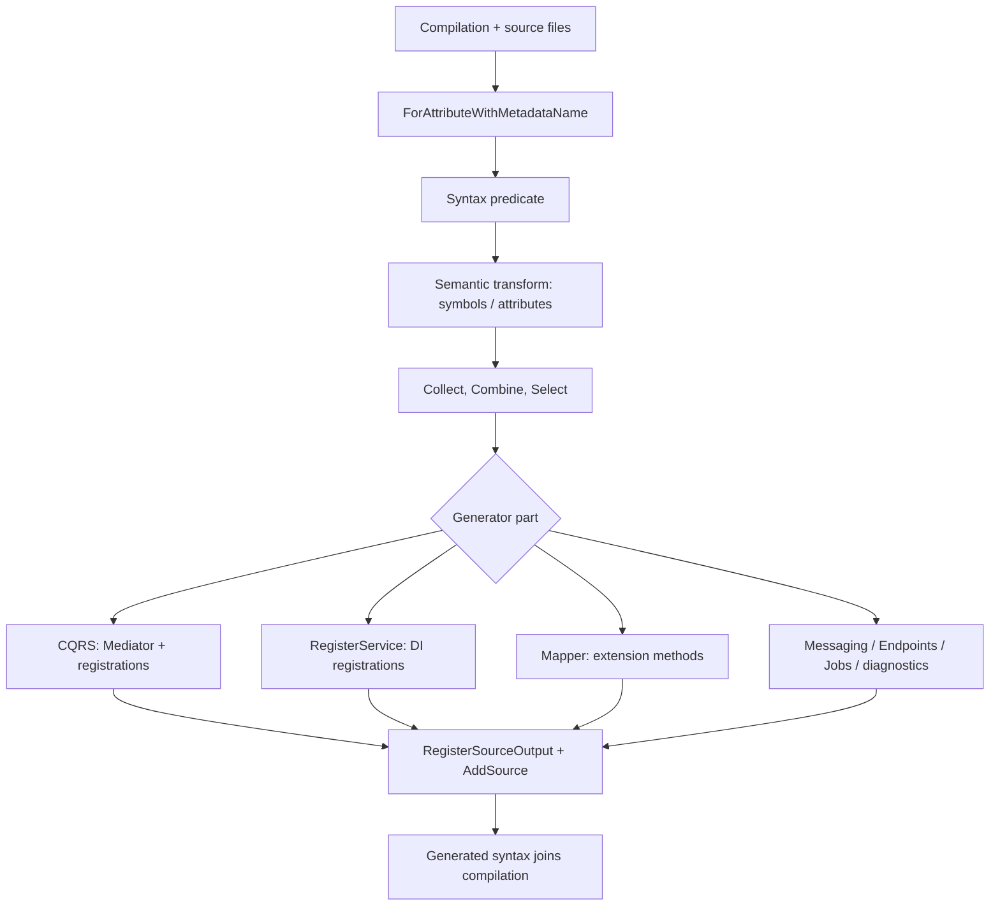
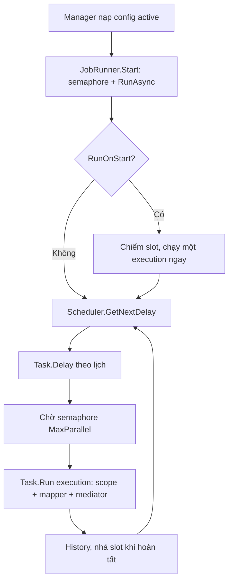
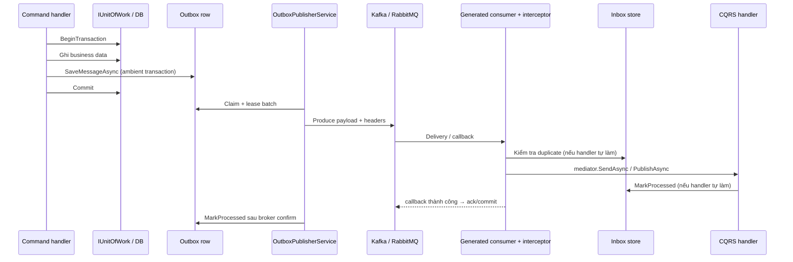

# LinKit: kiến trúc, luồng xử lý và giới hạn kỹ thuật

> Tài liệu này mô tả cách mã nguồn trong repository hiện hoạt động, không phải danh sách cam kết hiệu năng. LinKit ưu tiên source generation để giảm công việc discovery lúc chạy, nhưng không phải mọi API đều reflection-free hoặc đã được xác nhận Native AOT. Hãy kiểm tra đúng feature, provider và dependency của ứng dụng bằng build, analyzer và AOT publish.

## Mục lục

| Phần | Nội dung |
|---|---|
| 1–2 | Tổng quan module, cấu trúc repo, build/CI |
| 3 | Generator tổng quát: pipeline, CQRS, DI, Mapper, diagnostics, Result/Validation/Tracing |
| 4 | Endpoints (Minimal API) và Background jobs |
| 5 | Messaging, Kafka, RabbitMQ, Inbox, Outbox, Outbox.Data, luồng end-to-end và bảng lỗi |
| 6 | LinKit.Data: attribute, generator, repository, dialect, UoW, schema/migration, LINQ |
| 7 | gRPC, Caching, Resilience, Tenancy, Saga, AOT, test projects, phiên bản package |
| 8–9 | Build/test/pack và giới hạn hiện tại |

### Cách tự kiểm chứng mã được sinh

> Mã nguồn chính: [ResilienceAttributes.cs](./LinKit.Core/Resilience/ResilienceAttributes.cs) · [CacheAttributes.cs](./LinKit.Core/Caching/CacheAttributes.cs)

Mọi mô tả "generator sinh ra gì" đều có thể đối chiếu trực tiếp. Build một project dùng LinKit, rồi đọc mã sinh ra tại:

```text
<Project>\obj\Debug\<tfm>\generated\<GeneratorAssembly>\<GeneratorType>\*.g.cs
```

Ví dụ `Samples\MonolithSample\obj\Debug\net10.0\generated\` chứa `Cqrs.Mediator.g.cs`, `Endpoints.g.cs`, `LinKit.Data.Repositories.g.cs`... Để IDE giữ file ra đĩa ổn định có thể đặt `<EmitCompilerGeneratedFiles>true</EmitCompilerGeneratedFiles>` trong csproj. Không sửa file trong `obj`; hãy sửa attribute/entity/generator rồi build lại.

> Ghi chú về [`[CacheAside]`](./LinKit.Core/Caching/CacheAttributes.cs#L10), [`[InvalidateCache]`](./LinKit.Core/Caching/CacheAttributes.cs#L28), [`[Retry]`](./LinKit.Core/Resilience/ResilienceAttributes.cs#L17), [`[Timeout]`](./LinKit.Core/Resilience/ResilienceAttributes.cs#L55), [`[CircuitBreaker]`](./LinKit.Core/Resilience/ResilienceAttributes.cs#L36): hiện chỉ là metadata, generator chỉ phát cảnh báo `LKM003`, chưa tự "dệt" (weave) hành vi vào Mediator. Xem 3.5 và 7.2–7.3.

## 1. Tổng quan

### Ý nghĩa chức năng của từng thư viện (đọc trước)

> Mã nguồn chính: [MessageAttribute.cs](./LinKit.Core/Messaging/MessageAttribute.cs) · [CacheProvider.cs](./LinKit.Caching/CacheProvider.cs) · [ResiliencePipeline.cs](./LinKit.Resilience/ResiliencePipeline.cs) · [Tenancy.cs](./LinKit.Tenancy/Tenancy.cs) · [Sagas.cs](./LinKit.Sagas/Sagas.cs)

| Thư viện | Giải quyết vấn đề gì | Bạn viết gì, LinKit lo gì | Thay thế cho |
|---|---|---|---|
| `LinKit.Core` | Giảm boilerplate tầng ứng dụng | Bạn viết handler/endpoint/job/message với attribute; generator sinh mediator, đăng ký DI, Minimal API, mapper, scheduler mapping | MediatR, AutoMapper, tự viết `MapGet/MapPost`, tự đăng ký DI |
| `LinKit.Data` | Truy cập DB nhanh, không reflection, nhiều DB | Bạn khai báo entity + attribute; generator sinh mapper `DbDataReader`, repository CRUD/paging/soft-delete, schema, migration | Dapper + SQL tay, một phần EF Core |
| `LinKit.Grpc` | Gọi/serve gRPC mà vẫn dùng CQRS | Bạn viết request/handler; generator sinh adapter server và client map protobuf ↔ request | Viết tay service/client gRPC |
| `LinKit.Messaging.Kafka` / `.RabbitMQ` | Gửi/nhận message qua broker với retry/DLQ | Bạn viết [`[Message]`](./LinKit.Core/Messaging/MessageAttribute.cs#L4) + consumer; generator sinh publisher/consumer, adapter lo ack/commit | Tự dùng Confluent.Kafka / RabbitMQ.Client |
| `LinKit.Outbox` (+ `.Data`) | Không mất/phát trùng event khi ghi DB rồi publish | Ghi event cùng transaction nghiệp vụ; publisher nền gửi lại đến khi thành công | MassTransit/CAP outbox |
| `LinKit.Caching` | Cache + chống "cache stampede" | [`GetOrCreateAsync`](./LinKit.Caching/CacheProvider.cs#L17) single-flight; provider thay được (Redis…) | `IMemoryCache` tự bọc |
| `LinKit.Resilience` | Retry/timeout/circuit breaker nhẹ | [`ResiliencePipeline.ExecuteAsync`](./LinKit.Resilience/ResiliencePipeline.cs#L47) | Polly (bản nhẹ, không phụ thuộc) |
| `LinKit.Tenancy` | Mang `tenant id` xuyên async flow và message | [`TenantAccessor`](./LinKit.Tenancy/Tenancy.cs#L29), header propagation | Tự truyền tenant bằng tay |
| `LinKit.Sagas` | Giao dịch phân tán có bù trừ | [`SagaCoordinator.ExecuteStepAsync`](./LinKit.Sagas/Sagas.cs#L70) chạy 1 bước + compensation | MassTransit saga (bản tối giản) |

Nguyên tắc chung: **bạn tập trung nghiệp vụ (handler, entity, message), thư viện lo hạ tầng ở compile-time**; mỗi module độc lập, chỉ cài cái cần.

LinKit là tập hợp package .NET độc lập, ghép với nhau qua contract và dependency injection. Ứng dụng chỉ cài module cần dùng:

```text
Application / Host
├── LinKit.Core                 CQRS, contracts, endpoints, jobs, messaging
├── LinKit.Generator            CQRS, DI, endpoints, mapping, jobs, messaging
├── LinKit.Data                 ADO.NET, repository, UoW, schema, migrations
├── LinKit.Data.Generator       Entity metadata, mapper, repository, migrations
├── LinKit.Grpc                 gRPC runtime adapters
├── LinKit.Grpc.Generator       gRPC server/client source generation
├── LinKit.Messaging.Kafka      Kafka broker adapter
├── LinKit.Messaging.RabbitMQ   RabbitMQ broker adapter
├── LinKit.Outbox               Outbox/Inbox contracts, in-memory stores, publisher
├── LinKit.Outbox.Data          Durable ADO.NET Outbox/Inbox stores
├── LinKit.Caching              In-memory cache provider and contract
├── LinKit.Resilience           Retry, timeout, circuit breaker
├── LinKit.Tenancy              Async-flow tenant context and message headers
└── LinKit.Sagas                Saga step coordinator and repository contract
```

Các generator là thành phần build-time được đóng gói bên trong package runtime tương ứng; chúng không phải dependency runtime độc lập của ứng dụng. Runtime implementations thường dùng contract/interface để có thể thay thế bằng adapter của ứng dụng.

### Mục tiêu thiết kế

1. Chuyển một phần khám phá type và sinh boilerplate sang lúc compile.
2. Giữ API tường minh và chia nhỏ theo module.
3. Hỗ trợ .NET 8, .NET 9, .NET 10 ở các thư viện multi-target; test Native AOT hiện là ứng dụng smoke riêng trên .NET 10.
4. Không biến “có source generator” thành lời hứa rằng toàn bộ runtime không reflection, mọi provider AOT-safe, hay không có allocation.

## 2. Cấu trúc repository và quá trình build

### Các project chính

| Project | Vai trò |
|---|---|
| `LinKit.Core` | API runtime cơ sở và gói NuGet chứa `LinKit.Generator`. |
| `LinKit.Generator` | Roslyn incremental generator tổng quát, target `netstandard2.0`. |
| `LinKit.Data` | ADO.NET runtime; gói NuGet chứa `LinKit.Data.Generator`. |
| `LinKit.Data.Generator` | Generator cho entity, repository và migration; target `netstandard2.0`. |
| `LinKit.Grpc` | gRPC runtime; gói NuGet chứa `LinKit.Grpc.Generator`. |
| `LinKit.Grpc.Generator` | Generator cho endpoint và client gRPC; target `netstandard2.0`. |
| `Test/LinKit.Messaging.Tests` | Unit tests và integration tests cho store/provider. |
| `Test/LinKit.AotSmoke` | Ứng dụng kiểm tra Native AOT có đường Data và durable Outbox. |
| `Samples` | Ví dụ monolith và microservices; không phải bằng chứng mọi đường đi đều production-ready. |

Build solution thực hiện compile các library cho các target framework khai báo trong từng `.csproj`, compile các generator, sample và test projects. Các generator dùng Roslyn compile-time API. Khi `dotnet pack` package runtime, project reference tới generator đảm bảo DLL generator đã được build; DLL được đặt trong `analyzers/dotnet/cs`.

### CI hiện có

- Restore và Release build solution trên .NET 8/9/10.
- Chạy test suite.
- Kiểm tra package vulnerability.
- Publish và chạy AOT smoke trên Linux x64/.NET 10; một số cảnh báo trimming/AOT được nâng thành lỗi.
- Integration tests PostgreSQL, SQL Server, MySQL và Oracle chỉ chạy nếu truyền connection strings qua biến môi trường; CI hiện không khởi động các DB này.

## 3.1 Generator pipeline overview

> Mã nguồn chính: [RootGenerator.cs](./LinKit.Generator/Generators/RootGenerator.cs) · [RegisterServiceAttribute.cs](./LinKit.Core/Abstractions/RegisterServiceAttribute.cs) · [EndpointsGeneratorPart.cs](./LinKit.Generator/Generators/EndpointsGeneratorPart.cs) · [MapperGeneratorPart.cs](./LinKit.Generator/Generators/MapperGeneratorPart.cs) · [BackgroundJobGeneratorPart.cs](./LinKit.Generator/Generators/BackgroundJobGeneratorPart.cs) · [UnsupportedPolicyAttributePart.cs](./LinKit.Generator/Generators/UnsupportedPolicyAttributePart.cs)

> **Ý nghĩa & vai trò:** `LinKit.Generator` là "bộ não compile-time" của `LinKit.Core`. Thay vì lúc chạy quét assembly bằng reflection để tìm handler/endpoint/job, trình biên dịch tự đọc attribute và sinh mã C# tĩnh. Lợi ích: khởi động nhanh, không reflection (AOT/trimming an toàn), lỗi cấu hình lộ ra ở lúc build thay vì lúc chạy. Đánh đổi: phải đọc mã sinh (`obj\...\generated`) khi cần debug.

LinKit tạo code ở compile time bằng Roslyn incremental source generator, không phải reflection scan lúc ứng dụng khởi động. Entry point chính là `RootGenerator : IIncrementalGenerator` trong [`LinKit.Generator/Generators/RootGenerator.cs`](./LinKit.Generator/Generators/RootGenerator.cs). Phương thức `Initialize` khai báo các pipeline cho CQRS, [`[RegisterService]`](./LinKit.Core/Abstractions/RegisterServiceAttribute.cs#L9) và messaging; đồng thời gọi các part độc lập như [`EndpointsGeneratorPart`](./LinKit.Generator/Generators/EndpointsGeneratorPart.cs#L123), [`MapperGeneratorPart`](./LinKit.Generator/Generators/MapperGeneratorPart.cs#L39), [`BackgroundJobGeneratorPart`](./LinKit.Generator/Generators/BackgroundJobGeneratorPart.cs#L18) và [`UnsupportedPolicyAttributePart`](./LinKit.Generator/Generators/UnsupportedPolicyAttributePart.cs#L6). Generator phân tích compilation của dự án đang build, chuyển thông tin thành model nhỏ (symbol/type, lifetime, request/response, rule mapping), sau đó đăng ký callback sinh source.

Roslyn incremental API mô tả quan hệ phụ thuộc giữa đầu vào và đầu ra để khi tài liệu nguồn thay đổi chỉ tính lại phần bị ảnh hưởng. Trong LinKit, nhiều pipeline dùng `SyntaxProvider.ForAttributeWithMetadataName(metadataName, predicate, transform)`. `metadataName` là tên đầy đủ của attribute, ví dụ [`LinKit.Core.Cqrs.CqrsHandlerAttribute`](./LinKit.Core/Cqrs/CqrsAttributes.cs#L9). Roslyn chỉ gọi predicate với node liên quan đến attribute đó; predicate kiểm tra dạng cú pháp sơ bộ, thường chỉ nhận `ClassDeclarationSyntax`. Transform tiếp tục lấy `TargetSymbol`, `Attributes`, `SemanticModel` hoặc các kiểu generic đã được compiler phân giải. Vì vậy bước đầu lọc cú pháp, bước sau dựa trên symbol/ngữ nghĩa, không đơn giản tìm chuỗi `[CqrsHandler]` trong file.

Các provider được kết hợp bằng `Collect`, `Combine`, `Select` hoặc `SelectMany`. `Collect` gom các khai báo cùng loại thành một danh sách; `Combine` nối các nhánh độc lập, chẳng hạn handlers với behaviors hoặc ba loại dịch vụ với nhau. Khi đã có thông tin, `RegisterSourceOutput` nhận `SourceProductionContext` và dữ liệu đã tính để gọi `AddSource(hintName, SourceText.From(code, Encoding.UTF8))`. Hint name như `Cqrs.Mediator.g.cs` xác định tên file ảo của compilation, không phải file mà ứng dụng tự sửa. Generated source thường có `// <auto-generated/>` và `#nullable enable`.

Luồng tổng quát:



`RootGenerator` kết hợp các danh sách [`CqrsServiceInfo`](./LinKit.Generator/Generators/RootGenerator.cs#L266), [`ServiceInfo`](./LinKit.Generator/Generators/DependencyInjectionGeneratorPart.cs#L9) và [`MessagingServiceInfo`](./LinKit.Generator/Generators/RootGenerator.cs#L268) thành `AllServicesInfo`. Nếu danh sách CQRS có phần tử, nó phát `Cqrs.DependencyInjection.g.cs`; danh sách custom DI phát `CustomDI.DependencyInjection.g.cs`; danh sách messaging phát `Messaging.DependencyInjection.g.cs`. Sau đó các registration đó được render thành extension methods trong namespace `LinKit.Core`, trên `public static partial class ServicesExtensions`. `Distinct()` áp dụng cho các dòng đăng ký trước khi ghi file, nhưng không đồng nghĩa mọi đầu vào symbol được chuẩn hóa giống nhau.

Khi ít nhất một trong ba nhóm service-registration trên có file được phát, Root sinh thêm `GlobalUsings.g.cs` với `global using LinKit.Core;`. Đây là điều kiện của biến `hasGeneratedAnyFile`: chỉ CQRS, custom DI hoặc messaging làm điều kiện true; một mapper hoặc endpoint riêng lẻ không tự kích hoạt global using này. [`GlobalUsingGenerator.GenGlobalUsing`](./LinKit.Generator/Generators/GlobalUsingGenerator.cs#L8) có thể tồn tại dưới dạng helper, nhưng `RootGenerator` hiện xây chuỗi global using trực tiếp bằng `StringBuilder`; không gọi helper đó. Mapper có nhánh riêng sinh `GlobalMapperUsings.g.cs` khi có map config, chứa namespace của các class profile. Do đó hai file global using có mục đích và điều kiện phát sinh khác nhau.

### Những giới hạn ảnh hưởng tới phát hiện

> Mã nguồn chính: [RegisterServiceAttribute.cs](./LinKit.Core/Abstractions/RegisterServiceAttribute.cs) · [Abtraction.cs](./LinKit.Core/Mapping/Abtraction.cs) · [CqrsAttributes.cs](./LinKit.Core/Cqrs/CqrsAttributes.cs)

Predicate của CQRS và [`[RegisterService]`](./LinKit.Core/Abstractions/RegisterServiceAttribute.cs#L9) chỉ chấp nhận `ClassDeclarationSyntax`; không nên mặc định rằng mọi khai báo dạng record đều được phát hiện như class. Mapper cũng chọn class có [`[MapperContext]`](./LinKit.Core/Mapping/Abtraction.cs#L7). Ngược lại, policy diagnostic dùng predicate rộng hơn để bắt attribute trên mọi node phù hợp. Incremental pipeline xử lý compilation hiện tại, không tự động quét toàn bộ repo hay mọi package đã cài. Cross-assembly discovery chỉ xảy ra ở CQRS khi chủ động cấu hình [`[CqrsContext]`](./LinKit.Core/Cqrs/CqrsAttributes.cs#L15).

## 3.2 CQRS: abstraction, discovery và dispatch

> Mã nguồn chính: [IMediator.cs](./LinKit.Core/Cqrs/IMediator.cs)

> **Ý nghĩa & vai trò:** Tách "ý định" (command/query/notification) khỏi nơi xử lý (handler). Controller/endpoint chỉ gọi [`IMediator`](./LinKit.Core/Cqrs/IMediator.cs#L3), không biết handler cụ thể → code nghiệp vụ nằm gọn trong từng handler, dễ test và thay đổi. Pipeline behavior cho phép gắn logic xuyên suốt (logging, tracing, validation, transaction) mà không sửa handler. So với MediatR: mediator được **sinh sẵn bằng `switch` theo kiểu request**, không tra cứu bằng reflection/dictionary lúc chạy.

### Hợp đồng runtime

> Mã nguồn chính: [CqrsAbstractions.cs](./LinKit.Core/Cqrs/CqrsAbstractions.cs) · [CqrsAttributes.cs](./LinKit.Core/Cqrs/CqrsAttributes.cs) · [IMediator.cs](./LinKit.Core/Cqrs/IMediator.cs)

[`LinKit.Core.Cqrs.CqrsAbstractions.cs`](./LinKit.Core/Cqrs/CqrsAbstractions.cs) định nghĩa marker [`IRequest`](./LinKit.Core/Cqrs/CqrsAbstractions.cs#L3) và `IRequest<TResponse>`. [`ICommand<TResponse>`](./LinKit.Core/Cqrs/CqrsAbstractions.cs#L7) và [`IQuery<TResponse>`](./LinKit.Core/Cqrs/CqrsAbstractions.cs#L11) là request có response; `ICommand` rút gọn thành `ICommand<Unit>`, trong đó [`Unit`](./LinKit.Core/Cqrs/CqrsAbstractions.cs#L15) là `readonly struct` với singleton-like `Unit.Value`. [`INotification`](./LinKit.Core/Cqrs/CqrsAbstractions.cs#L13) dùng cho thông điệp broadcast, không kế thừa request.

Handler đều thực hiện `Task<TResponse> HandleAsync(request, CancellationToken)`. [`ICommandHandler<TCommand>`](./LinKit.Core/Cqrs/CqrsAbstractions.cs#L27) map command không trả dữ liệu sang `Unit`; `ICommandHandler<TCommand,TResponse>` và [`IQueryHandler<TQuery,TResponse>`](./LinKit.Core/Cqrs/CqrsAbstractions.cs#L33) giữ kiểu trả về; [`INotificationHandler<TNotification>`](./LinKit.Core/Cqrs/CqrsAbstractions.cs#L48) chỉ trả `Task`. Pipeline contract là [`IPipelineBehavior<TRequest,TResponse>`](./LinKit.Core/Cqrs/CqrsAbstractions.cs#L38) với delegate `RequestHandlerDelegate<TResponse> next`; behavior có thể thực hiện công việc trước/sau `next`, hoặc không gọi `next` nếu chủ ý chặn request. [`IMediator`](./LinKit.Core/Cqrs/IMediator.cs#L3) công khai `SendAsync` cho command thường và generic command, `QueryAsync`, cùng `PublishAsync` với [`PublishStrategy.Sequential`](./LinKit.Core/Cqrs/IMediator.cs#L24) hoặc `Parallel`.

Attributes nằm trong [`CqrsAttributes.cs`](./LinKit.Core/Cqrs/CqrsAttributes.cs): [`[CqrsHandler]`](./LinKit.Core/Cqrs/CqrsAttributes.cs#L9) đánh dấu handler; [`[CqrsContext(params Type[] assemblyMarkerTypes)]`](./LinKit.Core/Cqrs/CqrsAttributes.cs#L15) cung cấp marker để quét assembly; [`[CqrsBehavior(Type targetInterface, int order = 0)]`](./LinKit.Core/Cqrs/CqrsAttributes.cs#L26) đăng ký behavior dùng chung theo marker interface và thứ tự; [`[ApplyBehavior(params Type[] behaviorTypes)]`](./LinKit.Core/Cqrs/CqrsAttributes.cs#L42) gắn behavior cụ thể lên request.

### Phát hiện handler và behavior từng bước

> Mã nguồn chính: [CqrsGeneratorPart.cs](./LinKit.Generator/Generators/CqrsGeneratorPart.cs) · [CqrsAttributes.cs](./LinKit.Core/Cqrs/CqrsAttributes.cs) · [CqrsAbstractions.cs](./LinKit.Core/Cqrs/CqrsAbstractions.cs)

1. `CreatePipeline` của [`CqrsGeneratorPart`](./LinKit.Generator/Generators/CqrsGeneratorPart.cs#L30) tạo provider scan context, rồi đưa cùng provider ấy vào nhánh thu thập handler và behavior.
2. Handler local được tìm bằng `ForAttributeWithMetadataName` cho [`CqrsHandlerAttribute`](./LinKit.Core/Cqrs/CqrsAttributes.cs#L9), predicate `ClassDeclarationSyntax`, transform thành `INamedTypeSymbol`. Danh sách này được `Collect` rồi ghép với type từ context scan.
3. `HashSet<INamedTypeSymbol>` dùng `SymbolEqualityComparer.Default` loại symbol lặp. Với mỗi class, [`GetHandlerInfo`](./LinKit.Generator/Generators/CqrsGeneratorPart.cs#L343) duyệt `AllInterfaces` và so `OriginalDefinition` với tên đầy đủ của [`ICommandHandler`](./LinKit.Core/Cqrs/CqrsAbstractions.cs#L27), [`IQueryHandler`](./LinKit.Core/Cqrs/CqrsAbstractions.cs#L33), [`INotificationHandler`](./LinKit.Core/Cqrs/CqrsAbstractions.cs#L48). Nếu không tìm thấy một hợp đồng này, class dù có attribute cũng bị bỏ qua. Generator chọn interface đầu tiên phù hợp; một class triển khai nhiều handler contract không được khai triển thành nhiều handler độc lập theo từng interface.
4. Request lấy từ `TypeArguments[0]`. Response lấy từ type argument thứ hai của command/query; notification và command void nhận `global::LinKit.Core.Cqrs.Unit`. Generator lưu tên type fully-qualified, handler interface, các marker interface, danh sách [`ApplyBehavior`](./LinKit.Core/Cqrs/CqrsAttributes.cs#L42) và cờ notification.
5. Các handler command/query được nhóm theo request type và loại handler. Nếu có nhiều handler cho cùng một request, generator phát lỗi build `LNKCQRS001`, chỉ rõ các class xung đột; mediator giữ một handler theo thứ tự tên type để tránh phát thêm lỗi switch trùng. Notification vẫn cho phép nhiều handler.
6. Behavior local tìm bằng metadata name [`CqrsBehaviorAttribute`](./LinKit.Core/Cqrs/CqrsAttributes.cs#L26). [`GetBehaviorInfo`](./LinKit.Generator/Generators/CqrsGeneratorPart.cs#L300) cần constructor argument đầu là target type; đọc argument thứ hai làm `Order` (mặc định 0), tìm type parameter tên `TRequest` để lấy các `ConstraintTypes`, và bỏ generic arguments để giữ tên open behavior. Dù attribute khai báo `AllowMultiple = true`, code hiện dùng `FirstOrDefault` cho attribute trên mỗi behavior type, vì vậy không nên gắn nhiều cấu hình target khác nhau lên cùng một class để kỳ vọng tất cả được xử lý.
7. [`[CqrsContext(typeof(Marker))]`](./LinKit.Core/Cqrs/CqrsAttributes.cs#L15) được phát hiện trên class. Transform lấy mảng constructor argument, lấy `ContainingAssembly` của mỗi marker và đệ quy từ `GlobalNamespace` qua namespace con. [`CollectClassTypes`](./LinKit.Generator/Generators/CqrsGeneratorPart.cs#L214) chỉ lấy class không abstract, public, được khai báo trực tiếp trong namespace; không đệ quy vào nested types. Tập class của assembly ấy sau đó được đưa qua `GetHandlerInfo`/`GetBehaviorInfo`, nghĩa là nó cũng tìm attribute trên các type được scan chứ không chỉ xét class marker.

Vì vậy assembly marker là cách cho generator biết assembly nào cần scan, không phải một lệnh scan toàn bộ referenced assemblies. Cross-assembly type phải public, concrete, có attribute phù hợp và assembly phải xuất hiện trong marker list. Handler ở chính project thường được tìm trực tiếp nhờ `[CqrsHandler]`; context chủ yếu phục vụ module/assembly khác. Các symbol local và scanned được deduplicate theo symbol equality.

### Behavior applicability và ordering chính xác

> Mã nguồn chính: [CqrsGeneratorPart.cs](./LinKit.Generator/Generators/CqrsGeneratorPart.cs) · [CqrsAttributes.cs](./LinKit.Core/Cqrs/CqrsAttributes.cs) · [CqrsAbstractions.cs](./LinKit.Core/Cqrs/CqrsAbstractions.cs)

[`IsBehaviorApplicable`](./LinKit.Generator/Generators/CqrsGeneratorPart.cs#L60) tạo danh sách marker của request: chính request type, mọi `AllInterfaces`, và generic interface ở dạng `OriginalDefinition`. Tên generic được clean về tên gốc trước khi so sánh. Behavior áp dụng nếu target type là `System.Object` (quy ước bắt mọi request) hoặc target xuất hiện trong marker list; ngoài ra từng constraint của `TRequest` trên behavior cũng phải xuất hiện trong cùng danh sách. Ví dụ `where TRequest : ICommand` giới hạn behavior vào command; target `typeof(IQuery<>)` khớp query generic qua original definition. Behavior chỉ được xét cho handler không phải notification.

Thứ tự thực thi cần đọc đồng thời [`GetApplicableBehaviorTypes`](./LinKit.Generator/Generators/CqrsGeneratorPart.cs#L692) và vòng [`AppendBehaviorWrap`](./LinKit.Generator/Generators/CqrsGeneratorPart.cs#L718) trong [`GenerateMediatorClass`](./LinKit.Generator/Generators/CqrsGeneratorPart.cs#L491), không chỉ dựa vào thứ tự DI. Gọi danh sách global đã lọc là `G = OrderBy(Order)` và danh sách [`[ApplyBehavior]`](./LinKit.Core/Cqrs/CqrsAttributes.cs#L42) theo thứ tự attribute là `S`. Source trả về `Reverse(S) + Reverse(G)`. Sau đó generator lần lượt wrap từng phần tử quanh `next`, bắt đầu với delegate gọi handler. Mỗi lần wrap, delegate hiện tại được lưu vào `capturedNext`, rồi một behavior mới thay thế `next`. Vì behavior được wrap sau nằm phía ngoài behavior đã wrap trước đó, thực thi thực tế là:

```text
G nhỏ nhất (outermost)
  -> ... G lớn hơn
       -> S đầu tiên
            -> ... S tiếp theo
                 -> handler (innermost)
```

Cụ thể, nếu `G=[G1(order 1), G2(order 5)]` và `S=[S1,S2]`, chuỗi gọi là `G1 -> G2 -> S1 -> S2 -> handler`. Thứ tự thấp hơn là outermost trong nhóm global. Specific behaviors luôn nằm bên trong toàn bộ global behaviors; trong nhóm specific, phần tử xuất hiện trước trong attribute là outermost. DI registration lại thêm specific trước rồi global đã sắp theo Order; thứ tự đăng ký đó không làm thay đổi nesting, vì nesting do các delegate wrap trên quyết định. Nếu Order bằng nhau, kết quả thứ tự của source enumeration không nên được coi là hợp đồng ổn định; đặc biệt context scan đi qua `HashSet`.

`AppendBehaviorWrap` khởi đầu bằng delegate gọi `GetRequiredService<I...Handler>().HandleAsync(...)`. Khi đóng generic behavior, mediator cũng resolve behavior từ `IServiceProvider` theo từng request. Với response [`Unit`](./LinKit.Core/Cqrs/CqrsAbstractions.cs#L15), wrapper chuyển delegate `Task` thành delegate `Task<Unit>` bằng async lambda, rồi await và bỏ giá trị. Với response thực, kiểu delegate giữ nguyên `Task<TResponse>`. Cả hai cách thêm delegate/closure và overhead so với fast path.

### Mediator sinh ra: switch, fast path, notification

> Mã nguồn chính: [CqrsGeneratorPart.cs](./LinKit.Generator/Generators/CqrsGeneratorPart.cs) · [HandlerNotFoundException.cs](./LinKit.Core/Cqrs/HandlerNotFoundException.cs)

Nếu có handler, [`CqrsGeneratorPart.Initialize`](./LinKit.Generator/Generators/CqrsGeneratorPart.cs#L144) gọi [`GenerateMediatorClass`](./LinKit.Generator/Generators/CqrsGeneratorPart.cs#L491) và thêm `Cqrs.Mediator.g.cs` trong namespace `LinKit.Generated.Cqrs`. Class `internal sealed Mediator` nhận `IServiceProvider`; các phương thức dispatch được tạo thành switch expression trên object request, mỗi arm là type request cụ thể. Với request không có behavior applicable, private method gọi handler trực tiếp và trả task mà không tạo delegate hoặc async state machine. Ví dụ trích trực tiếp từ `Samples/MonolithSample/obj/Debug/net10.0/generated/.../Cqrs.Mediator.g.cs`:

```csharp
private Task<global::System.Guid> HandleResultRequest(
    global::MonolithSample.Modules.Ordering.Commands.PlaceOrderCommand request,
    CancellationToken cancellationToken)
    => _serviceProvider.GetRequiredService<
        global::LinKit.Core.Cqrs.ICommandHandler<
            global::MonolithSample.Modules.Ordering.Commands.PlaceOrderCommand,
            global::System.Guid>>().HandleAsync(request, cancellationToken);
```

Đây là fast path. Khi có behavior, code thay bằng delegate gọi handler, rồi lồng các delegate từ trong ra ngoài như phần ordering trên. Snapshot generated của MonolithSample thể hiện direct path; source generator là căn cứ cho trường hợp wrapper vì artifact trong `obj` chỉ phản ánh lần build đã tạo nó, không chứng minh mọi source hiện tại đã được regenerate.

`SendAsync(ICommand)` dispatch command void; `SendAsync<TResponse>` dispatch command có response; `QueryAsync<TResponse>` dispatch query. Request không có arm tương ứng ném [`HandlerNotFoundException(type)`](./LinKit.Core/Cqrs/HandlerNotFoundException.cs#L3), có message `No handler registered for type: {type.FullName}`. Lỗi thiếu service registration sau khi đã chọn được arm sẽ là lỗi resolve DI, không phải ngoại lệ này. Generic dispatch dùng cast qua object thành `Task<TResponse>`; contract handler phải khớp đúng response type.

Notifications được group theo request type. Generator gọi `_serviceProvider.GetServices<INotificationHandler<T>>()`; `Sequential` await từng handler với `ConfigureAwait(false)`, còn `Parallel` tạo `List<Task>` và await `Task.WhenAll`. Thứ tự sequential theo enumerable do DI trả về; không nên dựa vào thứ tự symbol nếu registration đến từ context scan. Khác với command/query, switch notification có default `Task.CompletedTask`: notification không có handler là no-op, không ném `HandlerNotFoundException`.

### DI cho CQRS

> Mã nguồn chính: [ServiceLifetimeAttributes.cs](./LinKit.Core/Abstractions/ServiceLifetimeAttributes.cs)

Root sinh `AddLinKitCqrs(IServiceCollection services, string? mediatorKey = null)` nếu danh sách CQRS service không rỗng. Mediator mặc định đăng ký [`AddScoped<IMediator, LinKit.Generated.Cqrs.Mediator>()`](./LinKit.Core/Abstractions/ServiceLifetimeAttributes.cs#L29); có key không rỗng thì dùng `AddKeyedScoped`. Từng handler và behavior khép generic được đăng ký [`AddTransient`](./LinKit.Core/Abstractions/ServiceLifetimeAttributes.cs#L10). Excerpt thực từ `Cqrs.DependencyInjection.g.cs`:

```csharp
if(!string.IsNullOrWhiteSpace(mediatorKey))
    services.AddKeyedScoped<LinKit.Core.Cqrs.IMediator,
        LinKit.Generated.Cqrs.Mediator>(mediatorKey);
else
    services.AddScoped<LinKit.Core.Cqrs.IMediator,
        LinKit.Generated.Cqrs.Mediator>();
services.AddTransient<global::LinKit.Core.Cqrs.ICommandHandler<
    global::MonolithSample.Modules.Ordering.Commands.PlaceOrderCommand,
    global::System.Guid>,
    global::MonolithSample.Modules.Ordering.Commands.PlaceOrderCommandHandler>();
```

Behavior có thể là scoped dependency trong logic của ứng dụng nhưng generator vẫn đăng ký transient; không có attribute lifetime cho handler/behavior trong pipeline này. Gọi `AddLinKitCqrs` là phần đưa các descriptor do compile-time discovery xác định vào container; nếu bỏ qua extension, mediator có thể không được resolve hoặc thiếu handler.

### Ví dụ sử dụng và giới hạn

> Mã nguồn chính: [CqrsAttributes.cs](./LinKit.Core/Cqrs/CqrsAttributes.cs) · [CqrsAbstractions.cs](./LinKit.Core/Cqrs/CqrsAbstractions.cs)

```csharp
public sealed record GetOrder(Guid Id) : IQuery<OrderDto>;

[CqrsHandler]
public sealed class GetOrderHandler : IQueryHandler<GetOrder, OrderDto>
{
    public Task<OrderDto> HandleAsync(GetOrder query, CancellationToken ct = default)
        => LoadOrder(query.Id, ct);
}

var mediator = provider.GetRequiredService<IMediator>();
OrderDto dto = await mediator.QueryAsync(new GetOrder(id), ct);
```

Với behavior chung, khai báo generic class thực thi [`IPipelineBehavior<TRequest,TResponse>`](./LinKit.Core/Cqrs/CqrsAbstractions.cs#L38) rồi gắn [`[CqrsBehavior(typeof(object), order)]`](./LinKit.Core/Cqrs/CqrsAttributes.cs#L26) hoặc target marker thích hợp. Với behavior một request, gắn [`[ApplyBehavior(typeof(MyBehavior<,>))]`](./LinKit.Core/Cqrs/CqrsAttributes.cs#L42) lên request. Generator giả định kiểu behavior có thể được đóng bằng chính hai type arguments request/response, implement đúng contract và có thể resolve qua DI; nó không xác thực toàn bộ tính đúng đắn trước khi sinh code, nên sai arity/contract sẽ dẫn đến lỗi compile. `ApplyBehavior` chỉ áp dụng cho request handler, không cho notification. Local discovery gắn với attribute class; context scan cross-assembly yêu cầu public top-level concrete classes. Nhiều handler contract trên một lớp, nested handler trong context, class abstract hoặc handler không gắn attribute ở project local là các trường hợp không được xử lý như người dùng có thể kỳ vọng.

## 3.3 Dependency Injection qua `[RegisterService]`

> Mã nguồn chính: [DependencyInjectionGeneratorPart.cs](./LinKit.Generator/Generators/DependencyInjectionGeneratorPart.cs) · [ServiceLifetimeAttributes.cs](./LinKit.Core/Abstractions/ServiceLifetimeAttributes.cs) · [RegisterServiceAttribute.cs](./LinKit.Core/Abstractions/RegisterServiceAttribute.cs) · [Lifetime.cs](./LinKit.Core/Abstractions/Lifetime.cs)

> **Ý nghĩa & vai trò:** Khỏi phải viết hàng chục dòng `services.AddScoped<I, T>()` rồi quên đăng ký. Gắn [`[RegisterService(Lifetime.X)]`](./LinKit.Core/Abstractions/RegisterServiceAttribute.cs#L9) lên class, generator sinh một extension `AddLinKitDependency()`. Đây là phiên bản compile-time của việc "scan assembly" (Scrutor).

Mục đích của `RegisterServiceAttribute` là biến một khai báo implementation thành descriptor DI mà không cần viết lại registration bằng tay. Attribute và enum [`Lifetime`](./LinKit.Core/Abstractions/Lifetime.cs#L3) nằm trong `LinKit.Core.Abstractions`. Các property gồm `Lifetime`, `ServiceType`, `Key`, `IsGeneric`; constructor nhận lifetime, service type, key, cờ generic. Mặc định attribute dùng transient. [`DependencyInjectionGeneratorPart.GetServices`](./LinKit.Generator/Generators/DependencyInjectionGeneratorPart.cs#L25) lọc class có metadata name chính xác `LinKit.Core.Abstractions.RegisterServiceAttribute`, chuyển mỗi attribute thành cặp implementation symbol/`AttributeData`, rồi `Collect` để tạo [`ServiceInfo`](./LinKit.Generator/Generators/DependencyInjectionGeneratorPart.cs#L9).

Với mỗi attribute, [`GetParameter`](./LinKit.Generator/Generators/DependencyInjectionGeneratorPart.cs#L74) đọc positional constructor argument trước, nếu không có thì đọc named argument (`Lifetime`, `ServiceType`, `Key`, `IsGeneric`) và fallback. Nếu `ServiceType` không được cung cấp, generator xem `Implementation.AllInterfaces`, bỏ interface cha nếu có interface khác kế thừa nó, sau đó chọn interface lá tên `I{Implementation.Name}` nếu có, nếu không thì chọn interface lá đầu tiên; không có interface thì self-registration. Cả service và implementation được render fully-qualified. Khi `IsGeneric=true`, kiểu constructed được chuyển về `ConstructedFrom`, type parameter được đổi thành dạng open generic (`<>`, `<,>`...).

Root map enum `Lifetime` thành [`AddTransient`](./LinKit.Core/Abstractions/ServiceLifetimeAttributes.cs#L10), [`AddScoped`](./LinKit.Core/Abstractions/ServiceLifetimeAttributes.cs#L29) hoặc [`AddSingleton`](./LinKit.Core/Abstractions/ServiceLifetimeAttributes.cs#L48); enum không khớp giá trị đã biết rơi về transient. Nếu có key, chọn overload `AddKeyedTransient/Scoped/Singleton`; nếu generic, dùng overload `Type` để đăng ký open type. Với custom service, output là `AddLinKitDependency(IServiceCollection)` trong `LinKit.Core`. Excerpt thật từ MonolithSample:

```csharp
public static IServiceCollection AddLinKitDependency(this IServiceCollection services)
{
    services.AddScoped<MonolithSample.Modules.Catalog.Services.IPricingService,
        MonolithSample.Modules.Catalog.Services.PricingService>();
    return services;
}
```

Khai báo phía ứng dụng:

```csharp
[RegisterService(Lifetime.Scoped, ServiceType = typeof(IPricingService))]
public class PricingService : IPricingService { /* ... */ }

builder.Services.AddLinKitDependency();
```

`IsGeneric` phải được đặt có chủ ý với open generic implementation; service/implementation cần arity tương thích để container chấp nhận. Khi `ServiceType` vắng mặt, “first leaf interface” không phải lúc nào cũng là abstraction mong muốn, nên lớp triển khai nhiều interface quan trọng nên chỉ định tường minh. Attribute target là class và generator predicate là `ClassDeclarationSyntax`; đừng dựa vào nó để tìm mọi dạng type declaration khác. Key được ghép trực tiếp thành string literal trong code sinh, không escape chuỗi ở RootGenerator, vì vậy nên dùng key đơn giản, không chứa dấu nháy/ký tự escape. Đây là compile-time registration, không tự quản lý disposal/lifetime semantics ngoài các extension chuẩn của Microsoft DI.

## 3.4 Mapper generator

> Mã nguồn chính: [Abtraction.cs](./LinKit.Core/Mapping/Abtraction.cs) · [MapperGeneratorPart.cs](./LinKit.Generator/Generators/MapperGeneratorPart.cs)

> **Ý nghĩa & vai trò:** Chuyển đổi Entity ↔ DTO mà không dùng reflection như AutoMapper. Bạn khai báo cặp [`CreateMap<S,D>()`](./LinKit.Core/Mapping/Abtraction.cs#L19) một lần, generator sinh extension method thuần C# (`ToXxx()`), nhanh bằng code viết tay và mọi lỗi mapping là lỗi biên dịch/được kiểm tra tĩnh.

[`MapperGeneratorPart`](./LinKit.Generator/Generators/MapperGeneratorPart.cs#L39) không tạo runtime mapper dựa reflection; nó phát extension methods cụ thể từ profile. Hợp đồng cấu hình ở `LinKit.Core.Mapping.Abraction.cs`: [`[MapperContext]`](./LinKit.Core/Mapping/Abtraction.cs#L7), [`IMappingConfigurator.Configure(IMapperConfigurationBuilder)`](./LinKit.Core/Mapping/Abtraction.cs#L14), `CreateMap<TSource,TDestination>()`, [`ForMember`](./LinKit.Core/Mapping/Abtraction.cs#L42), và options [`Ignore`](./LinKit.Core/Mapping/Abtraction.cs#L24), [`MapFrom`](./LinKit.Core/Mapping/Abtraction.cs#L26), [`ConvertWith`](./LinKit.Core/Mapping/Abtraction.cs#L28). Implementation phân tích cú pháp cấu hình, không chạy method `Configure` lúc runtime.

1. `ForAttributeWithMetadataName` tìm class gắn `MapperContextAttribute`. Transform lấy namespace và method declaration đầu tiên tên `Configure`. Không yêu cầu symbol phải implement [`IMappingConfigurator`](./LinKit.Core/Mapping/Abtraction.cs#L12); name/syntax là điều kiện thực tế.
2. Generator duyệt `InvocationExpressionSyntax` trong method. Nó nhận invocation có expression dạng member access, tên generic `CreateMap`, đúng hai type argument, và `SemanticModel.GetTypeInfo` phải phân giải cả hai thành `INamedTypeSymbol`.
3. `CollectForMemberChain` lần theo các lời gọi `.ForMember(...)` quanh `CreateMap`. `ParseForMemberInvocation` chỉ hiểu destination lambda có body là member access, options lambda gọi `Ignore`, `MapFrom` với một source lambda, hoặc `ConvertWith`. Với `MapFrom`/`ConvertWith`, [`LambdaBodyRewriter`](./LinKit.Generator/Generators/MapperGeneratorPart.cs#L616) đổi tên parameter thành `source`; semantic model thu namespace tham chiếu để thêm using.
4. Tất cả cặp source/destination được gom trước khi build mapper info để phát hiện nested map. Generator thu readable properties của source và settable properties của destination, bao gồm base class, loại bỏ static và tránh tên trùng. Auto-map trước tiên thử đối chiếu `JsonPropertyName` (tìm attribute tên chứa `JsonProperty`), sau đó so property name không phân biệt hoa thường. Expression chỉ được tạo nếu kiểu giống nhau/compatible, enumerable có element cùng kiểu, enumerable element có map khác, hoặc source/destination có map tương ứng.
5. Nếu destination có constructor public/internal không tham số, generator chọn constructor đó. Nếu không, nó thử constructor public/internal có nhiều tham số nhất mà mọi parameter đều được cấu hình/auto-map; nếu không constructor nào khớp đầy đủ, fallback constructor đầu và dùng `default(T)!` cho parameter chưa map. Các property `init` được đưa vào object initializer khi tạo object; property có setter được gán cả khi destination đã truyền vào.
6. Khi có map info, `Mappers.g.cs` được phát với extension class theo namespace profile (`namespace Demo; public static partial class Demo_MappingExtensions` theo dạng brace ở source hiện tại). Mỗi map tạo `To{DestinationShortName}(this Source? source, Destination? destination = default)` và `To{DestinationShortName}List(IEnumerable<Source>?)`. `GlobalMapperUsings.g.cs` import global namespace của profile để gọi extension.

Không có `Mappers.g.cs` trong snapshot MonolithSample được kiểm tra, nên excerpt sau là hình dạng code sinh từ template [`GenerateCode`](./LinKit.Generator/Generators/MapperGeneratorPart.cs#L374) của MapperGeneratorPart, với map ví dụ `Order -> OrderDto`:

```csharp
public static global::Demo.OrderDto? ToOrderDto(
    this global::Demo.Order? source,
    global::Demo.OrderDto? destination = default)
{
    if (source == null) return destination;
    if (destination == null)
    {
        destination = new global::Demo.OrderDto()
        {
            Id = source.Id,
            Name = source.Name,
        };
    }
    else
    {
        destination.Name = source.Name;
    }
    return destination;
}
```

Đoạn trên là excerpt minh họa được tạo bằng cách đọc template, không phải file `obj` có sẵn; nếu `Id` là init-only, nó chỉ xuất hiện trong object initializer ở nhánh tạo mới, không thể gán lại ở nhánh destination có sẵn. Cách dùng:

```csharp
[MapperContext]
public sealed class OrderMaps : IMappingConfigurator
{
    public void Configure(IMapperConfigurationBuilder builder)
    {
        builder.CreateMap<Order, OrderDto>()
            .ForMember(d => d.Name, o => o.MapFrom(s => s.DisplayName));
    }
}

OrderDto? dto = order.ToOrderDto();
```

Giới hạn quan trọng: parser nhận pattern syntax cụ thể chứ không evaluate mọi C# expression; destination member phải là member access trực tiếp, [`MapFrom`](./LinKit.Core/Mapping/Abtraction.cs#L26) phải là lambda expression, [`ConvertWith`](./LinKit.Core/Mapping/Abtraction.cs#L28) phải dùng một trong hai overload được parse. Constructor fallback `default!` có thể che mất mapping thiếu thay vì báo lỗi. Auto-map không đảm bảo chuyển đổi mọi kiểu số/collection tùy ý. Property private setter có thể được nhìn thấy như settable dù generated extension không có quyền gán, dẫn đến compile error. Nhiều destination cùng short name trong cùng namespace có thể sinh extension method trùng tên. Generator cũng không kiểm tra mọi biểu thức custom có thể biên dịch sau khi rewrite.

## 3.5 Diagnostics của generator

> Mã nguồn chính: [ResilienceAttributes.cs](./LinKit.Core/Resilience/ResilienceAttributes.cs) · [CacheAttributes.cs](./LinKit.Core/Caching/CacheAttributes.cs) · [MapperGeneratorPart.cs](./LinKit.Generator/Generators/MapperGeneratorPart.cs) · [Diagnostics.cs](./LinKit.Grpc.Generator/Diagnostics.cs) · [UnsupportedPolicyAttributePart.cs](./LinKit.Generator/Generators/UnsupportedPolicyAttributePart.cs)

> **Ý nghĩa & vai trò:** Báo lỗi/cảnh báo **ngay lúc build** (mã `LKMxxx`, `LNKDATAxxx`) khi cấu hình sai hoặc dùng attribute chưa có hiệu lực (ví dụ [`[Retry]`](./LinKit.Core/Resilience/ResilienceAttributes.cs#L17) chỉ là metadata → `LKM003`), tránh việc bạn tưởng tính năng đã chạy.

Cả `AnalyzerReleases.Shipped.md` và `AnalyzerReleases.Unshipped.md` cần được đọc cùng với các `DiagnosticDescriptor` thực tế. File shipped hiện không khai báo rule nào; unshipped liệt kê `LKM002` (Mapping, Error), `LKM003` (Usage, Warning) và `LNKCQRS001` (CQRS, Error).

`LKM002` được khai báo trong [`MapperGeneratorPart`](./LinKit.Generator/Generators/MapperGeneratorPart.cs#L39) với title `Invalid mapping configuration`, message `Invalid mapping configuration: {0}`, category `Mapping`, severity Error, bật mặc định. Tuy nhiên descriptor này hiện chỉ được khởi tạo; trong file không có chỗ gọi `Diagnostic.Create(InvalidMappingConfiguration, ...)`. `CollectForMemberChain` có danh sách [`Diagnostics`](./LinKit.Grpc.Generator/Diagnostics.cs#L5), nhưng parser hiện trả `null` diagnostic cho các hình dạng không nhận diện. Vì vậy cần phân biệt rule được đăng ký trong release tracking với cảnh báo thực sự: theo code đang kiểm tra, LKM002 chưa được phát ra; cấu hình không được parse có thể bị bỏ qua âm thầm hoặc dẫn đến code thiếu/không compile.

`LKM003` đến từ [`UnsupportedPolicyAttributePart`](./LinKit.Generator/Generators/UnsupportedPolicyAttributePart.cs#L6). Generator theo dõi metadata names [`CacheAsideAttribute`](./LinKit.Core/Caching/CacheAttributes.cs#L10), [`InvalidateCacheAttribute`](./LinKit.Core/Caching/CacheAttributes.cs#L28), `RetryAttribute`, [`CircuitBreakerAttribute`](./LinKit.Core/Resilience/ResilienceAttributes.cs#L36), [`TimeoutAttribute`](./LinKit.Core/Resilience/ResilienceAttributes.cs#L55). Với mỗi attribute được dùng, nó lấy application location và gọi `ReportDiagnostic(Diagnostic.Create(...))`. Cảnh báo nói attribute hiện chỉ là metadata, chưa có behavior do generator tạo, hãy dùng API tường minh tương ứng. Rule category `Usage`, severity Warning. Attribute được bắt ở bất kỳ node, không phụ thuộc class predicate như handler.

Ví dụ hiện diện attribute policy trên method/class sẽ tạo cảnh báo LKM003; không nên suy ra chỉ vì tên attribute có “Retry” hay “Cache” mà runtime tự động bọc gọi method. Gỡ cảnh báo bằng cách chuyển sang API caching/resilience rõ ràng của package tương ứng hoặc bỏ attribute nếu không dùng. Cảnh báo không tự cấm build như error; LKM002 nếu được wired trong tương lai sẽ là error theo descriptor. Khi nâng phiên bản, cần đọc lại AnalyzerReleases vì release tracking xác nhận rule public nhưng không đảm bảo generator phát đúng tất cả rule ở một revision cụ thể.

`LNKCQRS001` được phát khi generator tìm thấy từ hai command/query handler trở lên cho cùng một request. Đây là lỗi build để báo trực tiếp request và tên các handler; notification không bị giới hạn vì nhiều notification handler là hợp lệ.

## 3.6 Result, Validation và Diagnostics runtime trong Core

> Mã nguồn chính: [Result.cs](./LinKit.Core/Results/Result.cs) · [Validation.cs](./LinKit.Core/Validation/Validation.cs) · [LinKitDiagnostics.cs](./LinKit.Core/Diagnostics/LinKitDiagnostics.cs)

> **Ý nghĩa & vai trò:** Bộ "đồ nghề" chuẩn cho handler: [`Result<T>`](./LinKit.Core/Results/Result.cs#L30) biểu diễn thành công/lỗi như dữ liệu (không ném exception cho lỗi nghiệp vụ) và endpoint tự map sang HTTP status; [`IValidator`](./LinKit.Core/Validation/Validation.cs#L13) là hợp đồng validation đồng bộ nhưng hiện chưa được generator tự tìm/chạy trong mediator, nên ứng dụng phải đăng ký và gọi trong pipeline riêng; [`LinKitDiagnostics`](./LinKit.Core/Diagnostics/LinKitDiagnostics.cs#L11) cung cấp tracing/metrics (OpenTelemetry-ready).

### Result: biểu diễn lỗi như dữ liệu

> Mã nguồn chính: [Result.cs](./LinKit.Core/Results/Result.cs) · [SchemaMetadata.cs](./LinKit.Data/SchemaMetadata.cs)

[`LinKit.Core.Results.Result`](./LinKit.Core/Results/Result.cs#L30) và `Result<T>` là lớp kết quả operation, tách thành công/thất bại khỏi exception flow. [`ResultStatus`](./LinKit.Core/Results/Result.cs#L10) có `Ok`, [`NotFound`](./LinKit.Core/Results/Result.cs#L60), [`BadRequest`](./LinKit.Core/Results/Result.cs#L63), [`Conflict`](./LinKit.Core/Results/Result.cs#L66), [`Unauthorized`](./LinKit.Core/Results/Result.cs#L69), [`Forbidden`](./LinKit.Core/Results/Result.cs#L72), `Error`. Mỗi Result giữ `IsSuccess`, [`Status`](./LinKit.Core/Results/Result.cs#L33), `ErrorMessage`, [`ErrorCode`](./LinKit.Core/Results/Result.cs#L35) và `IReadOnlyList<ValidationError>`. [`ValidationError`](./LinKit.Core/Results/Result.cs#L24) là record gồm [`PropertyName`](./LinKit.Data/SchemaMetadata.cs#L15), `ErrorMessage`, `ErrorCode` tùy chọn. Constructor base materialize enumerable thành read-only list; nếu không có lỗi validation thì dùng list rỗng.

Factory [`Success`](./LinKit.Core/Results/Result.cs#L54), [`Failure`](./LinKit.Core/Results/Result.cs#L57), `NotFound`, `BadRequest`, `Conflict`, `Unauthorized`, `Forbidden`, [`Invalid`](./LinKit.Core/Results/Result.cs#L75) tạo trạng thái tương ứng; `Invalid` đặt status BadRequest và error code `ValidationError`. Phiên bản generic có cùng factory nhưng trả `Result<T>`. `Value` chỉ truy cập khi `IsSuccess`, nếu thất bại thì ném `InvalidOperationException`; `ValueOrDefault` đọc giá trị nullable/default mà không ném. [`GetRawValue()`](./LinKit.Core/Results/Result.cs#L52) trả raw value để tích hợp code chung; implicit conversion từ `T` thành `Result<T>` gọi `Success(value)`.

```csharp
Result<OrderDto> result = await service.GetOrderAsync(id, ct);
if (!result.IsSuccess)
    return Result<OrderDto>.NotFound("Order không tồn tại");
return result.Value;
```

Cần kiểm tra `IsSuccess` trước `Value`; `ValueOrDefault` không thay thế việc phân biệt lỗi với thành công có giá trị default. Result là model runtime, không tự bắt exception, không tự map HTTP response trong lớp `Core.Results`, và không tự validate request.

### Validation: contract nhỏ, không phải pipeline tự động

> Mã nguồn chính: [Validation.cs](./LinKit.Core/Validation/Validation.cs) · [Result.cs](./LinKit.Core/Results/Result.cs)

[`IValidator<in T>.Validate(T instance)`](./LinKit.Core/Validation/Validation.cs#L15) trả `IEnumerable<ValidationError>`. [`ValidationException`](./LinKit.Core/Validation/Validation.cs#L21) có thể nhận danh sách lỗi hoặc một cặp property/message; constructor materialize thành read-only list. Contract cho phép ứng dụng viết validator độc lập:

```csharp
public sealed class CreateOrderValidator : IValidator<CreateOrder>
{
    public IEnumerable<ValidationError> Validate(CreateOrder value)
    {
        if (value.Lines.Count == 0)
            yield return new("Lines", "Đơn hàng cần ít nhất một dòng.", "Required");
    }
}
```

Một lưu ý quan trọng khi đọc code: XML comment của [`IValidator<T>`](./LinKit.Core/Validation/Validation.cs#L13) nói validator “Automatically discovered and registered by LinKit code-generator”, nhưng `RootGenerator` hiện gọi các part CQRS, DI, messaging, endpoints, mapper, jobs và policy diagnostics; không có validation generator/nhánh `IValidator` trong generator hiện tại. Vì thế không nên dựa vào comment để kỳ vọng validator tự được resolve hoặc chạy. Ứng dụng cần tự đăng ký validator, tự gọi `Validate`, rồi quyết định trả [`Result.Invalid(errors)`](./LinKit.Core/Results/Result.cs#L75) hay ném `ValidationException`. Tương tự, Core không tự chèn validation behavior vào mediator chỉ vì request có validator.

### Diagnostics, tracing và metrics

> Mã nguồn chính: [LinKitDiagnostics.cs](./LinKit.Core/Diagnostics/LinKitDiagnostics.cs) · [CqrsAttributes.cs](./LinKit.Core/Cqrs/CqrsAttributes.cs) · [Diagnostics.cs](./LinKit.Grpc.Generator/Diagnostics.cs) · [CqrsAbstractions.cs](./LinKit.Core/Cqrs/CqrsAbstractions.cs)

[`LinKit.Core.Diagnostics.LinKitDiagnostics`](./LinKit.Grpc.Generator/Diagnostics.cs#L5) cung cấp `ActivitySource` tên `LinKit`, `Meter` cùng version đọc từ assembly, counter `linkit.requests.total` và histogram `linkit.requests.duration_ms`. [`TracingPipelineBehavior<TRequest,TResponse>`](./LinKit.Core/Diagnostics/LinKitDiagnostics.cs#L63) là implementation runtime của [`IPipelineBehavior`](./LinKit.Core/Cqrs/CqrsAbstractions.cs#L38): tạo activity `LinKit.Handle.{RequestName}` kiểu Internal, tag `linkit.request.type` và `linkit.request.is_command`, đo thời gian bằng Stopwatch, gọi `next`, đặt status Ok khi thành công. Nếu có exception, nó đánh dấu activity Error, thêm event `exception` có message/type rồi ném lại; trong `finally` luôn tăng counter và ghi duration, tag `request` bằng tên kiểu. Activity có thể null nếu không có listener, nhưng đo và ghi meter vẫn chạy.

`TracingPipelineBehavior` không tự gắn [`[CqrsBehavior]`](./LinKit.Core/Cqrs/CqrsAttributes.cs#L26) và `RootGenerator` không tự đăng ký nó. Muốn dùng, có thể áp dụng [`[ApplyBehavior(typeof(TracingPipelineBehavior<,>))]`](./LinKit.Core/Cqrs/CqrsAttributes.cs#L42) lên request hoặc tạo behavior generic của ứng dụng kế thừa nó và đánh `[CqrsBehavior(typeof(object), order)]`, rồi gọi `AddLinKitCqrs` để generator emit registration. Cần cấu hình OpenTelemetry/`ActivityListener`/`MeterListener` ở ứng dụng để thu hoạt động; tạo `ActivitySource` không đồng nghĩa tự gửi telemetry tới backend.

[`W3CTraceContext.Inject(MessageHeaders, Activity?)`](./LinKit.Core/Diagnostics/LinKitDiagnostics.cs#L37) chọn activity được truyền hoặc `Activity.Current`, ghi `traceparent` từ `Id`, và thêm `tracestate` nếu có. `Extract` đọc hai header; nếu `ActivityContext.TryParse` thành công thì trả context, nếu thiếu/sai thì trả `default`. Đây là helper truyền trace context qua messaging, không tự tạo activity mới hay xác thực quyền truy cập message. Những API runtime này độc lập với LKM diagnostics: LKM002/LKM003 là diagnostic compile-time của Roslyn, còn `ActivitySource`/`Meter` hoạt động khi ứng dụng chạy.

## 4. Endpoints và background jobs

Hai phần này thể hiện rõ mô hình của LinKit: mã ứng dụng khai báo ý định bằng attribute; generator đọc symbol ở thời điểm biên dịch và phát mã C# tĩnh; runtime ASP.NET Core cùng CQRS mediator thực thi phần mã đã sinh. Generator không tự chạy endpoint/job khi thấy attribute. Ứng dụng vẫn phải đăng ký dịch vụ, gọi extension tương ứng và cấu hình đúng tên, route, policy hoặc job.

### 4.1. Endpoints generator

> Mã nguồn chính: [HttpShorthandAttributes.cs](./LinKit.Core/Endpoints/HttpShorthandAttributes.cs) · [Result.cs](./LinKit.Core/Results/Result.cs)

> **Ý nghĩa & vai trò:** Biến một request CQRS thành HTTP API chỉ bằng attribute ([`[HttpPost("/x")]`](./LinKit.Core/Endpoints/HttpShorthandAttributes.cs#L18) trên request). Không cần viết controller/Minimal API thủ công: generator sinh `MapGeneratedEndpoints()` với binding, gọi mediator, map [`Result`](./LinKit.Core/Results/Result.cs#L30) → status code, OpenAPI metadata, phân quyền, filter và middleware xử lý exception. Bạn chỉ lo nghiệp vụ trong handler.

#### Mục đích và điểm vào

> Mã nguồn chính: [EndpointAttribute.cs](./LinKit.Core/Endpoints/EndpointAttribute.cs) · [CqrsAbstractions.cs](./LinKit.Core/Cqrs/CqrsAbstractions.cs) · [HttpShorthandAttributes.cs](./LinKit.Core/Endpoints/HttpShorthandAttributes.cs) · [FromAttribute.cs](./LinKit.Core/Endpoints/FromAttribute.cs) · [EndpointsGeneratorPart.cs](./LinKit.Generator/Generators/EndpointsGeneratorPart.cs) · [GetProductById.cs](./Samples/MonolithSample/Modules/Catalog/Queries/GetProductById.cs)

Endpoint generator chuyển các request CQRS thành Minimal API route mà không cần viết từng lambda `MapGet`/`MapPost`. Attribute nằm ở [`LinKit.Core\Endpoints\EndpointAttribute.cs`](./LinKit.Core/Endpoints/EndpointAttribute.cs), [`HttpShorthandAttributes.cs`](./LinKit.Core/Endpoints/HttpShorthandAttributes.cs) và [`FromAttribute.cs`](./LinKit.Core/Endpoints/FromAttribute.cs); phần phân tích và sinh mã ở [`LinKit.Generator\Generators\EndpointsGeneratorPart.cs`](./LinKit.Generator/Generators/EndpointsGeneratorPart.cs). Generator chỉ giữ class/record có một trong năm attribute shorthand hoặc [`ApiEndpointAttribute`](./LinKit.Core/Endpoints/EndpointAttribute.cs#L18), rồi yêu cầu kiểu đó implement [`IQuery<T>`](./LinKit.Core/Cqrs/CqrsAbstractions.cs#L11), [`ICommand<T>`](./LinKit.Core/Cqrs/CqrsAbstractions.cs#L7) hoặc `ICommand` không kết quả. Việc tìm endpoint dùng `ForAttributeWithMetadataName` riêng cho từng attribute được hỗ trợ, tránh lấy semantic symbol của mọi class/record chỉ vì có attribute không liên quan. Route group được so sánh theo nội dung để thay đổi compilation không làm sinh lại endpoint code khi cấu hình group không đổi. Một class có attribute nhưng không phải CQRS request sẽ bị bỏ qua. HTTP method và route lấy từ attribute; route được chuẩn hóa dấu `/`. Với `ApiEndpoint`, tên enum [`ApiMethod`](./LinKit.Core/Endpoints/EndpointAttribute.cs#L5) chuyển thành method HTTP.

Có hai cách khai báo. Shorthand phù hợp GET/POST/PUT/DELETE/PATCH phổ biến:

```csharp
[HttpGet("api/catalog/products/{id}", Summary = "Lấy chi tiết sản phẩm")]
public record GetProductByIdQuery([FromRoute] Guid Id) : IQuery<ProductDto>;
```

Hoặc dùng thuộc tính chung để khai báo metadata:

```csharp
[ApiEndpoint(ApiMethod.Post, "api/catalog/products",
    Summary = "Tạo sản phẩm", Tag = "Catalog",
    SuccessStatusCode = 201, RateLimitPolicy = "FixedWindow")]
public record CreateProductCommand(string Name, decimal Price) : ICommand<Guid>;
```

Đây là pattern có thật trong [`Samples\MonolithSample\Modules\Catalog\Queries\GetProductById.cs`](./Samples/MonolithSample/Modules/Catalog/Queries/GetProductById.cs) và [`Commands\CreateProduct.cs`](./Samples/MonolithSample/Modules/Catalog/Commands/CreateProduct.cs), không phải API minh họa được generator suy diễn.

#### Route group và route cuối cùng

> Mã nguồn chính: [EndpointAttribute.cs](./LinKit.Core/Endpoints/EndpointAttribute.cs)

Generator gom endpoint theo [`ApiEndpointAttribute.Group`](./LinKit.Core/Endpoints/EndpointAttribute.cs#L39); nếu không có thì dùng tên feature suy ra từ đoạn cuối của namespace. Tuy nhiên, việc tạo `app.MapGroup(...)` phụ thuộc vào một [`ApiRouteGroupAttribute`](./LinKit.Core/Endpoints/EndpointAttribute.cs#L171) khớp group key theo [`Feature`](./LinKit.Core/Endpoints/EndpointAttribute.cs#L186) hoặc [`Prefix`](./LinKit.Core/Endpoints/EndpointAttribute.cs#L176). Generator hiện thu thập route group từ **assembly attributes** trong `Compilation.Assembly.GetAttributes()`, rồi sinh group với `Prefix`, `Tag`, [`RequireAuthorization`](./LinKit.Core/Endpoints/EndpointAttribute.cs#L54), [`Policies`](./LinKit.Core/Endpoints/EndpointAttribute.cs#L44) và [`Filters`](./LinKit.Core/Endpoints/EndpointAttribute.cs#L101). Khi có group, prefix được gắn lên `MapGroup`; phần prefix trùng ở đầu route endpoint bị bỏ đi để tránh lặp. Khi không tìm thấy group tương ứng, endpoint map trực tiếp trên `app` với route đầy đủ.

Ví dụ khai báo group ở assembly:

```csharp
[assembly: ApiRouteGroup("api/v1/catalog", Feature = "Catalog",
    Tag = "Catalog", RequireAuthorization = true,
    Policies = "Catalog.Read")]
```

Cần phân biệt hợp đồng attribute với triển khai hiện tại: `ApiRouteGroupAttribute` cho phép gắn lên class theo `AttributeUsage`, nhưng pipeline đang duyệt route groups ở cấp assembly; không nên kỳ vọng class-level group tự được thu thập. Tương tự, `ApiEndpointAttribute.Group` chỉ cung cấp khóa để ghép endpoint vào route group đã thu thập, không tự tạo `MapGroup` nếu không có `ApiRouteGroupAttribute` khớp.

#### Binding request: GET/DELETE, POST và `AsParameters`

> Mã nguồn chính: [FromAttribute.cs](./LinKit.Core/Endpoints/FromAttribute.cs) · [EndpointAttribute.cs](./LinKit.Core/Endpoints/EndpointAttribute.cs) · [EndpointsGeneratorPart.cs](./LinKit.Generator/Generators/EndpointsGeneratorPart.cs) · [GetProductById.cs](./Samples/MonolithSample/Modules/Catalog/Queries/GetProductById.cs)

Quy tắc đang được phát mã rất cụ thể trong [`GenerateEndpoint`](./LinKit.Generator/Generators/EndpointsGeneratorPart.cs#L882):

* GET và DELETE luôn nhận request bằng `[Microsoft.AspNetCore.Http.AsParameters]`.
* POST, PUT và PATCH mặc định nhận một request body bằng `[Microsoft.AspNetCore.Mvc.FromBody]`.
* `AsParameters = true` trên [`ApiEndpointAttribute`](./LinKit.Core/Endpoints/EndpointAttribute.cs#L18) buộc dùng [`AsParameters`](./LinKit.Core/Endpoints/EndpointAttribute.cs#L118) cả với POST/PUT/PATCH. Dùng trường hợp này khi muốn request aggregate gồm route/query/header thay vì deserialize toàn bộ request từ body.
* Handler luôn nhận mediator từ DI (hoặc keyed DI nếu có [`MediatorKey`](./LinKit.Core/Endpoints/EndpointAttribute.cs#L85)) và `CancellationToken`.

LinKit định nghĩa [`[FromRoute]`](./LinKit.Core/Endpoints/FromAttribute.cs#L6), [`[FromQuery]`](./LinKit.Core/Endpoints/FromAttribute.cs#L9), [`[FromHeader]`](./LinKit.Core/Endpoints/FromAttribute.cs#L12), [`[FromBody]`](./LinKit.Core/Endpoints/FromAttribute.cs#L15) trong [`LinKit.Core.Endpoints.FromAttribute.cs`](./LinKit.Core/Endpoints/FromAttribute.cs); các attribute này có thể gắn vào property/parameter. Nhưng [`EndpointsGeneratorPart`](./LinKit.Generator/Generators/EndpointsGeneratorPart.cs#L123) **không đọc các attribute này trên member để phát sinh binding attribute ASP.NET tương ứng**. Nó chỉ chọn binding cho cả request như trên rồi ghi nguyên kiểu request vào lambda. Vì vậy, tên property khớp route trong `[AsParameters]` mới là căn cứ quan trọng để Minimal API bind theo quy ước; không xem marker LinKit như một bộ chuyển đổi tự động hoặc validator. Với POST mặc định, class request được bind từ body bất kể marker trên các property. Nếu cần trộn nguồn dữ liệu, đặt `AsParameters = true`, kiểm tra generated code và thử route/query/header thực tế; đặc biệt không giả định `[FromBody]` member có thể tạo nhiều body.

Generated excerpt của [`GetProductByIdQuery`](./Samples/MonolithSample/Modules/Catalog/Queries/GetProductById.cs#L8) minh họa GET: request có `[AsParameters]`, route `{id}` và mediator `QueryAsync`.

```csharp
app.MapGet("/api/catalog/products/{id}", async (
    [Microsoft.AspNetCore.Http.AsParameters]
    global::MonolithSample.Modules.Catalog.Queries.GetProductByIdQuery request,
    [Microsoft.AspNetCore.Mvc.FromServices] IMediator mediator,
    CancellationToken cancellationToken) =>
{
    var result = await mediator.QueryAsync(request, cancellationToken);
    return ToResult(result, 200);
})
.WithName("GetGetProductById")
.WithTags("Queries")
.WithSummary("Lấy chi tiết sản phẩm theo ID")
.Produces<global::MonolithSample.Modules.Catalog.Models.ProductDto>(200);
```

POST excerpt được lấy nguyên logic từ `obj\Debug\net10.0\generated\...\Endpoints.g.cs` của MonolithSample: body request, `SendAsync`, status 201 và policy tên `FixedWindow`.

```csharp
app.MapPost("/api/catalog/products", async (
    [Microsoft.AspNetCore.Mvc.FromBody]
    global::MonolithSample.Modules.Catalog.Commands.CreateProductCommand request,
    [Microsoft.AspNetCore.Mvc.FromServices] IMediator mediator,
    CancellationToken cancellationToken) =>
{
    var result = await mediator.SendAsync(request, cancellationToken);
    return ToResult(result, 201);
})
.WithName("PostCreateProduct")
.WithTags("Catalog")
.WithSummary("Tạo sản phẩm mới với giá chiết khấu tự động")
.RequireRateLimiting("FixedWindow")
.Produces<global::System.Guid>(201);
```

#### Mediator và thứ tự tạo code

> Mã nguồn chính: [EndpointAttribute.cs](./LinKit.Core/Endpoints/EndpointAttribute.cs) · [CqrsAbstractions.cs](./LinKit.Core/Cqrs/CqrsAbstractions.cs) · [Program.cs](./Samples/MonolithSample/Program.cs) · [Program.cs](./Samples/MicroserviceSample/OrderService/Program.cs) · [Program.cs](./Samples/MicroserviceSample/ApiGateway/Program.cs) · [HttpShorthandAttributes.cs](./LinKit.Core/Endpoints/HttpShorthandAttributes.cs)

Có thể đọc generator như một pipeline 5 bước:

1. Syntax provider tìm class/record có attribute; semantic model lấy symbol và thuộc tính đã gắn.
2. Generator nhận diện method, route, metadata và CQRS interface. Kiểu response suy ra từ generic argument của [`IQuery<T>`](./LinKit.Core/Cqrs/CqrsAbstractions.cs#L11)/[`ICommand<T>`](./LinKit.Core/Cqrs/CqrsAbstractions.cs#L7); [`ResponseType`](./LinKit.Core/Endpoints/EndpointAttribute.cs#L96) nếu có chỉ thay response type cho OpenAPI. `ICommand` không generic được đánh dấu là command không có kết quả.
3. Endpoint được nhóm, rồi tạo lời gọi `app.Map{Method}(route, async (...))`. Request từ command gọi `mediator.SendAsync`; query gọi `mediator.QueryAsync`; không phải trả về mediator `Send` đồng bộ. `ICommand` không generic chỉ `await SendAsync` rồi trả status theo [`SuccessStatusCode`](./LinKit.Core/Endpoints/EndpointAttribute.cs#L106).
4. Lambda kết quả có generic được đưa qua `ToResult(result, SuccessStatusCode)`; không có CQRS dispatch nào ở đây được sinh thành reflection.
5. Fluent metadata được nối vào route: tên, tag, mô tả OpenAPI, authorization, filter, rate limit/CORS và `.Produces(...)`.

Ứng dụng sở hữu DI và pipeline. [`Samples\MonolithSample\Program.cs`](./Samples/MonolithSample/Program.cs) gọi `builder.Services.AddLinKitCqrs()` và `app.MapGeneratedEndpoints()`; service cần thiết cho rate limiting/CORS phải được đăng ký bằng ASP.NET Core trước đó. Các sample microservice theo cùng cơ chế: [`MicroserviceSample\OrderService\Program.cs`](./Samples/MicroserviceSample/OrderService/Program.cs) và [`ApiGateway\Program.cs`](./Samples/MicroserviceSample/ApiGateway/Program.cs) gọi `MapGeneratedEndpoints()`. Ví dụ OrderService dùng [`[HttpPost("api/orders", ...)]`](./LinKit.Core/Endpoints/HttpShorthandAttributes.cs#L18) trên [`CreateOrderCommand`](./Samples/MicroserviceSample/OrderService/Features/Orders/CreateOrder.cs#L15); Gateway dùng [`[ApiEndpoint(ApiMethod.Post, "api/gateway/checkout", ...)]`](./LinKit.Core/Endpoints/EndpointAttribute.cs#L18). Handler của OrderService gọi gRPC mediator, lưu outbox và publish event, nhưng các thao tác đó là nội dung handler; endpoint generated chỉ chuyển HTTP request vào CQRS mediator. Hai sample này minh họa cách tích hợp, không phải một bản generated file khác được trích ở đây.

#### `ToResult`: quy đổi response sang HTTP

> Mã nguồn chính: [Result.cs](./LinKit.Core/Results/Result.cs) · [EndpointResponseTypes.cs](./LinKit.Core/Endpoints/EndpointResponseTypes.cs) · [EndpointAttribute.cs](./LinKit.Core/Endpoints/EndpointAttribute.cs) · [SchemaMetadata.cs](./LinKit.Data/SchemaMetadata.cs)

Generated class có helper `ToResult<T>` dùng chung:

1. `null` trả `404 NotFound`; response vốn là `IResult` được trả nguyên trạng.
2. Với LinKit [`Result`](./LinKit.Core/Results/Result.cs#L30)/`Result<T>`, nếu thất bại thì [`NotFound`](./LinKit.Core/Results/Result.cs#L60), [`Conflict`](./LinKit.Core/Results/Result.cs#L66), [`Unauthorized`](./LinKit.Core/Results/Result.cs#L69), `Forbid` hoặc [`BadRequest`](./LinKit.Core/Results/Result.cs#L63) tùy [`ResultStatus`](./LinKit.Core/Results/Result.cs#L10). `BadRequest` có validation errors sẽ thành `ValidationProblem`, group theo [`PropertyName`](./LinKit.Data/SchemaMetadata.cs#L15); status không nhận diện thành `Problem` 500. Nếu thành công, giá trị thô lấy qua [`GetRawValue()`](./LinKit.Core/Results/Result.cs#L52): null sinh 204 khi cấu hình 204, 201 khi cấu hình 201, còn lại 200; giá trị không null sinh JSON 201 hoặc 200. Lưu ý nhánh Result success không dùng các status code tùy ý như nhánh JSON thường.
3. [`FileResponse`](./LinKit.Core/Endpoints/EndpointResponseTypes.cs#L11) được ưu tiên theo [`Stream`](./LinKit.Core/Endpoints/EndpointResponseTypes.cs#L13), `Bytes`, sau đó [`FilePath`](./LinKit.Core/Endpoints/EndpointResponseTypes.cs#L15); truyền content type, tên file, range processing và [`LastModified`](./LinKit.Core/Endpoints/EndpointResponseTypes.cs#L19). Nếu cả ba nguồn rỗng thì tiếp tục kiểm tra kiểu khác.
4. `Stream`/`byte[]` thô thành file `application/octet-stream`.
5. [`RedirectResponse`](./LinKit.Core/Endpoints/EndpointResponseTypes.cs#L76) thành redirect với `Url`, `Permanent`, `PreserveMethod`.
6. [`ContentResponse`](./LinKit.Core/Endpoints/EndpointResponseTypes.cs#L85) thành content response, dùng [`ContentType`](./LinKit.Core/Endpoints/EndpointResponseTypes.cs#L16), `Encoding`, và [`StatusCode`](./LinKit.Core/Endpoints/EndpointAttribute.cs#L219) của content nếu có, nếu không dùng status cấu hình endpoint.
7. Các kiểu khác thành JSON: 200 dùng `Ok`, 201 dùng JSON status 201, code khác dùng JSON với status đã chỉ định.

[`ResponseType`](./LinKit.Core/Endpoints/EndpointAttribute.cs#L96) và CQRS generic type không biến đổi object thực tế; chúng điều khiển metadata `.Produces<T>()`. Generator xác định content type metadata thô cho file/stream, redirect hoặc content; [`ProducesStatusCodes`](./LinKit.Core/Endpoints/EndpointAttribute.cs#L112) bổ sung các `.Produces(code)` đã khai báo. Metadata này phục vụ OpenAPI, không bảo đảm response runtime luôn có đúng status.

#### OpenAPI, authorization, filters, rate limit và version

> Mã nguồn chính: [EndpointAttribute.cs](./LinKit.Core/Endpoints/EndpointAttribute.cs) · [Abstractions.cs](./LinKit.Data/Abstractions.cs) · [EndpointsGeneratorPart.cs](./LinKit.Generator/Generators/EndpointsGeneratorPart.cs)

Các trường được xử lý gồm [`Summary`](./LinKit.Core/Endpoints/EndpointAttribute.cs#L64), `Description`, `Tag`, [`OperationId`](./LinKit.Core/Endpoints/EndpointAttribute.cs#L133), `Name`, [`Deprecated`](./LinKit.Core/Endpoints/EndpointAttribute.cs#L123), [`ExcludeFromDescription`](./LinKit.Core/Endpoints/EndpointAttribute.cs#L128), [`ResponseType`](./LinKit.Core/Endpoints/EndpointAttribute.cs#L96), [`ProducesStatusCodes`](./LinKit.Core/Endpoints/EndpointAttribute.cs#L112), [`SuccessStatusCode`](./LinKit.Core/Endpoints/EndpointAttribute.cs#L106); default tag là segment cuối của namespace. `OperationId` thắng `Name`, rồi đến tên sinh từ method + tên request đã bỏ hậu tố [`Query`](./LinKit.Data/Abstractions.cs#L101), `Command`, `Request`. Generator luôn thêm validation/problem metadata trong output.

Authorization được sinh khi endpoint có [`RequireAuthorization`](./LinKit.Core/Endpoints/EndpointAttribute.cs#L54), [`Policies`](./LinKit.Core/Endpoints/EndpointAttribute.cs#L44) hoặc `Roles`. `Roles` được chuyển sang `AuthorizeAttribute { Roles = ... }`; `Policies` tách chuỗi phân cách dấu phẩy thành nhiều policy arguments; chỉ `RequireAuthorization` thì tạo lời gọi không tham số. `AllowAnonymous = true` sinh `.AllowAnonymous()` và được ưu tiên so với nhánh endpoint-level auth. Group có thể áp dụng authorization/policies mặc định lên toàn bộ route. Điều này chỉ tạo metadata; ứng dụng vẫn cần cấu hình authentication/authorization middleware và policy phù hợp.

Filter khai báo bằng [`Filters`](./LinKit.Core/Endpoints/EndpointAttribute.cs#L101) trong endpoint attribute hoặc [`[EndpointFilter(typeof(...), Order = n)]`](./LinKit.Core/Endpoints/EndpointAttribute.cs#L147) trên request. Generator sắp xếp filter endpoint theo order rồi loại trùng, và sinh `.AddEndpointFilter<T>()`; group filters được gắn trên `MapGroup`. Filter cần implement `IEndpointFilter`; phải bảo đảm type và dependency của nó dùng được trong ứng dụng. Attribute assembly-level `EndpointFilter` được generator ghép vào route group, không được áp trực tiếp như một filter toàn app nếu không có route group.

[`RateLimitPolicy`](./LinKit.Core/Endpoints/EndpointAttribute.cs#L74) sinh `.RequireRateLimiting("...")`; [`CorsPolicy`](./LinKit.Core/Endpoints/EndpointAttribute.cs#L79) sinh `.RequireCors("...")`. Đây là tên policy, không phải cấu hình policy. Ví dụ MonolithSample đăng ký `FixedWindow` bằng `AddRateLimiter` và gọi `UseRateLimiter`; ApiGateway cũng định nghĩa `GatewayRateLimit` trước khi endpoint dùng tên đó. Không đăng ký policy/middleware thì marker không tự tạo nó.

`Version` có trên attribute và được đọc vào [`EndpointInfo`](./LinKit.Generator/Generators/EndpointsGeneratorPart.cs#L21), nhưng hiện không được dùng trong bước sinh endpoint (không có `.WithApiVersion(...)` hay metadata tương đương). Không coi thuộc tính này là versioning runtime/OpenAPI đã hoàn chỉnh; version route/policy cần được cấu hình rõ ràng ở ứng dụng.

#### Exception mapping và handler middleware

> Mã nguồn chính: [EndpointAttribute.cs](./LinKit.Core/Endpoints/EndpointAttribute.cs) · [Validation.cs](./LinKit.Core/Validation/Validation.cs)

[`ApiExceptionMappingAttribute`](./LinKit.Core/Endpoints/EndpointAttribute.cs#L214) gắn lên exception class, mang status, title, [`IncludeDetails`](./LinKit.Core/Endpoints/EndpointAttribute.cs#L229), [`LogException`](./LinKit.Core/Endpoints/EndpointAttribute.cs#L234), [`LogLevel`](./LinKit.Core/Endpoints/EndpointAttribute.cs#L239). Generator tạo `ExceptionHandler.g.cs` khi compilation tham chiếu ASP.NET Core; extension generated là `UseGeneratedExceptionHandler()`. Middleware bắt exception qua `UseExceptionHandler`, đặt `application/problem+json`, ánh xạ một số built-in ([`ValidationException`](./LinKit.Core/Validation/Validation.cs#L21) → 400, `UnauthorizedAccessException` → 403, `ArgumentException` → 400), rồi switch theo exception được đánh dấu. Không khớp sẽ ghi log lỗi và trả 500; response có stack trace/message chỉ ở development.

Excerpt thật trong MonolithSample cho thấy type exception và metadata trở thành nhánh switch:

```csharp
case global::MonolithSample.Modules.Catalog.Exceptions.ProductNotFoundException ex:
    logger?.LogError(ex, "Exception occurred");
    context.Response.StatusCode = 404;
    await context.Response.WriteAsJsonAsync(new {
        Type = "https://tools.ietf.org/html/rfc7231",
        Title = "Sản phẩm không tồn tại", Status = 404,
        Detail = isDevelopment ? ex.Message : "An error occurred.",
        Instance = context.Request.Path
    }); break;
```

`IncludeDetails = true` chỉ cho phép đưa `ex.Message` ra ngoài trong Development; production vẫn nhận nội dung chung. `false` thì generic ở mọi môi trường. `LogLevel` chọn mức log; giá trị không nhận diện rơi về Error. Phần tạo endpoint không tự gọi middleware này. Muốn dùng, thêm `using LinKit.Core;` nếu cần và gọi `app.UseGeneratedExceptionHandler()` trong pipeline trước khi xử lý request; chỉ có attribute mapping chưa đủ. `Program.cs` MonolithSample hiện gọi `MapGeneratedEndpoints()` nhưng chưa gọi exception extension, nên cấu hình exception mapping không tự được kích hoạt trong sample đó.

#### Gotcha vận hành

> Mã nguồn chính: [EndpointAttribute.cs](./LinKit.Core/Endpoints/EndpointAttribute.cs)

Generated source là cách nhanh nhất để kiểm chứng binding/route thực tế: bật lưu generated files rồi xem `obj\Debug\<TFM>\generated\...\Endpoints.g.cs` và `ExceptionHandler.g.cs`. Tên metadata attribute/namespace phải đúng; route group chỉ áp khi khớp key; policy/rate limiter/CORS/auth phải được đăng ký; [`ResponseType`](./LinKit.Core/Endpoints/EndpointAttribute.cs#L96) là documentation metadata; `Version` hiện chưa có hiệu lực. Kiểm tra route parameter, property name và kiểu request của [`AsParameters`](./LinKit.Core/Endpoints/EndpointAttribute.cs#L118), vì generator không phân tích marker member `[FromRoute|Query|Header|Body]` để sửa lambda. Khi thay đổi handler hoặc response, phân biệt code dispatch trong endpoint với logic xử lý nằm trong CQRS handler.

### 4.2. Background jobs

> **Ý nghĩa & vai trò:** Chạy tác vụ định kỳ (interval/daily/weekly/monthly) mà **lịch nằm trong file JSON, không hard-code**, có hot-reload không cần restart. Job chính là một command CQRS nên tái dùng handler/DI/pipeline sẵn có; có giới hạn song song và ghi lịch sử chạy. Phù hợp cron-đơn-giản trong một process; không thay thế hệ thống lập lịch phân tán (Hangfire/Quartz cluster).

#### Vai trò, phát hiện và mapper generated

> Mã nguồn chính: [BackgroundJobConfig.cs](./LinKit.Core/BackgroundJobs/BackgroundJobConfig.cs) · [BackgroundJobAttribute.cs](./LinKit.Core/BackgroundJobs/BackgroundJobAttribute.cs) · [BackgroundJobGeneratorPart.cs](./LinKit.Generator/Generators/BackgroundJobGeneratorPart.cs) · [CqrsAbstractions.cs](./LinKit.Core/Cqrs/CqrsAbstractions.cs) · [IBackgroundJobMapper.cs](./LinKit.Core/BackgroundJobs/IBackgroundJobMapper.cs) · [InventoryAuditJob.cs](./Samples/MonolithSample/Modules/Catalog/Jobs/InventoryAuditJob.cs)

[`[BackgroundJob("tên-job")]`](./LinKit.Core/BackgroundJobs/BackgroundJobAttribute.cs#L4) nằm tại [`LinKit.Core\BackgroundJobs\BackgroundJobAttribute.cs`](./LinKit.Core/BackgroundJobs/BackgroundJobAttribute.cs). [`BackgroundJobGeneratorPart`](./LinKit.Generator/Generators/BackgroundJobGeneratorPart.cs#L18) tìm class/record có attribute, xác nhận kiểu implement [`ICommand`](./LinKit.Core/Cqrs/CqrsAbstractions.cs#L7) hoặc [`IQuery`](./LinKit.Core/Cqrs/CqrsAbstractions.cs#L11), rồi sinh ba file: `BackgroundJobTypeMapper.g.cs`, `BackgroundJobExtensions.g.cs`, `BackgroundJobGlobalUsing.g.cs`. Không có job hợp lệ thì generator không phát các file này và không có extension generated để gọi.

Mapper tạo switch từ tên cấu hình sang type cụ thể. [`GetJobInfoByName`](./LinKit.Core/BackgroundJobs/IBackgroundJobMapper.cs#L7) tạo instance kiểu job và delegate gọi `SendAsync`/`QueryAsync`; đường thực thi runtime dùng `GetExecutor(jobName, embeddedData, executionId)`, tạo request mới với hai property đó rồi gọi mediator. Mẫu thật của MonolithSample:

```csharp
"InventoryAuditJob" => async (mediator, token) =>
    await mediator.SendAsync(
        new global::MonolithSample.Modules.Catalog.Jobs.InventoryAuditJobCommand()
        { EmbeddedData = embeddedData, ExecutionId = executionId }, token),
```

Đây là source generated từ [`InventoryAuditJob.cs`](./Samples/MonolithSample/Modules/Catalog/Jobs/InventoryAuditJob.cs): class được đánh dấu attribute và kế thừa `BackgroundJobCommand : ICommand`. Job type cần có constructor không tham số mà mã sinh có thể gọi; property `EmbeddedData`/`ExecutionId` được cung cấp từ lớp base. Handler vẫn là CQRS handler thông thường, nên có thể inject service qua constructor handler. Mapper được keyed theo tên assembly; [`JobConfig.AssemblyName`](./LinKit.Core/BackgroundJobs/BackgroundJobConfig.cs#L77) phải bằng assembly chứa job. Name ở mapper là switch phân biệt hoa thường, do vậy [`JobConfig.Name`](./LinKit.Core/BackgroundJobs/BackgroundJobConfig.cs#L11) phải trùng chính xác với string trong attribute, dù manager có vài phép tìm cấu hình không phân biệt hoa thường.

Generated [`AddBackgroundJobs`](./LinKit.Generator/Generators/BackgroundJobGeneratorPart.cs#L207) đăng ký file JSON bằng `AddJsonFile(... optional: true, reloadOnChange: true)`, bind section [`BackgroundJobConfig`](./LinKit.Core/BackgroundJobs/BackgroundJobConfig.cs#L3), thêm [`IJobHistoryLogger`](./LinKit.Core/BackgroundJobs/IJobHistoryLogger.cs#L3) dạng file qua `TryAddSingleton`, đăng ký keyed mapper và mediator, gọi [`AddBackgroundJobManager()`](./LinKit.Core/BackgroundJobs/BackgroundJobServiceCollectionExtensions.cs#L8) rồi `AddLinKitCqrs()`. Dùng trước `builder.Build()`:

```csharp
var builder = WebApplication.CreateBuilder(args);
builder.AddBackgroundJobs("BackgroundJobsConfig.json");
var app = builder.Build();
```

`AddBackgroundJobs` nằm trong namespace của assembly job (ví dụ `MonolithSample`), nên cần gọi trong project chứa generated extension. Nó không tự khai báo job mới; muốn thêm job, cần attribute trên CQRS request được generator nhìn thấy và cấu hình có tên tương ứng.

#### JSON schema và ví dụ đầy đủ

> Mã nguồn chính: [BackgroundJobConfig.cs](./LinKit.Core/BackgroundJobs/BackgroundJobConfig.cs) · [BackgroundJobGeneratorPart.cs](./LinKit.Generator/Generators/BackgroundJobGeneratorPart.cs) · [FileJobHistoryLogger .cs](./LinKit.Core/BackgroundJobs/FileJobHistoryLogger%20.cs)

Root config section là [`BackgroundJobConfig`](./LinKit.Core/BackgroundJobs/BackgroundJobConfig.cs#L3), chứa [`HistoryConnectionString`](./LinKit.Core/BackgroundJobs/BackgroundJobConfig.cs#L5) và mảng [`BackgroundJobs`](./LinKit.Core/BackgroundJobs/BackgroundJobConfig.cs#L6). Mỗi [`JobConfig`](./LinKit.Core/BackgroundJobs/BackgroundJobConfig.cs#L9) có `Name`, [`IsActive`](./LinKit.Core/BackgroundJobs/BackgroundJobConfig.cs#L12), [`IsLogHistory`](./LinKit.Core/BackgroundJobs/BackgroundJobConfig.cs#L13), [`TimeZoneId`](./LinKit.Core/BackgroundJobs/BackgroundJobConfig.cs#L19), [`UtcOffsetHours`](./LinKit.Core/BackgroundJobs/BackgroundJobConfig.cs#L25), [`ScheduleType`](./LinKit.Core/BackgroundJobs/BackgroundJobConfig.cs#L142), [`TimeIntervalSeconds`](./LinKit.Core/BackgroundJobs/BackgroundJobConfig.cs#L39), [`TimeOfDay`](./LinKit.Core/BackgroundJobs/BackgroundJobConfig.cs#L45), [`DayOfWeek`](./LinKit.Core/BackgroundJobs/BackgroundJobConfig.cs#L51), [`DayOfMonth`](./LinKit.Core/BackgroundJobs/BackgroundJobConfig.cs#L58), [`RunOnStart`](./LinKit.Core/BackgroundJobs/BackgroundJobConfig.cs#L63), [`MaxParallel`](./LinKit.Core/BackgroundJobs/BackgroundJobConfig.cs#L72), [`AssemblyName`](./LinKit.Core/BackgroundJobs/BackgroundJobConfig.cs#L77), `EmbeddedData`. Không có cron expression. Ví dụ dưới đây minh họa bốn kiểu lịch, quy ước các tên phải trùng attribute và assembly MonolithSample:

```json
{
  "BackgroundJobConfig": {
    "HistoryConnectionString": null,
    "BackgroundJobs": [
      {
        "Name": "InventoryAuditJob",
        "IsActive": true,
        "IsLogHistory": true,
        "TimeZoneId": "SE Asia Standard Time",
        "UtcOffsetHours": 7,
        "ScheduleType": "Interval",
        "TimeIntervalSeconds": 300,
        "TimeOfDay": null,
        "DayOfWeek": null,
        "DayOfMonth": null,
        "RunOnStart": false,
        "MaxParallel": 1,
        "AssemblyName": "MonolithSample",
        "EmbeddedData": "{\"warehouse\":\"all\",\"dryRun\":false}"
      },
      {
        "Name": "DailySummaryJob",
        "IsActive": true,
        "IsLogHistory": true,
        "TimeZoneId": "Asia/Ho_Chi_Minh",
        "ScheduleType": "Daily",
        "TimeOfDay": "02:30:00",
        "RunOnStart": false,
        "MaxParallel": 1,
        "AssemblyName": "MonolithSample",
        "EmbeddedData": "{}"
      },
      {
        "Name": "WeeklyCleanupJob",
        "IsActive": false,
        "ScheduleType": "Weekly",
        "TimeOfDay": "03:00:00",
        "DayOfWeek": "Sunday",
        "TimeZoneId": "Asia/Ho_Chi_Minh",
        "MaxParallel": 1,
        "AssemblyName": "MonolithSample",
        "EmbeddedData": "{}"
      },
      {
        "Name": "MonthlyReconciliationJob",
        "IsActive": false,
        "ScheduleType": "Monthly",
        "TimeOfDay": "04:00:00",
        "DayOfMonth": -1,
        "TimeZoneId": "Asia/Ho_Chi_Minh",
        "MaxParallel": 1,
        "AssemblyName": "MonolithSample",
        "EmbeddedData": "{}"
      }
    ]
  }
}
```

[`ScheduleType`](./LinKit.Core/BackgroundJobs/BackgroundJobConfig.cs#L142) được bind thành enum; [`DayOfWeek`](./LinKit.Core/BackgroundJobs/BackgroundJobConfig.cs#L51) dùng tên enum như `Sunday`. Chỉ các trường phù hợp với loại lịch cần giá trị. Giá trị mặc định trong model là Interval, 60 giây, `RunOnStart=false`, `MaxParallel=1`; [`IsActive`](./LinKit.Core/BackgroundJobs/BackgroundJobConfig.cs#L12) mặc định false. `EmbeddedData` là chuỗi JSON, không object JSON tự động chuyển thành đối tượng job. Handler cần parse chuỗi theo schema riêng. [`HistoryConnectionString`](./LinKit.Core/BackgroundJobs/BackgroundJobConfig.cs#L5) có trong config model nhưng code [`AddBackgroundJobs`](./LinKit.Generator/Generators/BackgroundJobGeneratorPart.cs#L207) hiện không dùng nó: mặc định logger là [`FileJobHistoryLogger`](./LinKit.Core/BackgroundJobs/FileJobHistoryLogger%20.cs#L7), ghi từng JSON history thành một dòng vào tệp `<tên-file-config>_History.json` cạnh file config. Có thể thay logger bằng implementation riêng đăng ký trước, vì generated code dùng `TryAddSingleton`.

File sample hiện có `Samples\MonolithSample\BackgroundJobsConfig.json` vẫn dùng `IntervalSeconds` và `IsEnabled`; hai tên này không có trong [`JobConfig`](./LinKit.Core/BackgroundJobs/BackgroundJobConfig.cs#L9). Binder bỏ qua chúng, khiến `IsActive` giữ false và interval giữ giá trị mặc định 60 giây. Hãy chỉnh theo schema hiện tại, không sao chép nguyên config cũ.

#### Vòng scheduler và timezone

> Mã nguồn chính: [BackgroundJobConfig.cs](./LinKit.Core/BackgroundJobs/BackgroundJobConfig.cs) · [Scheduler.cs](./LinKit.Core/BackgroundJobs/Scheduler.cs) · [BackgroundJobManager.cs](./LinKit.Core/BackgroundJobs/BackgroundJobManager.cs) · [JobRunner.cs](./LinKit.Core/BackgroundJobs/JobRunner.cs)

[`BackgroundJobManager.StartAsync`](./LinKit.Core/BackgroundJobs/BackgroundJobManager.cs#L24) nạp `IOptionsMonitor<BackgroundJobConfig>.CurrentValue`, giữ các active job trong dictionary và khởi chạy [`JobRunner`](./LinKit.Core/BackgroundJobs/JobRunner.cs#L6) cho từng job. Mỗi runner có một vòng lặp riêng. [`Scheduler.GetNextDelay`](./LinKit.Core/BackgroundJobs/Scheduler.cs#L11) tính khoảng chờ tiếp theo; sau khi chờ, runner lấy semaphore rồi phát execution nền. Flow:



* **Interval**: `TimeSpan.FromSeconds(TimeIntervalSeconds)`. Không phải cron và không neo vào giờ cố định; vòng lặp tính lại sau khi dispatch nên thời gian chờ semaphore/thực thi có thể làm lịch trôi.
* **Daily**: lấy [`TimeOfDay`](./LinKit.Core/BackgroundJobs/BackgroundJobConfig.cs#L45) tiếp theo trong timezone; nếu giờ hôm nay đã qua thì chọn ngày tiếp theo.
* **Weekly**: tương tự, tính ngày kế tiếp theo [`DayOfWeek`](./LinKit.Core/BackgroundJobs/BackgroundJobConfig.cs#L51) và giờ.
* **Monthly**: tính ngày trong tháng và giờ. `DayOfMonth = -1` nghĩa là ngày cuối tháng; giá trị khác được `Math.Clamp` vào khoảng 1 đến số ngày trong tháng. Vì thế `31` chạy ngày cuối ở tháng ngắn; `99` cũng clamp về ngày cuối, dù cách viết rõ ràng nhất vẫn là `-1`.

[`TimeZoneId`](./LinKit.Core/BackgroundJobs/BackgroundJobConfig.cs#L19) được ưu tiên. Nếu ID không hợp lệ, code fallback UTC ngay, không thử [`UtcOffsetHours`](./LinKit.Core/BackgroundJobs/BackgroundJobConfig.cs#L25); nếu không cung cấp ID thì offset được chấp nhận trong khoảng -14..+14 giờ, nếu thiếu/không hợp lệ sẽ về UTC. ID timezone phụ thuộc hệ điều hành: Windows thường dùng `SE Asia Standard Time`, Linux thường dùng `Asia/Ho_Chi_Minh`; kiểm thử trên đúng hệ điều hành deploy. Khi giờ local rơi vào khoảng không tồn tại do DST mùa xuân, [`SafeConvertToUtc`](./LinKit.Core/BackgroundJobs/Scheduler.cs#L84) cộng đúng một giờ. Với giờ ambiguous mùa thu, code lấy offset nhỏ nhất từ danh sách offset. Lịch theo timezone chịu DST; lịch Interval thì không dùng timezone.

`TimeOfDay` sai định dạng hoặc thiếu `DayOfWeek`/[`DayOfMonth`](./LinKit.Core/BackgroundJobs/BackgroundJobConfig.cs#L58) cho loại lịch phù hợp khiến scheduler dùng delay mặc định 5 phút. Ngoại lệ khác trong tính lịch cũng bị bắt và đổi thành 5 phút, không làm host dừng. `JobRunner` còn chặn delay tính được lớn hơn 40 ngày và thay bằng 5 phút; đây là safeguard cụ thể, có thể khiến một lịch cực dài/giá trị bất thường chạy sớm hơn dự kiến. Interval âm được Scheduler clamp về zero, có thể tạo vòng chạy sát liên tục; hãy xác thực config, không dựa vào generator để kiểm tra.

#### Semaphore, `RunOnStart`, `TriggerNow` và hot reload

> Mã nguồn chính: [BackgroundJobConfig.cs](./LinKit.Core/BackgroundJobs/BackgroundJobConfig.cs) · [JobRunner.cs](./LinKit.Core/BackgroundJobs/JobRunner.cs) · [IBackgroundJobTrigger.cs](./LinKit.Core/BackgroundJobs/IBackgroundJobTrigger.cs) · [BackgroundJobExecution.cs](./LinKit.Core/BackgroundJobs/BackgroundJobExecution.cs) · [BackgroundJobManager.cs](./LinKit.Core/BackgroundJobs/BackgroundJobManager.cs)

[`Start()`](./LinKit.Core/BackgroundJobs/JobRunner.cs#L16) tạo `SemaphoreSlim(MaxParallel)`. Mọi lần chạy định kỳ và `TriggerNow` trên runner active đều phải chiếm slot; `MaxParallel=1` tuần tự hóa execution. Nếu số slot đang bận, scheduler phải chờ semaphore trước khi dispatch lượt mới. `RunOnStart=true` lấy một slot và đưa execution vào `Task.Run` ngay khi runner khởi động, sau đó vòng schedule bình thường vẫn tiếp tục; nó không thay lịch thành “chỉ chạy một lần”, và execution khởi động có thể chồng với lịch tiếp theo nếu `MaxParallel > 1`. `MaxParallel=0` tạo semaphore không có slot nên các lần chạy chờ mãi; số âm gây lỗi khi tạo semaphore.

Gọi [`IBackgroundJobTrigger.TriggerAsync("InventoryAuditJob", data, token)`](./LinKit.Core/BackgroundJobs/IBackgroundJobTrigger.cs#L5) để chạy thủ công. Job đang active dùng [`JobRunner.TriggerNowAsync`](./LinKit.Core/BackgroundJobs/JobRunner.cs#L39), chờ semaphore, truyền `data` override nếu có, còn null dùng `EmbeddedData` cấu hình. Nếu không có runner active, manager tìm config theo tên: nếu tìm thấy thì chạy trực tiếp bằng [`BackgroundJobExecution`](./LinKit.Core/BackgroundJobs/BackgroundJobExecution.cs#L7); đường này không qua semaphore runner, nên [`MaxParallel`](./LinKit.Core/BackgroundJobs/BackgroundJobConfig.cs#L72) không giới hạn lệnh thủ công cho job inactive. Không có config thì ném `InvalidOperationException`.

`AddJsonFile` bật `reloadOnChange`; `IOptionsMonitor.OnChange` gọi [`LoadOrUpdateJobs`](./LinKit.Core/BackgroundJobs/BackgroundJobManager.cs#L95). Manager dừng runner khi job bị xóa/tắt, khởi động job mới, và restart runner nếu [`JobConfig.Equals`](./LinKit.Core/BackgroundJobs/BackgroundJobConfig.cs#L88) nhận ra cấu hình khác. Tuy vậy equality hiện không so sánh [`IsLogHistory`](./LinKit.Core/BackgroundJobs/BackgroundJobConfig.cs#L13); đổi riêng cờ ghi history không restart runner. [`HistoryConnectionString`](./LinKit.Core/BackgroundJobs/BackgroundJobConfig.cs#L5) cũng không phải thành viên của từng job và hiện không được dùng bởi logger mặc định. Các thay đổi như vậy không nên được kỳ vọng thay đổi runtime như một cấu hình có restart.

#### Execution scope, history và shutdown

> Mã nguồn chính: [BackgroundJobConfig.cs](./LinKit.Core/BackgroundJobs/BackgroundJobConfig.cs) · [IBackgroundJobMapper.cs](./LinKit.Core/BackgroundJobs/IBackgroundJobMapper.cs) · [BackgroundJobExecution.cs](./LinKit.Core/BackgroundJobs/BackgroundJobExecution.cs) · [FileJobHistoryLogger .cs](./LinKit.Core/BackgroundJobs/FileJobHistoryLogger%20.cs) · [BackgroundJobManager.cs](./LinKit.Core/BackgroundJobs/BackgroundJobManager.cs) · [JobRunner.cs](./LinKit.Core/BackgroundJobs/JobRunner.cs)

Mỗi execution tạo `IServiceScope`, tìm keyed [`IBackgroundJobMapper`](./LinKit.Core/BackgroundJobs/IBackgroundJobMapper.cs#L5) bằng `config.AssemblyName`, gọi `GetExecutor`, tìm keyed mediator (fallback mediator unkeyed), rồi dispatch. [`BackgroundJobExecution`](./LinKit.Core/BackgroundJobs/BackgroundJobExecution.cs#L7) tạo execution ID, mở log scope, ghi thời điểm UTC và gọi handler với cancellation token. Exception từ handler được bắt, đưa thành `ErrorMessage`, ghi log và đánh dấu thất bại; nó không được ném ngược về scheduler để tự retry. Cuối execution, nếu `IsLogHistory=true` và có logger, history ghi cả thành công lẫn lỗi. Ghi history dùng token riêng với timeout 10 giây để thử lưu ngay cả khi token job đã bị hủy. [`FileJobHistoryLogger`](./LinKit.Core/BackgroundJobs/FileJobHistoryLogger%20.cs#L7) tuần tự append qua semaphore, nhưng tự bắt lỗi ghi file và bỏ qua; vì vậy không coi file logger mặc định là kho audit bền vững.

Khi host dừng, [`BackgroundJobManager.StopAsync`](./LinKit.Core/BackgroundJobs/BackgroundJobManager.cs#L31) gọi [`Stop()`](./LinKit.Core/BackgroundJobs/JobRunner.cs#L22) từng runner. Runner hủy `_cts`, đợi tối đa 5 giây cho task scheduler chính, rồi dispose semaphore/token. Execution định kỳ nhận token hủy nhưng handler chỉ thực sự dừng nếu tôn trọng token; manager không giữ/await riêng toàn bộ các task execution nền. Do đó shutdown không phải drain bảo đảm cho công việc dài, và tác vụ có thể chưa hoàn tất khi host kết thúc. Handler cần xử lý cancellation đúng; tác vụ đòi hỏi giao dịch bền vững nên ghi trạng thái/outbox trước khi thoát. Cũng cần tránh handler có side effect không idempotent nếu có thể bị gián đoạn rồi chạy lại.

Một cấu hình job phổ biến vì thế cần đồng thời thỏa bốn điều kiện: attribute name trùng chính xác [`JobConfig.Name`](./LinKit.Core/BackgroundJobs/BackgroundJobConfig.cs#L11); assembly name trùng [`AssemblyName`](./LinKit.Core/BackgroundJobs/BackgroundJobConfig.cs#L77); JSON section và property đúng schema; ứng dụng đã gọi [`AddBackgroundJobs`](./LinKit.Generator/Generators/BackgroundJobGeneratorPart.cs#L207) trước `Build`. Kiểm tra mapper và extension trong generated directory để xác minh generator đã thấy job. Khi debug scheduler, log cho biết lần tiếp theo sau bao lâu; phân biệt lỗi cấu hình (thường lùi 5 phút), lỗi dispatch (được ghi vào history/log nhưng không tự retry), và việc chờ slot (concurrency đã đầy).

## 5. Messaging, broker adapters và transactional outbox

> Mã nguồn chính: [IdempotentAttribute.cs](./LinKit.Core/Inbox/IdempotentAttribute.cs) · [IMessagePublisher.cs](./LinKit.Core/Messaging/IMessagePublisher.cs)

> **Ý nghĩa & vai trò của cả nhóm:** Giao tiếp bất đồng bộ giữa các service một cách đáng tin cậy. Phân tầng: **Core** định nghĩa hợp đồng + generator sinh publisher/consumer → **Kafka/RabbitMQ adapter** nói chuyện với broker → **Outbox** đảm bảo "ghi DB và gửi event" không lệch nhau → **Inbox/[`[Idempotent]`](./LinKit.Core/Inbox/IdempotentAttribute.cs#L9)** chống xử lý trùng phía nhận. Bảo đảm tổng thể là *at-least-once*, nên consumer phải idempotent.

Phần này lần theo một message từ khai báo kiểu C# đến broker và consumer. Cần phân biệt ba cơ chế có tên gần nhau nhưng đảm nhận việc khác nhau: generator tạo publisher/consumer glue code; broker adapter chuyển payload qua Kafka hoặc RabbitMQ; outbox/inbox lưu trạng thái bền vững để phục hồi khi tiến trình hoặc broker gặp lỗi. Source generator không thay thế adapter, và [`IMessagePublisher`](./LinKit.Core/Messaging/IMessagePublisher.cs#L3) không tự làm cho thao tác publish trở thành atomic với thao tác ghi database.

### 5.1. Messaging core

> Mã nguồn chính: [Abstractions.cs](./LinKit.Core/Messaging/Abstractions.cs) · [MessageAttribute.cs](./LinKit.Core/Messaging/MessageAttribute.cs) · [LinKitMessageJson.cs](./LinKit.Core/Messaging/LinKitMessageJson.cs) · [IMessagePublisher.cs](./LinKit.Core/Messaging/IMessagePublisher.cs) · [OutboxMessage.cs](./LinKit.Outbox/OutboxMessage.cs) · [Sagas.cs](./LinKit.Sagas/Sagas.cs)

> **Ý nghĩa & vai trò:** Hợp đồng trung lập broker ([`IBrokerProducer`](./LinKit.Core/Messaging/Abstractions.cs#L97), header chuẩn, serializer JSON) để code nghiệp vụ không phụ thuộc Kafka hay RabbitMQ; đổi broker chỉ là đổi adapter. [`IMessageConsumeInterceptor`](./LinKit.Core/Messaging/Abstractions.cs#L58) cho phép dựng lại ngữ cảnh (tenant, correlation) khi nhận message.

[`[Message]`](./LinKit.Core/Messaging/MessageAttribute.cs#L4) nằm trong `LinKit.Core.Messaging.MessageAttribute`. Attribute chỉ áp dụng lên class, không kế thừa và không cho phép lặp lại. Constructor nhận [`TopicOrExchange`](./LinKit.Core/Messaging/MessageAttribute.cs#L6); các named properties là [`RoutingKey`](./LinKit.Core/Messaging/MessageAttribute.cs#L7), [`QueueName`](./LinKit.Core/Messaging/MessageAttribute.cs#L8), `MaxRetries` (mặc định 0), [`RetryIntervalMs`](./LinKit.Core/Messaging/MessageAttribute.cs#L10) (mặc định 1000) và [`DeadLetterQueue`](./LinKit.Core/Messaging/MessageAttribute.cs#L11). Giá trị của chúng là metadata đầu vào cho generator và adapter, không phải cấu hình được kiểm tra/chuẩn hóa đầy đủ lúc biên dịch. Ví dụ thực tế ở sample:

```csharp
[Message("orders-exchange", RoutingKey = "order.submitted",
    QueueName = "inventory-orders-queue", MaxRetries = 3,
    RetryIntervalMs = 500, DeadLetterQueue = "orders-dlq")]
public record OrderSubmittedEvent(Guid OrderId, string CustomerId,
    string ProductCode, int Quantity, decimal TotalPrice) : ICommand;
```

`TopicOrExchange` có ngữ nghĩa tùy adapter: Kafka dùng nó làm topic; RabbitMQ dùng nó làm exchange. `RoutingKey` khi không chỉ định được generator thay bằng `messageSymbol.Name`, tức tên kiểu không kèm namespace. `QueueName` mới là điều kiện để sinh consumer. Một message chỉ có `[Message]` nhưng không có queue vẫn có publisher mapping, song không tạo consumer hosted service.

Core abstractions ở `LinKit.Core.Messaging.Abstractions.cs` định nghĩa [`IBrokerProducer.ProduceAsync(topicOrExchange, routingKey, object message, MessageHeaders? headers, CancellationToken)`](./LinKit.Core/Messaging/Abstractions.cs#L99) và [`IBrokerConnection.StartConsumingAsync(queueName, callback, stoppingToken)`](./LinKit.Core/Messaging/Abstractions.cs#L110). Callback nhận routing key, `ReadOnlyMemory<byte>` payload, và headers dạng `IReadOnlyDictionary<string, object>`. Đó là ranh giới giữa code sinh từ compile-time và implementation Kafka/RabbitMQ. [`IMessagePublisher`](./LinKit.Core/Messaging/IMessagePublisher.cs#L3) là API phía ứng dụng với `PublishAsync<TMessage>(message, cancellationToken)`.

Tên header chuẩn được khai báo bằng [`MessageHeaderNames`](./LinKit.Core/Messaging/Abstractions.cs#L3): `linkit-message-type`, `linkit-correlation-id`, `linkit-timestamp`, `linkit-retry-count`, `linkit-destination-topic` và `linkit-partition-key`. [`MessageHeaders`](./LinKit.Core/Messaging/Abstractions.cs#L13) là `Dictionary<string, object>` không phân biệt hoa thường; có convenience properties [`MessageType`](./LinKit.Outbox/OutboxMessage.cs#L21), [`CorrelationId`](./LinKit.Sagas/Sagas.cs#L21), `DestinationTopic`. Setter bỏ qua giá trị null, còn các key còn lại thao tác như dictionary thông thường. Header `linkit-destination-topic` chủ yếu có ý nghĩa với publisher outbox; Kafka adapter không tự diễn giải nó thành topic.

[`LinKitMessageJson`](./LinKit.Core/Messaging/LinKitMessageJson.cs#L16) là điểm chung cho serialize/deserialize wire payload. Nó giữ `JsonSerializerOptions` mặc định PascalCase để tương thích hợp đồng cũ, có thể mở rộng chuỗi `TypeInfoResolver` qua [`AddContext(JsonSerializerContext)`](./LinKit.Core/Messaging/LinKitMessageJson.cs#L24), và bỏ qua context đã đăng ký trước đó. Các context phải đăng ký trước khi xử lý message. Nếu runtime cho phép reflection và dynamic code thì resolver reflection được thêm làm fallback; Native AOT/trimming tắt fallback đó, nên mọi message cần source-generated metadata phải có trong context. [`SerializeToUtf8Bytes`](./LinKit.Core/Messaging/LinKitMessageJson.cs#L57) nhận `JsonElement` và ghi JSON trực tiếp; với `byte[]` trả về đúng mảng; kiểu khác được serialize theo metadata runtime type. [`Deserialize<T>`](./LinKit.Core/Messaging/LinKitMessageJson.cs#L76) yêu cầu type info cho `T`. Vì thế thêm context của ứng dụng là bước có ý nghĩa vận hành chứ không phải tối ưu tùy chọn khi chạy AOT.

[`IMessageConsumeInterceptor.Enter(scopedServices, headers)`](./LinKit.Core/Messaging/Abstractions.cs#L60) là hook tùy chọn để dựng context quanh lần consume, chẳng hạn khôi phục tenant hoặc correlation context. Generated consumer tạo một DI scope trước, gọi `MessageConsumeInterceptors.Enter` rồi resolve [`IMediator`](./LinKit.Core/Cqrs/IMediator.cs#L3). Helper lấy toàn bộ `IEnumerable<IMessageConsumeInterceptor>` từ scoped provider theo thứ tự DI; các `IDisposable` trả về được dispose theo thứ tự ngược. Nếu interceptor phía sau ném exception, những scope đã tạo trước đó vẫn được dọn và lỗi được ném tiếp. Khi callback kết thúc (thành công hoặc lỗi), `using` dispose cả interceptor scope lẫn DI scope.

### 5.2. Messaging generator

> Mã nguồn chính: [MessagingGeneratorPart.cs](./LinKit.Generator/Generators/MessagingGeneratorPart.cs) · [MessageAttribute.cs](./LinKit.Core/Messaging/MessageAttribute.cs) · [Abstractions.cs](./LinKit.Core/Messaging/Abstractions.cs) · [IMessagePublisher.cs](./LinKit.Core/Messaging/IMessagePublisher.cs) · [IdempotentAttribute.cs](./LinKit.Core/Inbox/IdempotentAttribute.cs) · [JobInfo.cs](./LinKit.Core/BackgroundJobs/JobInfo.cs)

> **Ý nghĩa & vai trò:** Bạn chỉ khai báo [`[Message]`](./LinKit.Core/Messaging/MessageAttribute.cs#L4) và viết consumer; generator sinh toàn bộ phần nối: serialize/deserialize, tạo scope DI, gọi interceptor, kiểm tra inbox, đăng ký với broker — không reflection.

[`MessagingGeneratorPart.cs`](./LinKit.Generator/Generators/MessagingGeneratorPart.cs) được đọc từ đầu đến cuối. Nó tìm symbol có metadata name `LinKit.Core.Messaging.MessageAttribute`, chỉ chấp nhận declaration class/record, đọc named properties như ở trên và tính hai cờ `IsNotification`/[`IsCommand`](./LinKit.Core/BackgroundJobs/JobInfo.cs#L8) từ interface. `IsCommand` được lưu nhưng hiện không dùng để chọn dispatch. Generator không phân tích method handler cụ thể, không sinh một publisher class cho mỗi message, không tạo JSON context, và không gắn inbox vào consumer.

Nếu tìm được ít nhất một message, publisher source được ghi ra `Messaging.Publisher.g.cs`, consumer source ra `Messaging.Consumers.g.cs`. Publisher tên cố định là [`LinKit.Generated.Messaging.GeneratedMessagePublisher`](./LinKit.Generator/Generators/MessagingGeneratorPart.cs#L171), implement [`IMessagePublisher`](./LinKit.Core/Messaging/IMessagePublisher.cs#L3). Với mỗi kiểu message generator sinh một overload strongly typed; ngoài ra có một generic fallback dùng switch theo kiểu message runtime. Mỗi nhánh gọi [`IBrokerProducer.ProduceAsync`](./LinKit.Core/Messaging/Abstractions.cs#L99) với topic/exchange và routing key literal từ attribute. Null message trả về `Task.CompletedTask`; kiểu không có attribute ném `InvalidOperationException`. Publisher lấy [`IMessageMetadataProvider`](./LinKit.Core/Messaging/Abstractions.cs#L49) tùy chọn từ `IServiceProvider`, gọi `GetHeaders(message)` nếu đã đăng ký, và chuyển headers đó cho producer. Việc thêm message type header hoặc timestamp sau đó là trách nhiệm adapter, không được generated publisher đảm bảo.

Excerpt tương ứng với cấu trúc code generator (rút gọn phần khai báo):

```csharp
public sealed class GeneratedMessagePublisher : IMessagePublisher
{
    private readonly IBrokerProducer _producer;
    private readonly IMessageMetadataProvider? _metadataProvider;

    public Task PublishAsync(OrderSubmittedEvent message,
        CancellationToken cancellationToken = default)
    {
        if (message is null) return Task.CompletedTask;
        var headers = _metadataProvider?.GetHeaders(message);
        return _producer.ProduceAsync("orders-exchange", "order.submitted",
            message, headers, cancellationToken);
    }
}
```

Generated consumers được nhóm theo [`QueueName`](./LinKit.Core/Messaging/MessageAttribute.cs#L8), mỗi queue một lớp `BackgroundService`. Tên lớp tạo bằng cách thay mọi ký tự không phải chữ/số thành `_`, rồi nối `ConsumerService`; ví dụ queue `inventory-orders-queue` cho lớp `inventory_orders_queueConsumerService` trong namespace `LinKit.Generated.Messaging`. Lớp được đăng ký dạng singleton `IHostedService`; `ExecuteAsync` gọi [`IBrokerConnection.StartConsumingAsync(queueName, callback, stoppingToken)`](./LinKit.Core/Messaging/Abstractions.cs#L110). Trong callback nó tạo scope, chạy interceptors, lấy [`IMediator`](./LinKit.Core/Cqrs/IMediator.cs#L3), đọc `linkit-message-type` nếu có, rồi so routing key hoặc message type header với mapping của từng message trên queue. So sánh không phân biệt hoa thường. Nếu match routing key hoặc header, payload được deserialize bằng [`LinKitMessageJson.Deserialize<T>(body.Span)`](./LinKit.Core/Messaging/LinKitMessageJson.cs#L76). [`INotification`](./LinKit.Core/Cqrs/CqrsAbstractions.cs#L13) được gửi qua `mediator.PublishAsync`; mọi kiểu còn lại được gửi qua `mediator.SendAsync`.

Với sample cụ thể, đường dispatch được sinh tương tự:

```csharp
if (string.Equals(routingKey, "order.submitted",
        StringComparison.OrdinalIgnoreCase) ||
    string.Equals(messageTypeHeader, "OrderSubmittedEvent",
        StringComparison.OrdinalIgnoreCase))
{
    var ordersubmittedevent = LinKitMessageJson
        .Deserialize<global::MicroserviceSample.SharedContracts.Events.OrderSubmittedEvent>(body.Span);
    if (ordersubmittedevent is not null)
        await mediator.SendAsync(ordersubmittedevent, stoppingToken);
    return;
}
```

Biến local được tạo từ tên kiểu viết thường, do đó kiểu tên có thể va chạm trong cùng một queue; source generator cũng không cho thấy cơ chế chẩn đoán collision. Nếu không match, callback chỉ log debug rồi kết thúc bình thường. Adapter sẽ xem callback đó là xử lý thành công và ack/commit record; đây là điểm cần cân nhắc khi queue dùng chung cho consumer khác. Deserialize lỗi hoặc lỗi từ mediator thì exception thoát callback và adapter quyết định retry.

DI registration không phải một API tên động theo message. [`MessagingGeneratorPart.GetServices`](./LinKit.Generator/Generators/MessagingGeneratorPart.cs#L28) yêu cầu root generator tạo `Messaging.DependencyInjection.g.cs`, trong namespace `LinKit.Core`, với extension `ServicesExtensions.AddLinKitMessaging(IServiceCollection services)`. Method đăng ký singleton [`IMessagePublisher`](./LinKit.Core/Messaging/IMessagePublisher.cs#L3) → [`GeneratedMessagePublisher`](./LinKit.Generator/Generators/MessagingGeneratorPart.cs#L171), và một singleton `IHostedService` cho mỗi queue. Ứng dụng gọi `builder.Services.AddLinKitMessaging()`. Khi không có message nào, phần registration không sinh ra. Trong `obj` của `InventoryService`/`OrderService` hiện không có file generated `Messaging*.g.cs`; excerpt trên được suy ra từ template generator và các metadata thật của [`OrderSubmittedEvent`](./Samples/MicroserviceSample/SharedContracts/Events/OrderSubmittedEvent.cs#L14), theo phương án dự phòng được yêu cầu, không phải output build được kiểm tra.

Đặc biệt, [`[Idempotent]`](./LinKit.Core/Inbox/IdempotentAttribute.cs#L9) ở `LinKit.Core.Inbox.IdempotentAttribute` hiện không được [`MessagingGeneratorPart`](./LinKit.Generator/Generators/MessagingGeneratorPart.cs#L24) đọc. [`ExpirationMinutes`](./LinKit.Core/Inbox/IdempotentAttribute.cs#L11) mặc định 1440 nhưng generated consumer không dùng attribute này, không gọi [`IInboxStore`](./LinKit.Outbox/IInboxStore.cs#L8), và không tự đánh dấu message processed. Chữ `Idempotent` trong chú thích sample mô tả cách ứng dụng tích hợp chứ không chứng minh generator tự thực hiện. Tương tự, `MaxRetries`/[`RetryIntervalMs`](./LinKit.Core/Messaging/MessageAttribute.cs#L10)/[`DeadLetterQueue`](./LinKit.Core/Messaging/MessageAttribute.cs#L11) được gắn vào consumer template, nhưng broker adapter vẫn quyết định việc retry record/message khi callback ném lỗi.

Retry generated consumer hoạt động như sau: nếu `MaxRetries > 0`, vòng lặp gọi mediator một lần, và với exception không phải do cancellation tăng `retryCount`; cho tới `MaxRetries` lần retry, log warning rồi delay `RetryIntervalMs`. Tổng số lần gọi handler có thể là `MaxRetries + 1` (lần đầu cộng số retry). Khi hết retry, nếu có `DeadLetterQueue`, code log lỗi, copy headers rồi thêm `linkit-death-reason` và `linkit-death-time`, resolve [`IBrokerProducer`](./LinKit.Core/Messaging/Abstractions.cs#L97) và gửi message tới routing key là DLQ với `topicOrExchange` rỗng; callback sau đó return, do vậy adapter ack/commit message gốc nếu DLQ publish thành công. Nếu không cấu hình DLQ, lỗi cuối được ném ra. Với `MaxRetries == 0`, không có vòng retry generated nào: gọi mediator đúng một lần, lỗi chuyển thẳng về adapter. Lỗi phát sinh trong lúc gửi DLQ cũng thoát callback. Cancellation không thuộc catch retry, nên adapter nhận lỗi/cancellation phù hợp.

### 5.3. Kafka adapter

> Mã nguồn chính: [KafkaOptions.cs](./LinKit.Messaging.Kafka/KafkaOptions.cs) · [Abstractions.cs](./LinKit.Core/Messaging/Abstractions.cs) · [DependencyInjection.cs](./LinKit.Messaging.Kafka/DependencyInjection.cs) · [LinKitMessageJson.cs](./LinKit.Core/Messaging/LinKitMessageJson.cs) · [KafkaRecordProcessor.cs](./LinKit.Messaging.Kafka/KafkaRecordProcessor.cs)

> **Ý nghĩa & vai trò:** Cầu nối tới Apache Kafka: producer có partition key (giữ thứ tự theo aggregate), consumer commit offset thủ công sau khi xử lý xong, retry bằng seek, quá số lần thì đẩy sang topic `.dlq`. Dùng khi cần throughput cao, replay, thứ tự theo partition.

[`AddLinKitKafka(configuration, sectionName = "Kafka")`](./LinKit.Messaging.Kafka/DependencyInjection.cs#L9) bind [`KafkaOptions`](./LinKit.Messaging.Kafka/KafkaOptions.cs#L5), đăng ký singleton [`IBrokerProducer`](./LinKit.Core/Messaging/Abstractions.cs#L97) và [`IBrokerConnection`](./LinKit.Core/Messaging/Abstractions.cs#L108). Producer cấu hình `Acks=All`, `EnableIdempotence=true`, cùng [`BootstrapServers`](./LinKit.Messaging.Kafka/KafkaOptions.cs#L7), [`LingerMs`](./LinKit.Messaging.Kafka/KafkaOptions.cs#L9), `BatchSize`, [`CompressionType`](./LinKit.Messaging.Kafka/KafkaOptions.cs#L11). Payload đi qua [`LinKitMessageJson`](./LinKit.Core/Messaging/LinKitMessageJson.cs#L16). Header message type được lấy từ header sẵn có hoặc `message.GetType().Name`; timestamp lấy header nếu có (byte[]/IFormattable/string) hoặc thời gian UTC Unix milliseconds. Header message type/timestamp không bị lặp khi copy headers ứng dụng. Header khác chuyển thành bytes UTF-8, byte[] giữ nguyên.

Kafka record key ưu tiên `linkit-partition-key` nếu dictionary có key; nếu không có thì dùng `routingKey` (null rơi về chuỗi rỗng). Vì vậy outbox ID làm key mặc định cho record do outbox publisher phát, còn publish thường được partition theo routing key. Producer `Dispose` flush tối đa 5 giây trước khi dispose.

Consumer subscribe queueName như tên topic, tắt auto commit lẫn auto offset store bất kể [`EnableAutoCommit`](./LinKit.Messaging.Kafka/KafkaOptions.cs#L13); nếu cấu hình flag true chỉ log cảnh báo. Loop gọi `Consume(stoppingToken)`, chuyển headers Kafka thành dictionary case-insensitive string UTF-8, truyền value memory trực tiếp. Offset chỉ commit sau callback thành công. [`KafkaRecordProcessor`](./LinKit.Messaging.Kafka/KafkaRecordProcessor.cs#L5) nhận callback, commit/seek, topic/key, retry delay, lần thử và DLQ delegate. Khi xử lý lỗi: nếu chưa chạm max, seek lại đúng `TopicPartitionOffset`, đợi 1 giây rồi thử record đó lần nữa; không commit nên giữ semantics ít nhất một lần. `attempt` bắt đầu 1, tăng khi loop đọc lại cùng offset. `MaxProcessingAttempts=0` mang ý nghĩa retry mãi, và lỗi có thể chặn partition đó.

Tại attempt cuối nếu có DLQ delegate, adapter gửi value/key gốc vào topic nguồn cộng [`DeadLetterTopicSuffix`](./LinKit.Messaging.Kafka/KafkaOptions.cs#L19) (mặc định `.dlq`), copy headers và thêm `x-original-topic`, `x-original-partition`, `x-original-offset`, `x-error`. Sau khi DLQ publish thành công, commit record gốc. Nếu DLQ publish lỗi, log rồi quay lại seek/delay để retry record, không làm mất dữ liệu. Cancellation do stopping token được ném ra thay vì bị coi là lỗi handler; consumer đóng bằng `Close()` trong finally. `KafkaOptions` mặc định `localhost:9092`, group `linkit-consumer-group`, offset reset `Earliest`, retry tối đa 5 lần và suffix `.dlq`.

### 5.4. RabbitMQ adapter

> Mã nguồn chính: [RabbitMqOptions.cs](./LinKit.Messaging.RabbitMQ/RabbitMqOptions.cs) · [DependencyInjection.cs](./LinKit.Messaging.RabbitMQ/DependencyInjection.cs) · [LinKitMessageJson.cs](./LinKit.Core/Messaging/LinKitMessageJson.cs) · [Abstractions.cs](./LinKit.Core/Messaging/Abstractions.cs) · [MessageAttribute.cs](./LinKit.Core/Messaging/MessageAttribute.cs)

> **Ý nghĩa & vai trò:** Cầu nối tới RabbitMQ: exchange topic bền vững, publisher confirm (broker xác nhận đã nhận), consumer ack/nack thủ công. Dùng khi cần routing linh hoạt, hàng đợi công việc; retry/DLQ cấu hình ở phía broker.

[`AddLinKitRabbitMQ(configuration, sectionName = "RabbitMQ")`](./LinKit.Messaging.RabbitMQ/DependencyInjection.cs#L9) bind [`RabbitMqOptions`](./LinKit.Messaging.RabbitMQ/RabbitMqOptions.cs#L3), đăng ký singleton factory, producer và connection. Factory tạo một RabbitMQ connection dùng chung với host/user/password/port/vhost. Producer quản lý `ConcurrentBag<IModel>` làm pool tối đa [`ChannelPoolSize`](./LinKit.Messaging.RabbitMQ/RabbitMqOptions.cs#L11) (mặc định 64), lấy channel còn mở hoặc tạo channel mới và gọi `ConfirmSelect()`. Exchange không rỗng được khai báo type `topic`, durable; message body do [`LinKitMessageJson`](./LinKit.Core/Messaging/LinKitMessageJson.cs#L16) serialize, properties đánh dấu persistent. Header mặc định gồm message type và timestamp; [`MessageHeaders`](./LinKit.Core/Messaging/Abstractions.cs#L13) truyền vào có thể ghi đè các giá trị tương ứng. Sau `BasicPublish`, `WaitForConfirmsOrDie(5 giây)` phải thành công mới trả về. Channel được trả về pool nếu còn mở và pool chưa đầy, nếu không dispose. Adapter producer hiện thực thi publish đồng bộ qua API channel, trả `Task.CompletedTask`; tham số cancellation token không được dùng trong phần code này.

Consumer tạo channel riêng cho queue, cấu hình `BasicQos(0, PrefetchCount, false)` (mặc định 50), khai báo queue durable, non-exclusive, không auto-delete, và `BasicConsume(autoAck:false)`. Headers dạng byte[] được decode UTF-8. Sau khi callback kết thúc thành công, `BasicAck(deliveryTag, multiple:false)`; khi callback ném lỗi, log rồi `BasicNack(..., requeue: RequeueOnFailure)`. [`RequeueOnFailure`](./LinKit.Messaging.RabbitMQ/RabbitMqOptions.cs#L12) mặc định true; nếu false message bị loại khỏi queue, nhưng code này không tự chuyển đến DLQ. Retry generator + [`DeadLetterQueue`](./LinKit.Core/Messaging/MessageAttribute.cs#L11) và Rabbit requeue là hai tầng khác nhau: nếu callback lỗi sau retries, Rabbit nack/requeue quyết định vòng xử lý tiếp; cấu hình DLQ broker-side cần thiết nếu muốn định tuyến dead-letter theo RabbitMQ. Shutdown cancel consumer, đóng rồi dispose channel.

### 5.5. Inbox và idempotency

> Mã nguồn chính: [IInboxStore.cs](./LinKit.Outbox/IInboxStore.cs) · [IdempotentAttribute.cs](./LinKit.Core/Inbox/IdempotentAttribute.cs) · [AdoNetInboxStore.cs](./LinKit.Outbox.Data/AdoNetInboxStore.cs)

> **Ý nghĩa & vai trò:** Vì broker có thể giao một message nhiều lần, Inbox ghi lại "message X đã được consumer Y xử lý" để bỏ qua bản trùng ([`[Idempotent]`](./LinKit.Core/Inbox/IdempotentAttribute.cs#L9)). Đây là nửa còn lại của Outbox: Outbox lo phía gửi, Inbox lo phía nhận.

[`IInboxStore`](./LinKit.Outbox/IInboxStore.cs#L8) có hai thao tác: `HasBeenProcessedAsync(messageId, consumerName)` và `MarkProcessedAsync(messageId, consumerName, expiry)`. Overload không có consumer dùng tên `DefaultConsumer`. [`InMemoryInboxStore`](./LinKit.Outbox/IInboxStore.cs#L19) ghép key `consumerName:messageId`, lưu timestamp và expiry trong `ConcurrentDictionary`; expiry null nghĩa là không hết hạn. Đây chỉ là bộ nhớ tiến trình: restart làm mất trạng thái, nhiều replica không chia sẻ dữ liệu, vì vậy phù hợp test/dev hơn production. [`AdoNetInboxStore`](./LinKit.Outbox.Data/AdoNetInboxStore.cs#L8) lưu khóa kép `(MessageId, ConsumerName)`, kiểm tra expiry trong query và upsert timestamp/expiry khi đánh dấu.

Idempotency phụ thuộc vào định danh ổn định của message và tên consumer ổn định. Mẫu trong sample dùng `OrderId` làm message ID và `nameof(OrderSubmittedConsumerHandler)` làm consumer name, bỏ qua nếu đã thấy, rồi đánh dấu sau khi xử lý. Tốt hơn nên có event ID riêng cho từng event: một order có thể phát ra nhiều event khác nhau. Cần hiểu rõ caveat race: `HasBeenProcessedAsync` rồi mới chạy nghiệp vụ, rồi `MarkProcessedAsync` là chuỗi check-then-act không nguyên tử. Hai bản delivery đồng thời có thể cùng nhận `false` và cùng thực thi nghiệp vụ. Nếu tiến trình chết sau side effect nhưng trước `MarkProcessedAsync`, redelivery chạy lại side effect. Upsert chỉ làm thao tác ghi inbox không lỗi vì duplicate key; nó không đảm bảo một consumer chỉ chạy một lần.

Muốn đạt hiệu quả gần exactly-once cho side effect trong cùng database, ghi business changes và inbox marker trong cùng một transaction/UoW, áp uniqueness cho consumer/message, và xử lý tình huống insert marker trùng như duplicate đã xử lý. Với side effect bên ngoài database (email, API khác), cần idempotency key ở hệ thống đích hoặc một workflow/outbox riêng; inbox một mình không thể tạo transaction phân tán. `[Idempotent]` chỉ là metadata hiện tại, không tự thực hiện các bước nói trên.

### 5.6. Outbox trong memory và publisher loop

> Mã nguồn chính: [OutboxMessage.cs](./LinKit.Outbox/OutboxMessage.cs) · [OutboxPublisherService.cs](./LinKit.Outbox/OutboxPublisherService.cs) · [IOutboxStore.cs](./LinKit.Outbox/IOutboxStore.cs) · [OutboxOptions.cs](./LinKit.Outbox/OutboxOptions.cs)

> **Ý nghĩa & vai trò:** Giải bài toán "dual write": nếu vừa ghi DB vừa gọi broker, một trong hai có thể lỗi và dữ liệu lệch. Outbox lưu event vào bảng **cùng transaction** với dữ liệu nghiệp vụ; một service nền ([`OutboxPublisherService`](./LinKit.Outbox/OutboxPublisherService.cs#L15)) lấy ra gửi lên broker, lỗi thì thử lại với backoff. Bản in-memory chỉ cho dev/test.

[`IOutboxMessage`](./LinKit.Outbox/OutboxMessage.cs#L6) định nghĩa `Id`, [`MessageType`](./LinKit.Outbox/OutboxMessage.cs#L21), [`Payload`](./LinKit.Outbox/OutboxMessage.cs#L22), [`Headers`](./LinKit.Outbox/OutboxMessage.cs#L23), `CreatedAtUtc`, `ProcessedAtUtc`, [`RetryCount`](./LinKit.Outbox/OutboxMessage.cs#L26), [`LastError`](./LinKit.Outbox/OutboxMessage.cs#L27). Concrete [`OutboxMessage`](./LinKit.Outbox/OutboxMessage.cs#L18) thêm [`LockedUntilUtc`](./LinKit.Outbox/OutboxMessage.cs#L28), [`NextAttemptAtUtc`](./LinKit.Outbox/OutboxMessage.cs#L29); `Create<TMessage>` đặt Guid mới, `typeof(TMessage).Name`, payload JSON đã tạo bởi caller, headers mặc định rỗng và UTC created time. Store không tự serialize object nghiệp vụ.

[`InMemoryOutboxStore`](./LinKit.Outbox/IOutboxStore.cs#L31) lưu trong `ConcurrentDictionary<Guid, OutboxMessage>`, hỗ trợ test/dev. Pending phải chưa processed, retry count nhỏ hơn MaxRetries, đến hạn NextAttemptAtUtc và hết lease. `ClaimPendingAsync` khóa từng object, đặt `LockedUntilUtc = now + lease`; `MarkProcessed` ghi thời gian, xóa error/lease; `MarkFailed` tăng retry, lưu lỗi/next attempt và thả lease. [`GetDeadLettered()`](./LinKit.Outbox/IOutboxStore.cs#L109) trả các record chưa processed đã đạt ngưỡng, nhưng không có API tự gửi chúng ra broker.

`OutboxPublisherService` là `BackgroundService`. Mỗi vòng lặp tạo DI scope, resolve store và producer; nếu thiếu một trong hai thì bỏ qua batch. Claim tối đa `BatchSize` (100 mặc định) với lease 30 giây. Với từng record, kiểm tra cancellation; clone headers, ghi `MessageType`, bổ sung partition key bằng `Id.ToString("N")` nếu chưa có. Destination topic lấy từ `headers.DestinationTopic`; nếu null/rỗng/trắng, sanitize `MessageType`: chỉ lấy phần sau dấu chấm cuối (bỏ namespace), giữ chữ/số/underscore/hyphen/dot, đổi ký tự khác thành `_`. Topic được truyền làm cả `topicOrExchange` và routing key. Payload parse thành `JsonDocument`, truyền `RootElement` cho producer. Publish xong mới `MarkProcessedAsync`.

Lỗi trong publish hoặc mark-processed (trừ khi stopping token đã bị hủy) tính attempt là `RetryCount + 1`, log thường hoặc critical khi attempt đạt ngưỡng, tính thời điểm kế tiếp từ [`GetRetryDelay(attempt)`](./LinKit.Outbox/OutboxOptions.cs#L36), rồi gọi `MarkFailedAsync`. Backoff exponential `BaseRetryDelay * 2^(attempt-1)` có cap `MaxRetryDelay`; mặc định base 2 giây, max 5 phút, MaxRetries 5. Poll interval mặc định 2 giây. Nếu claim được batch đủ số lượng, service lặp ngay không delay để drain backlog; batch thiếu thì delay PollInterval. Khi cancellation xảy ra trong delay, vòng lặp kết thúc. Nếu cancellation khi đang xử lý record, record còn lại bỏ qua; lease của record đã claim nhưng chưa cập nhật sẽ hết hạn rồi được claim lại.

Khi vượt MaxRetries, row vẫn `ProcessedAtUtc=null` nhưng `RetryCount >= MaxRetries`, nên query pending loại nó vĩnh viễn; log gọi là dead-lettered nhưng service không xuất sang DLQ, không đổi trạng thái sang cột dead-letter riêng, và ADO store không có getter dead-letter tương đương in-memory. Vận hành cần alert/maintenance dựa trên các row đó. Cũng cần lưu ý publish thành công nhưng process crash trước `MarkProcessedAsync` sẽ publish lại sau lease, nên outbox đảm bảo ít nhất một lần chứ không exactly once. [`AddLinKitOutbox()`](./LinKit.Outbox/OutboxPublisherService.cs#L139) đăng ký singleton in-memory stores và hosted service; overload generic đăng ký custom stores scoped và hosted service. In-memory được tài liệu source ghi rõ cho development/test.

### 5.7. Outbox.Data: ADO.NET bền vững và transaction

> Mã nguồn chính: [OutboxMessage.cs](./LinKit.Outbox/OutboxMessage.cs) · [AdoNetStoreSupport.cs](./LinKit.Outbox.Data/AdoNetStoreSupport.cs) · [AdoNetOutboxServiceCollectionExtensions.cs](./LinKit.Outbox.Data/AdoNetOutboxServiceCollectionExtensions.cs) · [Abstractions.cs](./LinKit.Data/Abstractions.cs) · [OutboxPublisherService.cs](./LinKit.Outbox/OutboxPublisherService.cs) · [IInboxStore.cs](./LinKit.Outbox/IInboxStore.cs)

> **Ý nghĩa & vai trò:** Bản Outbox/Inbox **dùng cho production**: lưu trong chính database của bạn (SQLite/PostgreSQL/SQL Server/MySQL/Oracle) qua `LinKit.Data`, nên event sống sót khi process khởi động lại và chung transaction với dữ liệu nghiệp vụ.

[`AddLinKitAdoNetOutbox(configure)`](./LinKit.Outbox.Data/AdoNetOutboxServiceCollectionExtensions.cs#L10) đăng ký [`AdoNetOutboxSchemaInitializer`](./LinKit.Outbox.Data/AdoNetOutboxServiceCollectionExtensions.cs#L19) trước, rồi gọi [`AddLinKitOutbox<AdoNetOutboxStore, AdoNetInboxStore>`](./LinKit.Outbox/OutboxPublisherService.cs#L139). Hai store cần [`IDbConnectionFactory`](./LinKit.Data/Abstractions.cs#L110) và [`IUnitOfWork`](./LinKit.Data/Abstractions.cs#L120) của `LinKit.Data`. Hosted initializer tạo async scope và chạy `EnsureSchemaAsync` cho cả hai bảng trước khi báo schema sẵn sàng. Outbox table tên `LinKitOutboxMessages` có `Id` primary key, [`MessageType`](./LinKit.Outbox/OutboxMessage.cs#L21), [`Payload`](./LinKit.Outbox/OutboxMessage.cs#L22), [`Headers`](./LinKit.Outbox/OutboxMessage.cs#L23), `CreatedAtUtc`, nullable `ProcessedAtUtc`, [`RetryCount`](./LinKit.Outbox/OutboxMessage.cs#L26), [`LastError`](./LinKit.Outbox/OutboxMessage.cs#L27), [`LockedUntilUtc`](./LinKit.Outbox/OutboxMessage.cs#L28), [`NextAttemptAtUtc`](./LinKit.Outbox/OutboxMessage.cs#L29); index pending theo `(ProcessedAtUtc, NextAttemptAtUtc, LockedUntilUtc, CreatedAtUtc)`. Inbox table `LinKitInboxMessages` có composite primary key `(MessageId, ConsumerName)`, `ProcessedAtUtc`, nullable [`ExpiresAtUtc`](./LinKit.Outbox/IInboxStore.cs#L24).

Dialect mapping tự dựng trong [`AdoNetStoreSupport`](./LinKit.Outbox.Data/AdoNetStoreSupport.cs#L37): SQL Server dùng `NVARCHAR(n)`, `NVARCHAR(MAX)`, `DATETIME2`, identifier `[name]`; MySQL `VARCHAR(n)`, `LONGTEXT`, `DATETIME(6)`, backtick; Oracle `VARCHAR2(n)`, `CLOB`, `TIMESTAMP`, dấu nháy kép và parameter `:`; PostgreSQL `TEXT`, `TIMESTAMP WITH TIME ZONE`, dấu nháy kép; SQLite dùng `TEXT`. Các dialect trừ Oracle dùng parameter `@`. Table creation dùng `IF OBJECT_ID...` cho SQL Server, block Oracle bắt mã -955, và `CREATE TABLE IF NOT EXISTS` cho MySQL/PostgreSQL/SQLite. Index MySQL được kiểm tra qua `information_schema`; các dialect khác dùng dialect-specific SQL. Đây là DDL khởi tạo schema tiện lợi, không thay thế migration/versioning của môi trường production.

`SaveAsync` materialize và validate toàn bộ danh sách, rồi insert từng row với parameters. `Headers` lưu thành JSON object: chuỗi/bool/số/null/byte[]/JsonElement được encode tương ứng (byte[] thành base64); các kiểu khác thành string invariant. Lúc đọc, chuỗi vẫn là string, bool giữ bool, số nguyên giữ `Int64`, các value phức tạp thành `JsonElement`; null bị bỏ qua. Do đó header object phức tạp không giữ nguyên CLR type qua vòng persist/restore. Payload lưu nguyên JSON string do caller cung cấp.

Claim chọn row đủ điều kiện `ProcessedAtUtc IS NULL`, `RetryCount < MaxRetries`, `NextAttemptAtUtc` null/đến hạn, `LockedUntilUtc` null/hết hạn, theo `CreatedAtUtc`. SQL Server giới hạn bằng `SELECT TOP (n) ... ORDER BY CreatedAtUtc`; Oracle dùng cùng `WHERE`/`ORDER BY` rồi `FETCH FIRST n ROWS ONLY`; SQLite/PostgreSQL/MySQL dùng `ORDER BY CreatedAtUtc LIMIT n`. Predicate thời gian tương ứng là `(NextAttemptAtUtc IS NULL OR NextAttemptAtUtc <= @nextAttemptNow)` và `(LockedUntilUtc IS NULL OR LockedUntilUtc <= @leaseNow)`; placeholder thực tế là `:name` trên Oracle, `@name` ở dialect còn lại. Với từng candidate, store chạy dạng `UPDATE LinKitOutboxMessages SET LockedUntilUtc=@lockedUntilUtc WHERE Id=@id AND ProcessedAtUtc IS NULL AND RetryCount < @maxRetries AND (NextAttemptAtUtc IS NULL OR NextAttemptAtUtc <= @nextAttemptNow) AND (LockedUntilUtc IS NULL OR LockedUntilUtc <= @leaseNow)`; tên bảng/cột được quote theo dialect. Chỉ row update được đúng một dòng mới tính là claimed. Đây không phải triển khai `SKIP LOCKED` dù comment interface mô tả đó là lựa chọn cho durable store: cơ chế hiện tại là select rồi conditional update trong transaction, giảm race bằng recheck nhưng có thể tranh chấp/đợi lock khi nhiều publisher cùng đọc. `GetPendingAsync` chỉ đọc, không claim; publisher dùng `ClaimPendingAsync`.

[`AdoNetStoreSupport.OpenAsync`](./LinKit.Outbox.Data/AdoNetStoreSupport.cs#L42) kiểm tra `IUnitOfWork.CurrentTransaction`: nếu có, dùng chính connection/transaction ambient và không sở hữu connection; nếu không, tự mở connection. [`WithTransactionAsync`](./LinKit.Outbox.Data/AdoNetStoreSupport.cs#L78) khi ambient chỉ chạy action trong transaction hiện có, không commit; nếu không có thì tạo transaction riêng, commit khi thành công, rollback (kể cả báo AggregateException nếu rollback cũng lỗi) khi thất bại. Điều này cho phép lưu business data và outbox row atomic khi cả hai cùng dùng đúng scoped `IUnitOfWork`/connection transaction. Nếu từng thao tác tự mở transaction riêng thì không có atomicity liên bảng. [`AdoNetInboxStore.MarkProcessedAsync`](./LinKit.Outbox.Data/AdoNetInboxStore.cs#L54) cũng tham gia UoW ambient; `HasBeenProcessedAsync` chạy query trong transaction đang có nếu tồn tại.

Ví dụ tối giản cho ứng dụng: mở transaction trước khi gọi repository và store, chỉ commit sau khi cả hai ghi thành công. `IOrderRepository.InsertAsync` ở đây đại diện repository ứng dụng; implementation phải dùng cùng `IUnitOfWork` transaction như ADO outbox store.

```csharp
public sealed class SubmitOrderHandler(
    IOrderRepository orders, IOutboxStore outbox, IUnitOfWork unitOfWork)
{
    public async Task<Guid> HandleAsync(SubmitOrder request, CancellationToken ct)
    {
        await unitOfWork.BeginTransactionAsync(ct);
        try
        {
            var order = Order.Create(request.CustomerId, request.ProductCode,
                request.Quantity, request.Price);
            await orders.InsertAsync(order, ct);

            var evt = new OrderSubmittedEvent(Guid.NewGuid(), order.Id,
                request.CustomerId, request.ProductCode, request.Quantity);
            var payload = JsonSerializer.Serialize(evt, MessagingJsonContext.Default.OrderSubmittedEvent);
            await outbox.SaveMessageAsync(
                OutboxMessage.Create(evt, payload,
                    new MessageHeaders { [MessageHeaderNames.DestinationTopic] = "orders" }), ct);

            await unitOfWork.CommitAsync(ct);
            return order.Id;
        }
        catch
        {
            await unitOfWork.RollbackAsync(CancellationToken.None);
            throw;
        }
    }
}
```

Trong mã thực tế, xác nhận signature repository và serialization metadata theo loại message thực dùng. Không gọi [`IMessagePublisher.PublishAsync`](./LinKit.Core/Messaging/IMessagePublisher.cs#L5) ngay sau khi outbox save trong cùng handler: nếu gọi direct ngoài transaction, message có thể được phát dù transaction rollback; nếu outbox publisher cũng phát, có thể gửi duplicate. Chỉ ghi outbox trong command transaction; hosted publisher phát sau commit. Với AOT, khai báo `[JsonSerializable(typeof(OrderSubmittedEvent))]` trên context source-generated rồi gọi [`LinKitMessageJson.AddContext(MessagingJsonContext.Default)`](./LinKit.Core/Messaging/LinKitMessageJson.cs#L24) một lần lúc khởi động. Ví dụ [`JsonSerializerContext`](./LinKit.Data/DataServiceCollectionExtensions.cs#L41) của ứng dụng cũng phải định nghĩa với `JsonSerializerOptions` tương thích với contract mặc định (PascalCase) ở hai phía.

### 5.8. Luồng end-to-end, điểm lỗi và ví dụ dùng phía ứng dụng

> Mã nguồn chính: [Abstractions.cs](./LinKit.Data/Abstractions.cs) · [RabbitMqOptions.cs](./LinKit.Messaging.RabbitMQ/RabbitMqOptions.cs) · [IMessagePublisher.cs](./LinKit.Core/Messaging/IMessagePublisher.cs) · [OutboxMessage.cs](./LinKit.Outbox/OutboxMessage.cs) · [AdoNetOutboxServiceCollectionExtensions.cs](./LinKit.Outbox.Data/AdoNetOutboxServiceCollectionExtensions.cs)



| Điểm crash/lỗi | Trạng thái quan sát được | Hệ quả khi phục hồi |
|---|---|---|
| Trước khi ghi business data hoặc outbox | Không có commit | Không có event; client có thể retry command theo chính sách API. |
| Sau ghi business data/outbox nhưng trước commit | Cả hai thuộc transaction chưa commit | Rollback hoặc DB recovery loại cả hai; không phát event lẻ. |
| Sau commit, trước khi publisher claim | Business và outbox đã bền vững | Poller sẽ claim sau; broker downtime chỉ làm backlog tăng. |
| Sau claim, trước publish | Row có lease, chưa processed | Instance khác bỏ qua trong lease; khi lease hết hạn record có thể được claim lại. |
| Broker nhận record nhưng producer không nhận confirm / timeout | Kết quả publish có thể không rõ | Outbox retry có thể phát duplicate; consumer cần idempotency. Kafka confirm hoặc Rabbit publisher confirm giảm xác suất mất nhưng không tạo transaction DB-broker. |
| Publish thành công, crash trước `MarkProcessed` | Broker có record, row vẫn pending/leased | Sau lease hết hạn record phát lại. Đây là lý do phải thiết kế at-least-once. |
| Handler crash trước side effect | Callback lỗi | Kafka seek/retry hoặc Rabbit nack/requeue; outbox không bị ảnh hưởng. |
| Side effect thành công, crash trước inbox marker | Inbox chưa đánh dấu | Redelivery có thể lặp side effect; cần transaction chung hoặc idempotency key. |
| Inbox marker/side effect xong, crash trước broker ack/offset commit | Broker vẫn coi chưa hoàn tất | Redelivery; inbox có thể bỏ qua nếu marker bền và được commit đúng. |
| Hết retry callback | Kafka có thể gửi DLQ rồi commit; Rabbit nack theo [`RequeueOnFailure`](./LinKit.Messaging.RabbitMQ/RabbitMqOptions.cs#L12); generated DLQ chỉ dùng nếu thiết lập attribute/logic phù hợp | Không có hành vi thống nhất giữa adapter: kiểm tra broker policy và DLQ độc lập. |
| Outbox đạt `MaxRetries` | Row không processed, retry count chạm ngưỡng, không còn pending | Log gọi dead-letter nhưng không tự chuyển topic; cần quan sát/điều tra hoặc công cụ xử lý riêng. |

Một ví dụ dùng phía ứng dụng hoàn chỉnh cần ba cấu phần rõ ràng: message contract có route và queue, khởi tạo DI/broker/context, và handler consumer tự làm inbox. Đây là minh họa cho cách ghép API hiện có; phần business transaction trong handler consumer chỉ atomic khi business repository, inbox store và [`IUnitOfWork`](./LinKit.Data/Abstractions.cs#L120) cùng dùng transaction/database tương ứng.

```csharp
[Message("orders", RoutingKey = "order.submitted",
    QueueName = "inventory.orders", MaxRetries = 4,
    RetryIntervalMs = 1000, DeadLetterQueue = "inventory.orders.dlq")]
public sealed record OrderSubmittedEvent(
    Guid EventId, Guid OrderId, string ProductCode, int Quantity) : ICommand;

[JsonSerializable(typeof(OrderSubmittedEvent))]
internal partial class MessagingJsonContext : JsonSerializerContext { }

// Program.cs
LinKitMessageJson.AddContext(MessagingJsonContext.Default);
builder.Services.AddLinKitCqrs();
builder.Services.AddLinKitMessaging();
builder.Services.AddLinKitAdoNetOutbox(options =>
{
    options.BatchSize = 100;
    options.MaxRetries = 8;
});
builder.Services.AddLinKitKafka(builder.Configuration); // hoặc AddLinKitRabbitMQ
```

Dùng [`IMessagePublisher`](./LinKit.Core/Messaging/IMessagePublisher.cs#L3) cho publish thông thường khi không cần atomicity DB-broker; với lệnh tạo dữ liệu quan trọng, ghi [`OutboxMessage`](./LinKit.Outbox/OutboxMessage.cs#L18) trong transaction như ví dụ 5.7. Trước khi gọi [`AddLinKitAdoNetOutbox`](./LinKit.Outbox.Data/AdoNetOutboxServiceCollectionExtensions.cs#L10), ứng dụng phải đăng ký [`IDbConnectionFactory`](./LinKit.Data/Abstractions.cs#L110) và `IUnitOfWork` (thường từ `LinKit.Data`/provider tương ứng), và đưa namespace `LinKit.Outbox.Data` vào scope. Consumer handler có thể tự deduplicate như sau, nhưng production cần thay check-then-act bằng transaction/unique-claim phù hợp:

```csharp
[CqrsHandler]
public sealed class InventoryHandler(IInboxStore inbox,
    IInventoryRepository inventory) : ICommandHandler<OrderSubmittedEvent>
{
    public async Task<Unit> HandleAsync(OrderSubmittedEvent message,
        CancellationToken ct = default)
    {
        const string consumer = "Inventory.OrderSubmitted.v1";
        var id = message.EventId.ToString("N");
        if (await inbox.HasBeenProcessedAsync(id, consumer, ct))
            return Unit.Value;

        await inventory.ReserveAsync(message.ProductCode, message.Quantity, ct);
        await inbox.MarkProcessedAsync(id, consumer,
            TimeSpan.FromDays(1), ct);
        return Unit.Value;
    }
}
```

Ở cấu hình trên generated consumer routing queue thành hosted service; producer adapter nhận lại broker metadata; consumer handler chạy trong mediator. `EventId` ở payload giúp handler có định danh bất biến kể cả khi outbox record ID khác. Cần đặt tên consumer version ổn định và quyết định TTL dựa trên thời gian broker có thể redeliver. Nếu marker hết hạn sớm hơn replay window, event cũ có thể chạy lại. Khi cần tính đúng đắn chặt chẽ, bao cả `ReserveAsync` và inbox marker trong transaction chung, hoặc dùng thao tác claim inbox atomic và xử lý rollback marker nếu business operation thất bại.

## 6. LinKit.Data: persistence, code generation và vòng đời database

> Mã nguồn chính: [DataGenerator.cs](./LinKit.Data.Generator/DataGenerator.cs) · [Attributes.cs](./LinKit.Data/Attributes.cs) · [Abstractions.cs](./LinKit.Data/Abstractions.cs)

> **Ý nghĩa & vai trò của `LinKit.Data`:** Lớp truy cập dữ liệu nhẹ trên ADO.NET: bạn khai báo entity bằng attribute, generator sinh mapper đọc `DbDataReader` (không reflection), repository CRUD/bulk/paging/soft-delete, metadata schema và đăng ký migration. Lúc khởi động có thể tự tạo bảng/cột còn thiếu và chạy migration có phiên bản. Hỗ trợ 5 DB qua dialect. Phù hợp khi cần hiệu năng + AOT; không phải ORM đầy đủ (không change-tracking, không LINQ tổng quát như EF).

Phần này giải thích `LinKit.Data` theo đường đi của một request thực tế: compiler đọc entity và metadata, sinh mã ADO.NET tĩnh, ứng dụng đăng ký mã ấy qua DI, repository tạo câu lệnh có tham số, còn startup đồng bộ schema và chạy migration. Cần phân biệt ba nguồn SQL: câu lệnh CRUD được [`DataGenerator`](./LinKit.Data.Generator/DataGenerator.cs#L13) sinh; DDL/type/catalog SQL do dialect sinh; và SQL do người dùng viết trong [`[SqlQuery]`](./LinKit.Data/Attributes.cs#L253), `QuerySqlAsync` hoặc [`IFluentQuery.Where`](./LinKit.Data/Abstractions.cs#L55). Hai nhóm đầu được framework kiểm soát theo metadata; SQL người dùng viết không được parse hay tự sửa.

### 6.1. Kiến trúc dữ liệu ba lớp

> Mã nguồn chính: [DataServiceCollectionExtensions.cs](./LinKit.Data/DataServiceCollectionExtensions.cs) · [Abstractions.cs](./LinKit.Data/Abstractions.cs) · [Attributes.cs](./LinKit.Data/Attributes.cs) · [MigrationAttribute.cs](./LinKit.Data/Migrations/MigrationAttribute.cs) · [DataGenerator.cs](./LinKit.Data.Generator/DataGenerator.cs) · [SchemaMetadata.cs](./LinKit.Data/SchemaMetadata.cs)

**Lớp 1 — compile-time/source generator.** [`LinKit.Data.Generator.DataGenerator`](./LinKit.Data.Generator/DataGenerator.cs#L13) chạy trong build. Nó không quét assembly lúc ứng dụng khởi động: Roslyn `SemanticModel` tìm class [`[Table]`](./LinKit.Data/Attributes.cs#L20), interface [`[DataRepository]`](./LinKit.Data/Attributes.cs#L245) và migration [`[Migration]`](./LinKit.Data/Migrations/MigrationAttribute.cs#L10) (cũng nhận alias [`[DataMigration]`](./LinKit.Data/Migrations/MigrationAttribute.cs#L33)). Generator thu metadata property, khóa, bảng, index, soft-delete, constraint và JSON; sau đó sinh mapper `DbDataReader`→entity, [`ITableSchemaProvider`](./LinKit.Data/SchemaMetadata.cs#L64), repository, migration registry và extension `AddLinKitData`. Mã đã sinh được biên dịch cùng ứng dụng, không phải ORM model tạo bằng reflection khi chạy.

**Lớp 2 — runtime ADO.NET.** [`IRepository<TEntity,TId>`](./LinKit.Data/Abstractions.cs#L71) là contract CRUD; repository concrete lấy `DbConnection` từ [`IDbConnectionFactory`](./LinKit.Data/Abstractions.cs#L110), gán `DbTransaction` nếu [`IUnitOfWork.CurrentTransaction`](./LinKit.Data/Abstractions.cs#L120) đang tồn tại, tạo `DbCommand`, gắn parameter và đọc kết quả bằng mapper sinh sẵn. Raw SQL, fluent query và LINQ translator cũng nằm trên lớp này. Native AOT là mục tiêu thiết kế, không có nghĩa mọi đường đi tuyệt đối không reflection: mapper/repository sinh tĩnh, nhưng translator có fallback đánh giá expression khi runtime cho phép dynamic code và đọc closure member qua reflection.

**Lớp 3 — database lifecycle.** [`DataAutoSyncHostedService`](./LinKit.Data/DataServiceCollectionExtensions.cs#L70) gọi theo thứ tự [`DatabaseInitializer`](./LinKit.Data/Initialization/DatabaseInitializer.cs#L9), [`SchemaSynchronizer`](./LinKit.Data/Synchronization/SchemaSynchronizer.cs#L16), rồi [`MigrationRunner`](./LinKit.Data/Migrations/MigrationRunner.cs#L24). Schema sync tạo bảng/cột/index còn thiếu theo metadata; migration xử lý thay đổi có phiên bản, dữ liệu và DDL phức tạp hơn. Đây không phải schema-diff engine hoàn chỉnh: production nên quản lý thay đổi có chủ đích bằng migration thay vì trông chờ auto-sync đổi/xóa cấu trúc hiện hữu.

Đăng ký thường dùng `services.AddLinKitData(options => ...)`. Extension này được generator sinh trong namespace `LinKit.Data` khi compilation phát hiện entity hoặc migration; nó gọi [`AddLinKitDataCore`](./LinKit.Data/DataServiceCollectionExtensions.cs#L145) rồi thêm `GeneratedTableSchemaProvider`, repository và registry. Nếu không có output generated, API nền là `AddLinKitDataCore`, nhưng ứng dụng cần tự cung cấp các dịch vụ schema/repository cần thiết. Core đăng ký [`LinKitDataOptions`](./LinKit.Data/DataServiceCollectionExtensions.cs#L31) singleton, `IDbConnectionFactory` singleton, `IUnitOfWork`, initializer, synchronizer và runner scoped, cùng registry rỗng dự phòng. Registry generated được đăng ký sau registry rỗng; với DI mặc định, resolve một [`IMigrationRegistry`](./LinKit.Data/Migrations/MigrationDescriptor.cs#L32) đơn lẻ sẽ lấy registration cuối.

Các option hiện hành trong `LinKitDataOptions`:

| Option | Mặc định / tác động |
|---|---|
| [`UseConnection(DatabaseDialect, Func<DbConnection>)`](./LinKit.Data/DataServiceCollectionExtensions.cs#L43) | Bắt buộc gọi; thiếu [`ConnectionCreator`](./LinKit.Data/DataServiceCollectionExtensions.cs#L34) thì `AddLinKitDataCore` ném `InvalidOperationException`. Factory gọi delegate tạo connection; mở/đóng connection do service/repository quản lý. |
| `Dialect` | Mặc định `Sqlite`; `UseConnection` đặt dialect cùng factory. Hỗ trợ `Sqlite`, `PostgreSql`, `SqlServer`, `MySql`, `Oracle`. |
| [`EnsureDatabaseCreated`](./LinKit.Data/DataServiceCollectionExtensions.cs#L35) | `true`; bật gọi `DatabaseInitializer`. SQLite tạo file khi mở connection; dialect server có logic provisioning database theo connection string. |
| [`AdminConnectionString`](./LinKit.Data/DataServiceCollectionExtensions.cs#L36) | Chuỗi kết nối quyền quản trị để tạo database khi tài khoản ứng dụng không đủ quyền. |
| [`UserProvisioning`](./LinKit.Data/DataServiceCollectionExtensions.cs#L37) | Tắt mặc định; khi bật cấu hình [`Username`](./LinKit.Data/DataServiceCollectionExtensions.cs#L26), `Password`, `Roles`. Chỉ cấp quyền tối thiểu cần thiết. |
| [`AutoSyncSchema`](./LinKit.Data/DataServiceCollectionExtensions.cs#L38) | `true`; bật `SchemaSynchronizer`. |
| [`RunMigrations`](./LinKit.Data/DataServiceCollectionExtensions.cs#L39) / [`RunDataMigrations`](./LinKit.Data/DataServiceCollectionExtensions.cs#L40) | `true`; hai property là alias cùng trạng thái, bật `MigrationRunner`. |
| [`UseJsonSerializerContext(context)`](./LinKit.Data/DataServiceCollectionExtensions.cs#L62) / [`JsonSerializerContext`](./LinKit.Data/DataServiceCollectionExtensions.cs#L41) | Đặt source-generated `System.Text.Json` context cho JSON column không khai báo context riêng. `UseJsonSerializerContext` cũng ghi vào static [`LinKitDataJsonSerializerAccessor.Context`](./LinKit.Data/DataServiceCollectionExtensions.cs#L20). |

Vì cả ba cờ lifecycle đều mặc định bật, chỉ gọi `AddLinKitData` có thể khiến ứng dụng kết nối database ngay khi host start. Nếu tắt cả ba cờ (và provisioning) hosted service được bỏ qua. Với deploy nhiều replica, cân nhắc tắt migration/schema sync tại web replica và chạy một deployment step riêng.

### 6.2. Attribute của entity và tác động thực tế

> Mã nguồn chính: [Attributes.cs](./LinKit.Data/Attributes.cs) · [SchemaMetadata.cs](./LinKit.Data/SchemaMetadata.cs) · [Abstractions.cs](./LinKit.Data/Abstractions.cs) · [ISqlDialect.cs](./LinKit.Data/Dialects/ISqlDialect.cs) · [DataServiceCollectionExtensions.cs](./LinKit.Data/DataServiceCollectionExtensions.cs) · [DataGenerator.cs](./LinKit.Data.Generator/DataGenerator.cs)

Các attribute dưới đây định nghĩa trong [`LinKit.Data\Attributes.cs`](./LinKit.Data/Attributes.cs); [`OnDeleteAction`](./LinKit.Data/Attributes.cs#L8) là enum đi kèm, không phải attribute. “Metadata” không có nghĩa framework sẽ enforce business rule tương ứng.

| Attribute | Dùng và ảnh hưởng | Giới hạn cần biết |
|---|---|---|
| [`[Table("name", Schema=..., Comment=...)]`](./LinKit.Data/Attributes.cs#L20) | Đánh dấu entity; `Name` thành tên bảng, `Schema`/comment đi vào [`TableSchemaMetadata`](./LinKit.Data/SchemaMetadata.cs#L49). | Không có `[Table]` thì không phát hiện entity. Hỗ trợ schema phụ thuộc dialect; CRUD SQL hiện chỉ dùng [`TableName`](./LinKit.Data/SchemaMetadata.cs#L51), không ghép `Schema`. Comment được lưu metadata nhưng dialect hiện không phát `COMMENT` DDL. |
| [`[PrimaryKey]`](./LinKit.Data/Attributes.cs#L36), `[PrimaryKey(true)]` | Đánh dấu property làm khóa và tùy chọn identity/autoincrement; có thể đặt qua constructor hoặc named property. | Không tự lấy identity trả về entity sau insert. Convention `Id`/`<ClassName>Id` tự nhận; chỉ `int`/`long` theo convention tự bật auto-increment. |
| [`[Column("db_name", CustomSqlType=..., Length=..., Precision=..., Scale=..., IsNullable=..., Comment=...)]`](./LinKit.Data/Attributes.cs#L52) | Đổi tên column; generator đọc custom type, length, precision, scale, comment vào schema metadata. | [`ColumnAttribute.IsNullable`](./LinKit.Data/Attributes.cs#L59) có trong API nhưng parser hiện không đọc. `IsNullable` suy từ Roslyn: mọi reference type bị coi nullable, `Nullable<T>` nullable, value type thường không nullable. Không tin riêng `IsNullable=false` đang được phản ánh. |
| [`[MaxLength(n)]`](./LinKit.Data/Attributes.cs#L74) | Đặt độ dài cho string/binary; dialect có thể map thành `VARCHAR(n)`, `NVARCHAR(n)`, `VARBINARY(n)`. | Chỉ tác động DDL, không validate hay cắt giá trị khi ghi. |
| [`[FixedLength(n)]`](./LinKit.Data/Attributes.cs#L88) | Đặt độ dài cố định; type mapping hướng tới `CHAR`/`NCHAR` hoặc kiểu tương ứng. | Không kiểm tra dữ liệu đầu vào có đủ chiều dài. |
| [`[DecimalPrecision(p, scale=2)]`](./LinKit.Data/Attributes.cs#L102) | Đặt precision/scale cho `DECIMAL`, `NUMERIC`, `NUMBER` theo dialect. | Không làm tròn giá trị CLR trước khi bind. |
| [`[DefaultValueSql("...")]`](./LinKit.Data/Attributes.cs#L118) | Ghi expression SQL raw vào `DEFAULT` khi tạo bảng/cột. | Không parameterize, không kiểm tra cú pháp/tính portable. `GETUTCDATE()` không dùng chung được với mọi provider. |
| [`[ForeignKey("table", TargetColumn="Id", OnDelete=...)]`](./LinKit.Data/Attributes.cs#L132) | Ghi bảng/cột đích và hành động xóa vào [`ColumnSchemaMetadata`](./LinKit.Data/SchemaMetadata.cs#L13); DDL tạo foreign key. `OnDeleteAction`: `NoAction`, `Cascade`, `SetNull`, `Restrict`; attribute mặc định `Cascade`. | Không tạo navigation/loading. `SetNull` cần cột nullable; framework không sửa model. Hỗ trợ DDL khác nhau theo provider. |
| [`[CheckConstraint("sql", Name=...)]`](./LinKit.Data/Attributes.cs#L148) | Constraint class-level được generator đưa vào table metadata và dialect dùng trong `CREATE TABLE`; hỗ trợ nhiều constraint. | Attribute cho phép gắn property nhưng parser hiện chỉ thu thập attribute class-level. SQL expression raw, không validate. |
| [`[Comment("text")]`](./LinKit.Data/Attributes.cs#L163) | Trên class thành table comment, trên property thành column comment. Property comment có thể ghi đè `Column.Comment`; table ưu tiên `Table.Comment`, rồi mới tới class `[Comment]`. | Metadata có comment nhưng [`GenerateCreateTableSql`](./LinKit.Data/Dialects/ISqlDialect.cs#L13) các dialect chưa phát DDL comment. |
| [`[Unicode(false)]`](./LinKit.Data/Attributes.cs#L177) | Ghi cờ Unicode; có tác động rõ với SQL Server (`VARCHAR` thay `NVARCHAR`) và Oracle. | Mapping MySQL/SQLite/PostgreSQL hiện không dùng cờ này. |
| [`[JsonColumn]`](./LinKit.Data/Attributes.cs#L192), `[JsonColumn(typeof(MyJsonContext))]` | Đánh dấu property JSON; dialect dùng type như PostgreSQL `JSONB`, MySQL `JSON`, SQL Server `NVARCHAR(MAX)`, SQLite `TEXT`. Mapper sinh serialize/deserialize; context explicit được nhúng vào code. | Không có context explicit thì dùng accessor global nếu đặt, nếu không fallback `JsonSerializer` reflection-based. XML comment nói tự động sinh [`JsonSerializerContext`](./LinKit.Data/DataServiceCollectionExtensions.cs#L41), nhưng [`DataGenerator`](./LinKit.Data.Generator/DataGenerator.cs#L13) không tạo context mới; khai báo source-generated context và cấu hình để an toàn AOT/trimming. Mapper đọc JSON qua `reader.GetString`; provider trả kiểu khác có thể cần cast. |
| [`[ConcurrencyCheck]`](./LinKit.Data/Attributes.cs#L212) | Đặt `IsConcurrencyCheck=true` trong schema metadata. | [`UpdateAsync`](./LinKit.Data/Abstractions.cs#L83) không thêm token vào `WHERE`, không kiểm tra rows affected, không ném concurrency exception; chưa triển khai optimistic concurrency. |
| [`[IgnoreColumn]`](./LinKit.Data/Attributes.cs#L220) | Loại property khỏi model, mapper, CRUD column list và schema. | Generator vốn chỉ xét property public instance có getter/setter; field/static/non-settable bị bỏ qua độc lập với attribute. |
| [`[Indexed]`](./LinKit.Data/Attributes.cs#L228), `[Indexed(true, IndexName="...")]` | Tạo index đơn khi schema sync; tùy chọn unique/tên. Tên mặc định `idx_<table>_<property-lowercase>`. | Lỗi tạo index log Debug rồi bị bỏ qua; startup có thể tiếp tục mà index chưa tồn tại. |
| [`[DataRepository]`](./LinKit.Data/Attributes.cs#L245) | Đánh dấu interface để generator sinh implementation `<EntityName>Repository` và DI registration. | Cần kế thừa [`IRepository<TEntity,TId>`](./LinKit.Data/Abstractions.cs#L71) để generator tìm entity/key. Interface không khớp entity không được gắn vào implementation. |
| [`[SqlQuery("...")]`](./LinKit.Data/Attributes.cs#L253) | Đặt command text cho custom method trong repository interface; generator tạo command và map kết quả thành entity. | SQL giữ nguyên, không parse, không tự thêm soft-delete/tenant predicate, không rewrite placeholder. |
| [`[CompositeIndex("IX_name", nameof(A), nameof(B), IsUnique=true)]`](./LinKit.Data/Attributes.cs#L267) | Class-level index nhiều cột đi vào [`TableSchemaMetadata.Indexes`](./LinKit.Data/SchemaMetadata.cs#L57), được schema sync xử lý sau index đơn. | Cột trong danh sách cần khớp tên database column, đặc biệt khi property dùng `[Column]`. |
| [`[SoftDelete("deleted_at")]`](./LinKit.Data/Attributes.cs#L286) | [`DeleteAsync`](./LinKit.Data/Abstractions.cs#L87) thành `UPDATE ... SET DeletedAt=timestamp`; built-in get/list/count/exists và fluent/LINQ lọc `DeletedAt IS NULL`. Riêng [`GetPagedAsync`](./LinKit.Data/Abstractions.cs#L76) ở nhánh ANSI (SQLite/PostgreSQL) hiện có mismatch: query count lọc deleted nhưng query items không lọc; các nhánh SQL Server/MySQL/Oracle có predicate. | Cột phải là property mapped hoặc được thêm bằng migration (`LNKDATA003`). Raw SQL và `[SqlQuery]` không rewrite; không có restore API dựng sẵn. |
| [`[MultiTenant("TenantId")]`](./LinKit.Data/Attributes.cs#L305) | Lưu tên tenant column trong metadata và phát warning `LNKDATA001`. | **Không** tự scope query, inject tenant accessor hay enforce isolation. Phải thêm tenant predicate tường minh. |

**Suy luận khóa và diagnostics.** Generator ưu tiên `[PrimaryKey]`, sau đó tên `Id`, rồi `<TênEntity>Id` (không phân biệt hoa thường). Khi không tìm được khóa theo quy ước, nó dùng property mapped đầu tiên cho repository và phát `LNKDATA002`. Property fallback không được đánh dấu [`IsPrimaryKey`](./LinKit.Data/SchemaMetadata.cs#L18) trong metadata: schema có thể không khai báo primary key trong khi repository vẫn dùng property đó trong `WHERE`. Nếu không có property nào, code dùng mặc định tên/cỡ `Guid Id` trong repository nhưng không tạo property thật. Vì vậy hãy khai báo khóa rõ ràng. `LNKDATA001` cảnh báo `[MultiTenant]` chưa enforce; `LNKDATA003` báo `[SoftDelete]` không có property mapped tương ứng.

### 6.3. DataGenerator từng bước và output được sinh

> Mã nguồn chính: [Attributes.cs](./LinKit.Data/Attributes.cs) · [DataGenerator.cs](./LinKit.Data.Generator/DataGenerator.cs) · [MigrationAttribute.cs](./LinKit.Data/Migrations/MigrationAttribute.cs) · [SchemaMetadata.cs](./LinKit.Data/SchemaMetadata.cs) · [Abstractions.cs](./LinKit.Data/Abstractions.cs) · [DataServiceCollectionExtensions.cs](./LinKit.Data/DataServiceCollectionExtensions.cs)

`Initialize` khai báo ba `SyntaxProvider`. Predicate ban đầu chỉ lọc class/interface có attribute list; transform mới kiểm tra symbol và attribute đúng bằng Roslyn. Entity cần [`[Table]`](./LinKit.Data/Attributes.cs#L20); interface cần [`[DataRepository]`](./LinKit.Data/Attributes.cs#L245); migration nhận [`[Migration]`](./LinKit.Data/Migrations/MigrationAttribute.cs#L10)/[`[DataMigration]`](./LinKit.Data/Migrations/MigrationAttribute.cs#L33) với version hợp lệ. Ba tập hợp được `Collect` rồi `Combine`; callback báo diagnostics entity, sau đó phát output theo compilation. Nếu không có entity lẫn migration, callback return sớm; repository interface riêng lẻ không đủ để sinh code.

Với entity, [`GetEntitySemanticModel`](./LinKit.Data.Generator/DataGenerator.cs#L187) lấy table name/schema/comment, constraint class-level, composite index, soft-delete và tenant column. Nó duyệt class cùng base class để lấy property kế thừa; chỉ xét property public instance có getter/setter, property trùng tên ưu tiên type dẫn xuất, [`[IgnoreColumn]`](./LinKit.Data/Attributes.cs#L220) loại khỏi danh sách. Các bước tiếp đọc mapping/type/index/JSON/foreign-key/concurrency và suy nullable. `Column.IsNullable` khai báo trong attribute nhưng không được đọc ở parser. Với repository, generator tìm [`IRepository<TEntity,TId>`](./LinKit.Data/Abstractions.cs#L71) trong `AllInterfaces`; method khai báo trên interface được đọc [`[SqlQuery]`](./LinKit.Data/Attributes.cs#L253), tham số/token và loại return bằng tên hiển thị (`List<...>`/`IEnumerable<...>`). Migration model giữ class, version, description.

[`PropertyModel`](./LinKit.Data.Generator/DataGenerator.cs#L2063) gom tên property/column, CLR type, PK/auto-increment, nullability, index, SQL type/length/precision/default, Unicode/JSON/context, enum, concurrency, comment và foreign key. [`EntityModel`](./LinKit.Data.Generator/DataGenerator.cs#L2032) giữ table/schema, check constraints, index composite, soft-delete, tenant, property list, key fallback và source location phục vụ diagnostic. Generator phát các file:

1. `LinKit.Data.Mappers.g.cs`: mapper reader→entity, ordinal theo tên cột một lần trên result set.
2. `LinKit.Data.SchemaProvider.g.cs`: `GeneratedTableSchemaProvider` chứa [`TableSchemaMetadata`](./LinKit.Data/SchemaMetadata.cs#L49)/[`ColumnSchemaMetadata`](./LinKit.Data/SchemaMetadata.cs#L13) cố định.
3. `LinKit.Data.Repositories.g.cs`: CRUD, parameter helper, SQL theo dialect, raw SQL, fluent query và LINQ wrapper.
4. `LinKit.Data.Migrations.g.cs`: `GeneratedMigrationRegistry` với descriptor/factory sắp theo version.
5. `LinKit.Data.DependencyInjection.g.cs`: extension `AddLinKitData`, schema provider, repository, registry và migration registrations.

Đoạn sau trích từ file thật `Samples\MonolithSample\obj\Debug\net10.0\generated\LinKit.Data.Generator\LinKit.Data.Generator.DataGenerator\LinKit.Data.Mappers.g.cs` sau build (lược bớt property giữa):

```csharp
public static int[] ProductEntityOrdinals(this DbDataReader reader)
{
    var ords = new int[11];
    ords[0] = ResolveOrdinal(reader, "Id");
    ords[1] = ResolveOrdinal(reader, "Name");
    ords[2] = ResolveOrdinal(reader, "Price");
    // ... các ordinal tiếp theo ...
    return ords;
}

public static global::MonolithSample.Modules.Catalog.Domain.ProductEntity
    ReadProductEntity(this DbDataReader reader, int[] ords)
{
    var entity = new global::MonolithSample.Modules.Catalog.Domain.ProductEntity();
    int ord_Id = ords[0];
    if (ord_Id >= 0 && !reader.IsDBNull(ord_Id))
    { var val = reader.GetValue(ord_Id); entity.Id = val is Guid g ? g : (val is byte[] bytes && bytes.Length == 16 ? new Guid(bytes) : Guid.Parse(val.ToString()!)); }
    // ... các property được map theo ordinal ...
    return entity;
}
```

Mapper thật còn xử lý enum, `DateOnly`, `TimeOnly`, JSON và số bằng conversion riêng. Ordinal `-1` hoặc `DBNull` làm property không được gán; property giữ giá trị khởi tạo. Schema provider thật có excerpt sau (đã lược các column khác):

```csharp
// LinKit.Data.SchemaProvider.g.cs
new TableSchemaMetadata
{
    TableName = "catalog_products",
    Schema = null,
    TableComment = "Catalog products inventory table",
    EntityType = typeof(global::MonolithSample.Modules.Catalog.Domain.ProductEntity),
    CheckConstraints = new CheckConstraintMetadata[]
    {
        new CheckConstraintMetadata
        { SqlExpression = "Price >= 0", Name = "chk_product_price_positive" },
    },
    Columns = new ColumnSchemaMetadata[]
    {
        new ColumnSchemaMetadata
        {
            PropertyName = "Id", ColumnName = "Id",
            ClrTypeName = "System.Guid", IsPrimaryKey = true,
            IsAutoIncrement = false, IsNullable = false,
        },
        // ... các ColumnSchemaMetadata còn lại ...
    },
}
```

Comment nằm trong metadata; dialect hiện không phát DDL comment.

Generated repository thật có `ProductEntityRepository : IRepository<ProductEntity, Guid>`. File DI thật đăng ký (rút gọn type qualification):

```csharp
services.AddSingleton<ITableSchemaProvider, GeneratedTableSchemaProvider>();
services.AddScoped<IRepository<ProductEntity, Guid>, ProductEntityRepository>();
services.AddSingleton<IMigrationRegistry, GeneratedMigrationRegistry>();
services.AddTransient<SeedCatalogInitialProductsMigration>();
```

`LinKit.Data.Migrations.g.cs` của sample chứa descriptor version `20261021_01`, mô tả “Seed initial sample products for catalog” và factory resolve migration từ service provider, nếu không có thì tạo instance. `LinKit.Data.DependencyInjection.g.cs` sinh `AddLinKitData` và gọi [`AddLinKitDataCore`](./LinKit.Data/DataServiceCollectionExtensions.cs#L145) trước các registration generated. Đây là output artifact của `MonolithSample`, không phải mã minh họa tự dựng; output trong `obj` thay đổi theo build và không nên chỉnh trực tiếp.

### 6.4. Generated repository: CRUD, query và giao dịch

> Mã nguồn chính: [Abstractions.cs](./LinKit.Data/Abstractions.cs) · [Attributes.cs](./LinKit.Data/Attributes.cs) · [ProductEntity.cs](./Samples/MonolithSample/Modules/Catalog/Domain/ProductEntity.cs) · [ExpressionSqlTranslator.cs](./LinKit.Data/Linq/ExpressionSqlTranslator.cs)

[`IRepository<TEntity,TId>`](./LinKit.Data/Abstractions.cs#L71) có [`GetByIdAsync`](./LinKit.Data/Abstractions.cs#L74), [`ListAsync`](./LinKit.Data/Abstractions.cs#L75), [`GetPagedAsync`](./LinKit.Data/Abstractions.cs#L76); [`InsertAsync`](./LinKit.Data/Abstractions.cs#L79)/[`InsertRangeAsync`](./LinKit.Data/Abstractions.cs#L80); [`UpdateAsync`](./LinKit.Data/Abstractions.cs#L83)/[`UpdateRangeAsync`](./LinKit.Data/Abstractions.cs#L84); [`DeleteAsync`](./LinKit.Data/Abstractions.cs#L87)/[`DeleteRangeAsync`](./LinKit.Data/Abstractions.cs#L88); `CountAsync`, `ExistsAsync`; raw query/execution/scalar; [`Query()`](./LinKit.Data/Abstractions.cs#L101) và [`AsQueryable()`](./LinKit.Data/Abstractions.cs#L104). API async nhận `CancellationToken`; generated body truyền token tới open/execute/read và thao tác bulk.

**Connection và transaction.** `GetConnectionAsync` chỉ dùng `_uow.CurrentTransaction.Connection` khi có transaction, gán transaction cho command và không dispose connection đó. Nếu không có transaction, repository tạo/open connection mới, `Transaction=null`, rồi dispose ở `finally`. Resolve chung một [`IUnitOfWork`](./LinKit.Data/Abstractions.cs#L120) chưa đủ để chia sẻ connection: cần `BeginTransactionAsync`. Repository không commit transaction ambient. `UpdateRangeAsync` tạo transaction cục bộ nếu không có ambient transaction, lặp từng `UPDATE` rồi commit/rollback; nếu có ambient thì dùng transaction chung. `InsertRangeAsync` không tạo transaction cục bộ: Oracle lặp `InsertAsync`; dialect khác gửi multi-values insert theo batch, tối đa 500 row và khoảng 2000 parameter. `DeleteRangeAsync` chia chunk 500 key nhưng không mở transaction bao toàn bộ chunks. Không có ambient transaction, lỗi giữa batch có thể để lại phần đã chạy.
```text
Caller -> GeneratedRepository.GetByIdAsync
       -> build parameterized DbCommand
       -> if UoW.CurrentTransaction exists: reuse its Connection + Transaction
          else: IDbConnectionFactory -> open local connection -> execute -> dispose
       -> DbDataReader -> generated ordinal mapper -> entity or null
```

Trong generated artifact sample [`ProductEntity`](./Samples/MonolithSample/Modules/Catalog/Domain/ProductEntity.cs#L16) dùng `Guid Id`, không soft delete. SQL thực tế ở nhánh SQLite/PostgreSQL mặc định:

```sql
SELECT "Id", "Name", "Price", "Stock", "Sku", "IsFeatured", "Status",
       "ReleasedDate", "DailyRestockTime", "Tags", "CreatedAt"
FROM "catalog_products" WHERE "Id" = @id LIMIT 1;

SELECT "Id", "Name", "Price", "Stock", "Sku", "IsFeatured", "Status",
       "ReleasedDate", "DailyRestockTime", "Tags", "CreatedAt"
FROM "catalog_products" ORDER BY "Id" ASC LIMIT @take OFFSET @skip;

INSERT INTO "catalog_products" ("Id", "Name", "Price", "Stock", "Sku", "IsFeatured",
 "Status", "ReleasedDate", "DailyRestockTime", "Tags", "CreatedAt")
VALUES (@Id, @Name, @Price, @Stock, @Sku, @IsFeatured, @Status,
 @ReleasedDate, @DailyRestockTime, @Tags, @CreatedAt);

UPDATE "catalog_products" SET "Name" = @Name, "Price" = @Price, "Stock" = @Stock,
 "Sku" = @Sku, "IsFeatured" = @IsFeatured, "Status" = @Status,
 "ReleasedDate" = @ReleasedDate, "DailyRestockTime" = @DailyRestockTime,
 "Tags" = @Tags, "CreatedAt" = @CreatedAt WHERE "Id" = @id;

DELETE FROM "catalog_products" WHERE "Id" = @id;
SELECT COUNT(*) FROM "catalog_products";
SELECT 1 FROM "catalog_products" WHERE "Id" = @id LIMIT 1;
```

Các template bulk/query còn lại có hình dạng sau (tên cột rút gọn, parameter name theo generator):

```sql
INSERT INTO "catalog_products" ("Id", "Name")
VALUES (@Id0, @Name0), (@Id1, @Name1);
UPDATE "catalog_products" SET "Name" = @Name WHERE "Id" = @id;
DELETE FROM "catalog_products" WHERE "Id" IN (@id0, @id1);
SELECT COUNT(*) FROM "catalog_products";
SELECT "Id", "Name" FROM "catalog_products"
WHERE <where clauses> ORDER BY "Name" ASC LIMIT @take OFFSET @skip;
```

[`UpdateRangeAsync`](./LinKit.Data/Abstractions.cs#L84) phát cùng UPDATE một lần cho mỗi item, không thành một UPDATE set-based; raw `QuerySqlAsync` giữ nguyên `cmd.CommandText = sql`. Fluent [`Where`](./LinKit.Data/Abstractions.cs#L55) ghép fragment bằng `AND`, gắn parameter dictionary/tuple, rồi repository thêm soft-delete clause khi entity có cấu hình.

Đây là SQL từ generated repository thật; `Id` không auto-increment nên hiện diện trong INSERT. Với auto-increment generator bỏ key column nhưng chỉ gọi `ExecuteNonQueryAsync`: không có `RETURNING`, `OUTPUT INSERTED` hay cập nhật key về entity. Contract không có `UpsertAsync`; dialect cũng không có hook upsert.

[`GetPagedAsync(pageNumber,pageSize)`](./LinKit.Data/Abstractions.cs#L76) chuẩn hóa giá trị dưới 1 thành 1 và 10, tính skip, chạy COUNT rồi lấy items với `ORDER BY primary key ASC`. [`ListAsync`](./LinKit.Data/Abstractions.cs#L75) mặc định `skip=0`, `take=100`, cũng sắp theo PK. Hai command paging riêng biệt có thể thấy trạng thái dữ liệu khác nhau nếu ghi đồng thời mà không có transaction/isolation phù hợp. [`TableAttribute.Schema`](./LinKit.Data/Attributes.cs#L23) không được ghép vào CRUD SQL.

**Soft delete.** Với [`[SoftDelete]`](./LinKit.Data/Attributes.cs#L286), [`DeleteAsync`](./LinKit.Data/Abstractions.cs#L87) là `UPDATE table SET column = timestamp WHERE key = @id`; delete range tạo UPDATE theo `IN (...)`. Built-in get/list/count/exists và fluent/LINQ bổ sung `softColumn IS NULL`. Lưu ý bug nhánh SQLite/PostgreSQL: `GetPagedAsync` đếm có lọc nhưng SQL lấy items thiếu predicate; SQL Server/MySQL/Oracle có lọc ở cả hai lệnh. Timestamp là expression theo provider (SQL Server `SYSUTCDATETIME()`, MySQL `CURRENT_TIMESTAMP`; nhánh còn lại dùng `CURRENT_TIMESTAMP`). Không có restore API. Raw SQL và [`[SqlQuery]`](./LinKit.Data/Attributes.cs#L253) không rewrite; người viết phải tự lọc deleted/tenant.

**Raw SQL và parameter.** `QuerySqlAsync` map nhiều entity bằng tên column; [`QuerySingleSqlAsync`](./LinKit.Data/Abstractions.cs#L96) trả row đầu hoặc null, không xác minh đúng một row; `ExecuteSqlAsync` trả rows affected; [`ExecuteScalarSqlAsync<T>`](./LinKit.Data/Abstractions.cs#L98) trả trực tiếp nếu kiểu DB khớp kiểu yêu cầu, nếu khác thì dùng `Convert.ChangeType` để giữ khả năng chuyển đổi phổ biến. Đây là scalar conversion, không phải mapper DTO/JSON tổng quát. Parameter object hỗ trợ `IEnumerable<DbParameter>`, `IEnumerable<KeyValuePair<string,object?>>` (kể cả `Dictionary<string,object?>`) và `IEnumerable<(string Name,object? Value)>`. Null chuyển thành `DBNull.Value`; key đầu `@`/`:` bị bỏ rồi gắn prefix provider (`:` Oracle, `@` còn lại). Anonymous object như `new { id }` bị `NotSupportedException` vì reflection fallback bị loại để phù hợp AOT. SQL text không rewrite theo parameter key; placeholder phải đúng provider. Identifier không bind được như parameter, nên không nối table/column từ input không tin cậy.
**Custom repository interface.** Interface cần kế thừa [`IRepository<Entity,Id>`](./LinKit.Data/Abstractions.cs#L71):

```csharp
[DataRepository]
public interface IUserRepository : IRepository<User, long>
{
    [SqlQuery("SELECT ... FROM users WHERE email = @email")]
    Task<User?> FindByEmailAsync(string email, CancellationToken ct = default);

    [SqlQuery("SELECT ... FROM users WHERE status = @status")]
    Task<List<User>> ListByStatusAsync(string status, CancellationToken ct = default);
}
```

Generator tạo command text chính là attribute SQL, lấy connection/transaction, tạo parameter cho mỗi argument trừ `CancellationToken`, rồi chạy reader với cùng token. Prefix parameter chọn theo dialect; SQL không tự chuyển `@email` thành `:email` khi chạy Oracle. Ngoài ra, template hiện đóng SQL bằng C# verbatim literal nhưng không escape dấu `"` trong SQL; query có quoted identifier như PostgreSQL `"Id"` có thể làm generated C# lỗi compile. Với cấu trúc chữ thường có thể dùng identifier unquoted; nếu cần quote, cần sửa generator để escape. Nếu bỏ `[SqlQuery]`, fallback chỉ là `SELECT <mọi cột> FROM "<table>"`, không dùng method arguments làm predicate. Nhận diện list dựa trên type display có `List<` hoặc `IEnumerable<`; mọi kết quả map về entity, không phải scalar/DTO. Method single sinh để trả entity đầu hoặc null; nên khai báo `Task<TEntity?>`. Generator duyệt method khai báo trên interface này, không dùng nó làm mapper tổng quát cho mọi interface cha.

**Fluent query.** [`Query()`](./LinKit.Data/Abstractions.cs#L101) trả [`IFluentQuery<TEntity>`](./LinKit.Data/Abstractions.cs#L53): [`Where(string sqlCondition, object? parameters)`](./LinKit.Data/Abstractions.cs#L55), [`OrderBy`](./LinKit.Data/Abstractions.cs#L56), [`OrderByDescending`](./LinKit.Data/Abstractions.cs#L57), [`Skip`](./LinKit.Data/Abstractions.cs#L58), [`Take`](./LinKit.Data/Abstractions.cs#L59), `ToListAsync`, `FirstOrDefaultAsync`, `CountAsync`, `AnyAsync`, `ToPagedListAsync`. `Where` giữ SQL fragment nhưng bind value qua dictionaries/tuples/KVP; `OrderBy` quote toàn chuỗi như column name, không parse SQL. Dùng `OrderBy("Name")`, không truyền expression SQL phức tạp. Soft-delete predicate được ghép vào `BuildWhereClause`, tenant thì không.

**LINQ.** [`AsQueryable()`](./LinKit.Data/Abstractions.cs#L104) trả [`ILinKitQueryable<TEntity>`](./LinKit.Data/Abstractions.cs#L41) kế thừa `IQueryable<TEntity>` và thêm terminal async. [`ExpressionSqlTranslator`](./LinKit.Data/Linq/ExpressionSqlTranslator.cs#L26) tháo chain `Where`, `OrderBy`/descending, `ThenBy`/descending, `Skip`, `Take`; `Select` bị bỏ qua như identity nhưng provider từ chối `TElement != TEntity`. Terminal `Count`, `Any`, `First`/`FirstOrDefault`, `Single`/`SingleOrDefault` được nhận diện; First và Single cùng gọi `FirstOrDefaultAsync`, không giữ cardinality exception của LINQ chuẩn. `ILinKitQueryable.GetEnumerator()` thực thi đồng bộ và block; nên dùng async terminal. Chi tiết translator ở §6.8.

### 6.5. Dialect SQL và khác biệt database

> Mã nguồn chính: [ISqlDialect.cs](./LinKit.Data/Dialects/ISqlDialect.cs) · [Abstractions.cs](./LinKit.Data/Abstractions.cs) · [AdoNetStoreSupport.cs](./LinKit.Outbox.Data/AdoNetStoreSupport.cs) · [DataGenerator.cs](./LinKit.Data.Generator/DataGenerator.cs)

[`ISqlDialect`](./LinKit.Data/Dialects/ISqlDialect.cs#L6) cung cấp `DialectType`, [`ParameterPrefix`](./LinKit.Outbox.Data/AdoNetStoreSupport.cs#L120), [`QuoteIdentifier`](./LinKit.Data/Dialects/ISqlDialect.cs#L10), [`MapSqlType`](./LinKit.Data/Dialects/ISqlDialect.cs#L11), DDL tạo bảng/cột/index, metadata query cột/index, migrations table, rename/drop table/column. Interface **không** có abstraction cho paging, đọc identity hay upsert. Những câu DML/paging và timestamp soft-delete được [`DataGenerator.GenerateRepositories`](./LinKit.Data.Generator/DataGenerator.cs#L870) hard-code bằng switch; hỗ trợ dialect vì vậy không đồng nghĩa tất cả SQL đều đi qua abstraction chung.

| Dialect | Quote / prefix | Paging, identity và type tiêu biểu | Query metadata |
|---|---|---|---|
| SQLite | `"name"`, `@` | `LIMIT @take OFFSET @skip`; type affinity (`INTEGER`, `REAL`, `TEXT`, `BLOB`); DDL appends `AUTOINCREMENT` cho integer PK. Không có schema riêng kiểu PostgreSQL. | `PRAGMA table_info(table)`; index từ `pragma_index_list('table')`. |
| PostgreSQL | `"name"`, `@` | `LIMIT/OFFSET`; auto `SERIAL`/`BIGSERIAL`; JSON `JSONB`, Guid `UUID`, `TIMESTAMPTZ`. | `information_schema.columns` lọc `CURRENT_SCHEMA` hoặc `table_schema`; index `pg_indexes`. |
| SQL Server | `[name]`, `@` | `ORDER BY ... OFFSET @skip ROWS FETCH NEXT @take ROWS ONLY`; `TOP 1`; `INT/BIGINT IDENTITY(1,1)`; Unicode mặc định `NVARCHAR`, cờ false `VARCHAR`. | `INFORMATION_SCHEMA.COLUMNS`; index `sys.indexes`/`OBJECT_ID`. |
| MySQL | `` `name` ``, `@` | `LIMIT @take OFFSET @skip`; `INT/BIGINT AUTO_INCREMENT`; JSON `JSON`; string dài mặc định `LONGTEXT`; DDL có thể implicit commit. | `INFORMATION_SCHEMA.COLUMNS`/`STATISTICS`, lọc `TABLE_SCHEMA = DATABASE()`. |
| Oracle | `"name"`, `:` | `OFFSET :skip ROWS FETCH NEXT :take ROWS ONLY`; first row `FETCH FIRST`; DDL dùng `GENERATED BY DEFAULT AS IDENTITY` cho auto PK; `NUMBER`, JSON `NCLOB`. | `ALL_TAB_COLS`/`ALL_INDEXES`, lọc owner theo schema hoặc `CURRENT_SCHEMA`. |

Repository SQL đúng theo từng nhánh: [`GetByIdAsync`](./LinKit.Data/Abstractions.cs#L74) dùng `TOP 1` trên SQL Server, `LIMIT 1` ở SQLite/PostgreSQL/MySQL và `FETCH FIRST 1 ROWS ONLY` ở Oracle; list/page sắp theo PK. Identity column bị bỏ khỏi INSERT khi auto, nhưng generated repository không đọc lại giá trị bằng `RETURNING` hay `OUTPUT`. Upsert không có trong [`IRepository`](./LinKit.Data/Abstractions.cs#L71) hoặc dialect hooks; cần SQL tùy provider. `MapSqlType` nhận `CustomSqlType` trước, sau đó map CLR/JSON/enum/fixed length/precision/Unicode tùy implementation. DDL constraint/default là raw SQL, không portable tự động.

Schema-aware DDL không nhất quán hoàn toàn: PostgreSQL, SQL Server và Oracle ghép `table.Schema` vào table reference; SQLite/MySQL chủ yếu dùng tên bảng. Metadata query cũng khác catalog và case rule. Nếu dùng schema/casing tùy chỉnh, chạy kiểm thử với provider/version đích; tên identifier không parameterize được.

### 6.6. UnitOfWork: scope, begin, commit, rollback

> Mã nguồn chính: [UnitOfWork.cs](./LinKit.Data/UnitOfWork.cs)

[`UnitOfWork`](./LinKit.Data/UnitOfWork.cs#L26) giữ `_connection` và `_transaction` trong instance scoped. `BeginTransactionAsync(ct)` dùng `SemaphoreSlim`, trả transaction đang có nếu đã begin (idempotent, không phải nested transaction/savepoint); nếu chưa thì tạo/open connection và bắt đầu transaction. Repository trong scope dùng cùng transaction. `CommitAsync`/`RollbackAsync` cũng lấy lock; không có transaction thì no-op. Nếu có, gọi provider, rồi `finally` dispose transaction và đặt field null. Vì vậy nếu commit ném lỗi, `RollbackAsync` sau đó có thể thành no-op do transaction đã bị xóa; cần hiểu commit outcome theo provider. Connection vẫn mở đến `Dispose`/`DisposeAsync`; begin tiếp theo có thể tái sử dụng connection.

Dispose giải phóng transaction và connection nhưng không gọi `RollbackAsync` rõ ràng. Dùng `try/Commit/catch/Rollback/throw`, rồi dispose scope. Lock chỉ bảo vệ begin/commit/rollback, không khóa repository command, không biến ADO.NET connection thành thread-safe. Tránh chạy song song command trên cùng UoW; một `CommitAsync` kết thúc transaction chung cho tất cả repository trong scope. Lifetime scoped là điều kiện để các handler/repository nhận cùng UoW.

### 6.7. Startup: DatabaseInitializer → SchemaSynchronizer → MigrationRunner

> Mã nguồn chính: [DataServiceCollectionExtensions.cs](./LinKit.Data/DataServiceCollectionExtensions.cs) · [DatabaseInitializer.cs](./LinKit.Data/Initialization/DatabaseInitializer.cs) · [SchemaSynchronizer.cs](./LinKit.Data/Synchronization/SchemaSynchronizer.cs) · [SchemaMetadata.cs](./LinKit.Data/SchemaMetadata.cs) · [MigrationRunner.cs](./LinKit.Data/Migrations/MigrationRunner.cs) · [IMigration.cs](./LinKit.Data/Migrations/IMigration.cs)

[`DataAutoSyncHostedService.StartAsync`](./LinKit.Data/DataServiceCollectionExtensions.cs#L86) return nếu các flag lifecycle đều tắt; nếu không, tạo scope và làm tuần tự:

1. **[`DatabaseInitializer.InitializeAsync`](./LinKit.Data/Initialization/DatabaseInitializer.cs#L25).** Chạy khi [`EnsureDatabaseCreated`](./LinKit.Data/DataServiceCollectionExtensions.cs#L35) hoặc user provisioning bật. SQLite tạo file khi mở connection; server dialect dùng connection string/admin logic để tạo database/user; Oracle thường quản lý PDB/schema user riêng. Exception được log rồi rethrow, làm host startup thất bại.
2. **[`SchemaSynchronizer.SynchronizeAsync`](./LinKit.Data/Synchronization/SchemaSynchronizer.cs#L13).** Đọc bảng từ [`ITableSchemaProvider`](./LinKit.Data/SchemaMetadata.cs#L64); với từng bảng chạy DDL `CREATE TABLE`, truy vấn catalog, thêm từng column thiếu, rồi tạo index đơn/composite. Đây là sync additive, không đổi type/drop/rename. Lỗi truy vấn metadata bị catch và coi như danh sách rỗng; lỗi tạo index log Debug và bỏ qua. Lỗi tạo bảng/cột làm sync fail.
3. **[`MigrationRunner.RunMigrationsAsync`](./LinKit.Data/Migrations/MigrationRunner.cs#L18).** Nếu registry rỗng thì return. Nếu có migration, tạo `__linkit_migrations`, đọc version đã chạy, lọc pending và sort version ordinal. Mỗi migration chạy trong transaction riêng: tạo context, gọi [`UpAsync`](./LinKit.Data/Migrations/IMigration.cs#L14), ghi version/description/UTC `AppliedAt`/`ExecutionTimeMs`, commit. Khi lỗi runner thử rollback, log và rethrow nên migration tiếp theo không chạy.


```text
Host.StartAsync
  -> DataAutoSyncHostedService (creates scope)
       -> [database/provisioning enabled] DatabaseInitializer
       -> [AutoSyncSchema] SchemaSynchronizer
       -> [RunMigrations] MigrationRunner
            -> versioned transaction per pending migration
  any uncaught step error -> log + rethrow -> host startup fails
```

Idempotency là bỏ qua version đã ghi, không đảm bảo thân `UpAsync` tự idempotent. Truy vấn history hiện catch lỗi bất kỳ và coi như chưa có migration; lỗi quyền/query có thể làm chạy lại và gặp duplicate. Sort là ordinal string (`"10"` trước `"2"`); dùng timestamp hoặc chuỗi zero-padded như `0002`, `0010`. Không thấy distributed migration lock: hai instance startup đồng thời có thể cùng đọc pending và chạy side effect trước khi một bên ghi history. Nên chạy migration ở một job/replica hoặc tự thêm advisory lock. MySQL/Oracle có DDL implicit commit; runner bỏ qua `InvalidOperationException` khi commit trong hai dialect này, nhưng không thể làm DDL implicit commit trở nên atomic/rollbackable.

### 6.8. LINQ translator và giới hạn biểu thức

> Mã nguồn chính: [Abstractions.cs](./LinKit.Data/Abstractions.cs) · [ExpressionSqlTranslator.cs](./LinKit.Data/Linq/ExpressionSqlTranslator.cs)

[`ExpressionSqlTranslator`](./LinKit.Data/Linq/ExpressionSqlTranslator.cs#L26) chuyển cây expression thành [`WhereSql`](./LinKit.Data/Linq/ExpressionSqlTranslator.cs#L16), parameter dictionary, sort, skip và take. Hỗ trợ `&&`, `||`, `==`, `!=`, `>`, `>=`, `<`, `<=`, null thành `IS NULL`/`IS NOT NULL`, unary `!`, boolean member, `object.Equals`, `string.Contains`/`StartsWith`/`EndsWith` thành `LIKE`, và `Contains(collection, entity.Property)` thành `IN`. Collection rỗng thành `(1 = 0)`. Literal và closure value đều là parameter `@pN` hoặc `:pN`, không nội suy vào SQL. Column được quote theo dialect/map theo tên property.

Translator tháo chain [`Where`](./LinKit.Data/Abstractions.cs#L55), [`OrderBy`](./LinKit.Data/Abstractions.cs#L56)/descending, `ThenBy`/descending, [`Skip`](./LinKit.Data/Abstractions.cs#L58), [`Take`](./LinKit.Data/Abstractions.cs#L59). `Select` không tạo projection SQL; provider từ chối `TElement != TEntity`, nên không projection DTO/anonymous type. `Join`, `GroupBy`, `SelectMany`, navigation loading, aggregate hoặc method call tùy biến không hỗ trợ và thường ném `NotSupportedException`. `Contains` chuỗi dùng `LIKE` parameter `%value%`; collation/case behavior không nhất thiết trùng LINQ in-memory.

Closure evaluation hỗ trợ constant, convert và member chain (field/property đọc bằng reflection); parameterless static method có thể invoke. Nếu còn expression phức tạp, translator chỉ gọi `Compile().DynamicInvoke()` khi `RuntimeFeature.IsDynamicCodeSupported`; nếu không thì ném lỗi yêu cầu đưa giá trị ra local. Cách viết AOT-friendly:

```csharp
var prefix = request.Prefix;
var rows = await repository.AsQueryable()
    .Where(x => x.Name.StartsWith(prefix))
    .ToListAsync(ct);
```

Provider nhận diện terminal `Count`, `Any`, `First`, `FirstOrDefault`, `Single`, `SingleOrDefault`; nhưng `First`/`Single` đều dùng `FirstOrDefaultAsync`, nên không đảm bảo exception chuẩn LINQ về không có row/nhiều row. Async extension trên provider khác LinKit fallback sang LINQ đồng bộ in-memory rồi bọc `Task`; trên LinKit dùng các terminal async. [`ILinKitQueryable.GetEnumerator()`](./LinKit.Data/Abstractions.cs#L41) cũng block đồng bộ.

### 6.9. Viết migration

> Mã nguồn chính: [MigrationAttribute.cs](./LinKit.Data/Migrations/MigrationAttribute.cs) · [IMigration.cs](./LinKit.Data/Migrations/IMigration.cs) · [MigrationContext.cs](./LinKit.Data/Migrations/MigrationContext.cs) · [IMigrationContext.cs](./LinKit.Data/Migrations/IMigrationContext.cs) · [Abstractions.cs](./LinKit.Data/Abstractions.cs)

[`[Migration("version", Description="...")]`](./LinKit.Data/Migrations/MigrationAttribute.cs#L10) được generator phát hiện ở compile-time; [`[DataMigration]`](./LinKit.Data/Migrations/MigrationAttribute.cs#L33) là alias tương thích. Class implement [`IMigration.UpAsync(IMigrationContext, CancellationToken)`](./LinKit.Data/Migrations/IMigration.cs#L14); [`DownAsync`](./LinKit.Data/Migrations/IMigration.cs#L19) mặc định no-op. Runner hiện chỉ gọi `UpAsync`, không cung cấp rollback tự động.

[`IMigrationContext`](./LinKit.Data/Migrations/IMigrationContext.cs#L13) expose `Connection`, `Transaction`, `Dialect`, [`Services`](./LinKit.Data/Migrations/MigrationContext.cs#L21); raw `ExecuteSqlAsync`, `QuerySqlAsync<T>(sql,map,...)`, `ExecuteScalarAsync`; `ExistsAsync` dạng table/condition hoặc generic LINQ predicate; `GetRepository<TEntity,TId>()`; DDL helpers `RenameColumnAsync`, `DropColumnAsync`, `RenameTableAsync`, `DropTableAsync`. Các command thực hiện qua `IMigrationContext` gắn `Transaction` hiện tại. Tuy nhiên `context.GetRepository<TEntity,TId>()` chỉ resolve DI repository; nó không enlist repository vào [`MigrationContext.Transaction`](./LinKit.Data/Migrations/MigrationContext.cs#L19), vì repository nhìn riêng [`IUnitOfWork.CurrentTransaction`](./LinKit.Data/Abstractions.cs#L120). Do đó `UpAsync` viết qua repository có thể dùng connection/transaction khác và không được rollback cùng migration. Cần dùng `context.ExecuteSqlAsync`/`QuerySqlAsync` cho công việc phải atomic với history record, hoặc thiết kế enlistment rõ ràng. Parameter hỗ trợ dictionary/KVP hoặc tuple, không anonymous object. Ví dụ giống mẫu thực tế:

```csharp
[Migration("20261021_02", Description = "Seed sample user")]
public sealed class SeedUserMigration : IMigration
{
    public async Task UpAsync(IMigrationContext context, CancellationToken ct = default)
    {
        if (await context.ExistsAsync<User>(x => x.Email == "seed@example.test", ct))
            return;
        var repo = context.GetRepository<User, long>();
        await repo.InsertAsync(new User
        {
            Email = "seed@example.test", Name = "Seed user"
        }, ct);
    }
}
```

Runner chỉ đánh dấu version sau khi `UpAsync` thành công; tuy nhiên thao tác qua `context.GetRepository` như ví dụ không tham gia transaction runner, nên có thể đã commit trước khi `UpAsync` lỗi. Ưu tiên `IMigrationContext` raw APIs nếu cần atomicity. Với provider implicit-commit hoặc deploy gián đoạn, migration nên retry được mà không tạo side effect trùng.

### 6.10. Gotchas và giới hạn vận hành

> Mã nguồn chính: [Attributes.cs](./LinKit.Data/Attributes.cs)

- Luôn khai báo khóa; fallback có thể chọn cột tùy tiện và không tạo PK trong schema metadata.
- [`[MultiTenant]`](./LinKit.Data/Attributes.cs#L305) chỉ metadata/warning; phải lọc tenant ở mọi built-in/custom/raw flow thích hợp. [`[SoftDelete]`](./LinKit.Data/Attributes.cs#L286) không tự lọc [`[SqlQuery]`](./LinKit.Data/Attributes.cs#L253)/raw SQL và không có restore.
- [`[Column(IsNullable=...)]`](./LinKit.Data/Attributes.cs#L52) hiện không được parser áp dụng; nullable metadata suy từ type. Property-level [`[CheckConstraint]`](./LinKit.Data/Attributes.cs#L148) không được thu thập; comment metadata chưa phát DDL.
- [`[ConcurrencyCheck]`](./LinKit.Data/Attributes.cs#L212) chưa enforce optimistic locking. JSON AOT cần context source-generated rõ ràng; attribute không tự sinh context dù XML comment gợi ý vậy.
- Range semantics khác nhau: Oracle insert từng row; insert batches không có transaction local; update range có local transaction; delete range chỉ chunks. Bao ngoài UoW nếu cần all-or-nothing.
- Không có identity readback/upsert. Paging là hai lệnh riêng; raw/custom SQL tự chịu trách nhiệm soft-delete/tenant, cardinality và placeholder provider.
- Schema sync chỉ additive; query catalog bị swallow, index create có thể bỏ qua. Migrations không có distributed lock; tránh để nhiều replica đồng thời apply.
- UoW không nested/savepoint, không thread-safe cho commands; begin thêm lần nữa trả transaction cũ. Dispose không gọi rollback tường minh.

### 6.11. Ví dụ phía ứng dụng từ entity đến UoW

> Mã nguồn chính: [IMigrationContext.cs](./LinKit.Data/Migrations/IMigrationContext.cs)

Ví dụ PostgreSQL minh họa custom repository, tenant predicate và transaction. SQL custom phải tự viết điều kiện deleted/tenant vì attribute không thêm chúng.

```csharp
[Table("users")]
[SoftDelete("deleted_at")]
[MultiTenant("TenantId")]
[CompositeIndex("UX_users_tenant_email", "tenant_id", "email", IsUnique = true)]
public sealed class User
{
    [PrimaryKey(true), Column("id")] public long Id { get; set; }
    [Column("tenant_id")] public Guid TenantId { get; set; }
    [Column("email", Length = 320)] public string Email { get; set; } = "";
    [Column("name")] public string Name { get; set; } = "";
    [Column("deleted_at")] public DateTimeOffset? DeletedAt { get; set; }
}

[DataRepository]
public interface IUserRepository : IRepository<User, long>
{
    [SqlQuery("""
        SELECT id, tenant_id, email, name, deleted_at
        FROM users
        WHERE email = @email AND tenant_id = @tenantId
          AND deleted_at IS NULL
        """)]
    Task<User?> FindByEmailAsync(string email, Guid tenantId,
        CancellationToken ct = default);
}
```

Migration minh họa cho cùng entity `User` (PostgreSQL như cấu hình dưới); dùng command trên [`IMigrationContext`](./LinKit.Data/Migrations/IMigrationContext.cs#L13) để gắn lệnh vào transaction migration:

```csharp
[Migration("20261021_02", Description = "Seed initial user")]
public sealed class SeedUserMigration : IMigration
{
    public async Task UpAsync(IMigrationContext context, CancellationToken ct = default)
    {
        await context.ExecuteSqlAsync("""
            INSERT INTO users (tenant_id, email, name, deleted_at)
            SELECT @tenantId, @email, @name, NULL
            WHERE NOT EXISTS (SELECT 1 FROM users WHERE email = @email)
            """, new Dictionary<string, object?>
            {
                ["tenantId"] = Guid.Empty,
                ["email"] = "seed@example.test",
                ["name"] = "Seed user"
            }, ct);
    }
}
```
Khi project có entity/migration, generated extension khả dụng trong `LinKit.Data`:

```csharp
using LinKit.Data;
using Npgsql;

var builder = WebApplication.CreateBuilder(args);
var cs = builder.Configuration.GetConnectionString("AppDb")!;
builder.Services.AddLinKitData(options =>
{
    options.UseConnection(DatabaseDialect.PostgreSql,
        () => new NpgsqlConnection(cs)); // cần provider package do ứng dụng tham chiếu
    options.EnsureDatabaseCreated = false; // database do infra quản lý
    options.AutoSyncSchema = true;
    options.RunMigrations = true;
});
var app = builder.Build();
```

Một endpoint có thể dùng cùng scoped repository và UoW như sau:

```csharp
app.MapPost("/users", async (
    User input, IUserRepository users, IUnitOfWork uow, CancellationToken ct) =>
{
    await uow.BeginTransactionAsync(ct);
    try
    {
        await users.InsertAsync(input, ct);
        await uow.CommitAsync(ct);
        return Results.Created($"/users/{input.Id}", input);
    }
    catch
    {
        await uow.RollbackAsync(ct);
        throw;
    }
});
```

Repository phải được resolve trong cùng request scope như UoW; khi transaction đã begin, generated code dùng transaction đó. Thay đổi schema additive có thể được sync, còn rename/drop/data conversion nên có migration version mới. Không sửa artifact trong `obj`; sửa entity/generator rồi build lại.

## 7.1 gRPC

> **Ý nghĩa & vai trò của `LinKit.Grpc`:** Cho phép gọi service khác qua gRPC **như gọi mediator cục bộ**: phía server, generator sinh adapter nhận protobuf → gọi handler CQRS → trả protobuf; phía client, sinh client map request ↔ protobuf. Dùng trong kiến trúc microservice để giao tiếp đồng bộ giữa các service với code gần như không đổi so với monolith. Không thay `protoc`: hợp đồng wire vẫn do file `.proto` định nghĩa.

### Hai lớp: runtime và generator

> Mã nguồn chính: [ServiceCollectionExtensions.cs](./LinKit.Grpc/ServiceCollectionExtensions.cs) · [GrpcContextAccessor.cs](./LinKit.Grpc/GrpcContextAccessor.cs) · [IGrpcChannelProvider.cs](./LinKit.Grpc/IGrpcChannelProvider.cs) · [IGrpcInterceptorProvider.cs](./LinKit.Grpc/IGrpcInterceptorProvider.cs) · [IMetadataProvider.cs](./LinKit.Grpc/IMetadataProvider.cs) · [IGrpcClientFactory.cs](./LinKit.Grpc/IGrpcClientFactory.cs)

LinKit gRPC gồm `LinKit.Grpc` (runtime) và `LinKit.Grpc.Generator` (Roslyn incremental source generator). Runtime không biên dịch `.proto`: ứng dụng vẫn cần `Grpc.Tools`/`Grpc.AspNetCore` để sinh các message, `InventoryServiceBase` và `InventoryServiceClient` từ proto. LinKit dùng type đã sinh đó làm đầu vào để nối RPC unary với CQRS. Vì vậy lỗi proto hoặc thiếu reference protobuf xảy ra trước, hoặc độc lập với, phần mapping CQRS của LinKit.

Runtime cung cấp bốn provider abstraction: [`IGrpcChannelProvider`](./LinKit.Grpc/IGrpcChannelProvider.cs#L9) trả `GrpcChannel` cho một `TClient`; [`IGrpcInterceptorProvider`](./LinKit.Grpc/IGrpcInterceptorProvider.cs#L5) trả mảng `Interceptor` theo client type; [`IMetadataProvider`](./LinKit.Grpc/IMetadataProvider.cs#L8) trả `Metadata?` cho outgoing call; và [`IGrpcClientFactory`](./LinKit.Grpc/IGrpcClientFactory.cs#L7) gom các thao tác lấy channel, `CallInvoker`, client, interceptors, metadata. [`DefaultGrpcInterceptorProvider`](./LinKit.Grpc/DefaultGrpcInterceptorProvider.cs#L5) trả mảng rỗng, [`DefaultMetadataProvider`](./LinKit.Grpc/DefaultMetadataProvider.cs#L5) trả `null`. [`DefaultGrpcChannelProvider(baseAddress)`](./LinKit.Grpc/DefaultGrpcChannelProvider.cs#L7) cache một channel cho mỗi client type trong `ConcurrentDictionary<Type, GrpcChannel>`; nếu channel đã `Shutdown`, nó dispose channel cũ và tạo lại. [`DefaultGrpcClientFactory`](./LinKit.Grpc/DefaultGrpcClientFactory.cs#L8) cache channel, invoker và client type-wise. Invoker được tạo từ channel rồi bọc bằng `Intercept(...)` khi provider có interceptor. Metadata thì được hỏi lại ở mỗi lần gọi `GetMetadata()`, vì thế có thể tạo header theo request hiện tại.

[`AddGrpcChannel(baseAddress)`](./LinKit.Grpc/ServiceCollectionExtensions.cs#L7) đăng ký channel provider mặc định. Có thể thay bằng [`AddGrpcChannelProvider<T>()`](./LinKit.Grpc/ServiceCollectionExtensions.cs#L31), [`AddGrpcInterceptorProvider<T>()`](./LinKit.Grpc/ServiceCollectionExtensions.cs#L25) và [`AddGrpcMetadataProvider<T>()`](./LinKit.Grpc/ServiceCollectionExtensions.cs#L19). Generator sinh [`AddLinKitGrpcClient()`](./LinKit.Grpc.Generator/RootGenerator.cs#L92), đăng ký mặc định interceptor, metadata và `IGrpcClientFactory`, cộng mediator được sinh nếu tìm thấy client endpoint hợp lệ. Extension này **không** tự chọn địa chỉ server: ứng dụng phải gọi `AddGrpcChannel(...)` hoặc đăng ký implementation của `IGrpcChannelProvider` trước khi resolve client mediator. `GetClient<TClient>()` ưu tiên [`GrpcClientActivator<TClient>.Factory`](./LinKit.Grpc/GrpcClientActivator.cs#L9); nếu không có thì dùng `Activator.CreateInstance(typeof(TClient), invoker)`. Đây là fallback tương thích nhưng không phải đường reflection-free/AOT nên dùng generated registration hoặc đăng ký activator cho client đó. Generator sinh đăng ký activator bằng module initializer và delegate `invoker => new TClient(invoker)`.

[`GrpcContextAccessor`](./LinKit.Grpc/GrpcContextAccessor.cs#L5) giữ `ServerCallContext?` trong static `AsyncLocal`. [`BeginScope(context)`](./LinKit.Grpc/GrpcContextAccessor.cs#L15) gán context, trả disposable và khi dispose đặt giá trị về `null`; `Current` và [`Reset()`](./LinKit.Grpc/GrpcContextAccessor.cs#L21) cũng public. [`GrpcUtils`](./LinKit.Grpc/GrpcUtils.cs#L6)/[`GrpcContextExtensions`](./LinKit.Grpc/GrpcContextExtensions.cs#L7) đọc request headers từ context hiện tại, header string, kiểu giá trị hoặc JSON. Overload có [`JsonSerializerContext`](./LinKit.Data/DataServiceCollectionExtensions.cs#L41) là lựa chọn rõ ràng hơn cho AOT; overload generic không có context dùng `JsonSerializer.Deserialize(value, targetType)`. Scope hiện tại không lưu context cũ để khôi phục, nên đừng lồng `BeginScope` rồi kỳ vọng context ngoài quay lại.

### Cách generator dò và sinh server

> Mã nguồn chính: [GrpcEndpointAttribute.cs](./LinKit.Grpc/GrpcEndpointAttribute.cs) · [CqrsAbstractions.cs](./LinKit.Core/Cqrs/CqrsAbstractions.cs) · [GrpcClientGeneratorPart.cs](./LinKit.Grpc.Generator/GrpcClientGeneratorPart.cs) · [GrpcGeneratorPart.cs](./LinKit.Grpc.Generator/GrpcGeneratorPart.cs) · [IMediator.cs](./LinKit.Core/Cqrs/IMediator.cs) · [GrpcContextAccessor.cs](./LinKit.Grpc/GrpcContextAccessor.cs)

`RootGenerator.Initialize` lấy registration từ cả [`GrpcClientGeneratorPart.GetServices`](./LinKit.Grpc.Generator/GrpcClientGeneratorPart.cs#L43) và [`GrpcGeneratorPart.GetServices`](./LinKit.Grpc.Generator/GrpcGeneratorPart.cs#L663), khởi tạo cả hai pipeline, rồi combine danh sách. Pipeline server dùng `ForAttributeWithMetadataName("LinKit.Grpc.GrpcEndpointAttribute")`; predicate chấp nhận `ClassDeclarationSyntax` hoặc `RecordDeclarationSyntax`. Mỗi endpoint hợp lệ đi vào `Grpc.Services.g.cs`; lỗi được báo dưới dạng diagnostics. Các endpoint được group theo service base để sinh một adapter cho mỗi base class.

[`[GrpcEndpoint(typeof(MyService.MyServiceBase), "Get")]`](./LinKit.Grpc/GrpcEndpointAttribute.cs#L9) phải nằm trên CQRS request. Generator kiểm tra lần lượt: attribute có hai constructor arguments hợp lệ; service base có method instance với tên chính xác, hai tham số và return type tên `Task`; tham số đầu là protobuf request, generic argument trả về là protobuf response, tham số hai có tên type `ServerCallContext`; request thực hiện [`IQuery<T>`](./LinKit.Core/Cqrs/CqrsAbstractions.cs#L11), [`ICommand<T>`](./LinKit.Core/Cqrs/CqrsAbstractions.cs#L7) hoặc `ICommand`. Sai attribute, không thấy method, signature sai hoặc thiếu interface sẽ lần lượt thành `LKG104`, `LKG101`, `LKG102`, `LKG103`. Nếu type generic response không phân giải được, báo `LKG105`. Các kiểm tra chủ yếu dựa vào tên type và hình dạng symbol, không phải phân tích hợp đồng RPC tổng quát.

Property mapping so khớp tên không phân biệt hoa/thường. Request CQRS được khởi tạo bằng object initializer từ các property trùng tên có getter/setter, gồm cả property kế thừa. Response protobuf được tạo theo chiều ngược lại; mapping đơn giản và collection được xử lý riêng. Server có thể map `List<T>`, `IList<T>` hoặc `IEnumerable<T>` sang protobuf `RepeatedField<T>` nếu item có property tương ứng. Các chuyển đổi được nhận diện cụ thể gồm `Guid`/`string`, `DateTime` hoặc `DateTimeOffset` với protobuf `Timestamp`, và enum/`int`; đây không phải mapper tùy ý, không có map property khác tên, nested object tổng quát hay cấu hình chuyển đổi do người dùng cung cấp. Một số bước response chỉ đọc member khai báo trên symbol trực tiếp nên DTO dùng kế thừa phức tạp cần được kiểm tra bằng compile.

Tên adapter được tạo bằng `LinKit` + tên service base sau khi bỏ chuỗi `Base`: ví dụ base `InventoryService.InventoryServiceBase` trở thành `LinKitInventoryService`. Namespace được suy ra bằng cách bỏ hai thành phần cuối từ tên đầy đủ service base. Adapter kế thừa proto-generated base, nhận [`IMediator`](./LinKit.Core/Cqrs/IMediator.cs#L3) và `IServiceProvider`, lấy logger tùy chọn. Mỗi override RPC mở [`GrpcContextAccessor.BeginScope(context)`](./LinKit.Grpc/GrpcContextAccessor.cs#L15), tạo CQRS request, rồi gọi `QueryAsync<T>` nếu là query hoặc `SendAsync<T>`/`SendAsync` nếu là command. [`MediatorKeyedService`](./LinKit.Grpc/GrpcEndpointAttribute.cs#L22) trên attribute là key tùy chọn; generator lấy keyed `IMediator` từ service provider, fallback sang mediator mặc định nếu không resolve được. Command không có result trả `new GrpcResponse()` sau khi gửi xong. Kết quả query/command có result được map sang response protobuf; collection result dùng vòng `foreach`, tạo item protobuf rồi `.Add(...)` vào repeated field.

Hình dạng rút gọn trong generated source (tên concrete type tùy proto) là:

```csharp
public sealed class LinKitInventoryService : InventoryService.InventoryServiceBase
{
    private readonly IMediator _mediator;
    private readonly IServiceProvider _serviceProvider;
    private readonly ILogger<LinKitInventoryService>? _logger;

    public override async Task<CheckStockResponse> CheckStock(
        CheckStockRequest request, ServerCallContext context)
    {
        using var _ = GrpcContextAccessor.BeginScope(context);
        var cqrsRequest = new CheckStockServerQuery {
            ProductCode = request.ProductCode, Quantity = request.Quantity
        };
        var result = await _mediator.QueryAsync<CheckStockResponse>(
            cqrsRequest, context.CancellationToken);
        return new CheckStockResponse {
            IsAvailable = result.IsAvailable,
            RemainingStock = result.RemainingStock,
            Message = result.Message
        };
    }
}
```

Đoạn minh họa lược bỏ try/catch thực tế. Adapter rethrow `RpcException`; [`ValidationException`](./LinKit.Core/Validation/Validation.cs#L21) và `ArgumentException` thành `InvalidArgument`; `KeyNotFoundException` thành [`NotFound`](./LinKit.Core/Results/Result.cs#L60); `UnauthorizedAccessException` thành `Unauthenticated`; `InvalidOperationException` thành `FailedPrecondition`; cancellation do context thành `Cancelled`; exception còn lại được log rồi trả `Internal` với thông báo chung. Kết quả nullable trả `null` bị chuyển thành `NotFound`. Generator cũng sinh `MapLinKitGrpcServices(IEndpointRouteBuilder)` để gọi `MapGrpcService<...>` cho từng adapter.

### Client generator, diagnostics và nhiều module

> Mã nguồn chính: [GrpcClientAttribute.cs](./LinKit.Grpc/GrpcClientAttribute.cs) · [RootGenerator.cs](./LinKit.Grpc.Generator/RootGenerator.cs) · [CorrelationGrpcInterceptor.cs](./Samples/MicroserviceSample/ApiGateway/Infrastructure/CorrelationGrpcInterceptor.cs) · [CqrsAbstractions.cs](./LinKit.Core/Cqrs/CqrsAbstractions.cs) · [GrpcClientActivator.cs](./LinKit.Grpc/GrpcClientActivator.cs) · [Diagnostics.cs](./LinKit.Grpc.Generator/Diagnostics.cs)

Client pipeline tìm [`[GrpcClient(typeof(GeneratedClient), "Method")]`](./LinKit.Grpc/GrpcClientAttribute.cs#L8) trên class/record. Nó lấy các method public/member trên client có ít nhất một tham số và return type tên chứa [`AsyncUnaryCall`](./Samples/MicroserviceSample/ApiGateway/Infrastructure/CorrelationGrpcInterceptor.cs#L9); tìm method case-insensitive theo tên khai báo, tiếp theo `MethodAsync`, hoặc bỏ hậu tố `Async` nếu attribute có hậu tố đó. Parameter đầu là protobuf request, type argument đầu của `AsyncUnaryCall<TResponse>` là response. Client query/command được dispatch qua interface CQRS. Tên phương thức ghi trong generated handler là tên method symbol đã tìm, không nhất thiết đúng nguyên văn tên attribute.

Generator tạo `LinKit.Generated.Grpc.GrpcClientMediator : IGrpcMediator`. Constructor tạo một instance client cho mỗi client type distinct bằng `new Client(factory.GetCallInvokerFor<Client>())`. Ba API dispatch (`SendAsync(ICommand)`, `SendAsync<T>(ICommand<T>)`, `QueryAsync<T>(IQuery<T>)`) dùng switch trên runtime type của request; type chưa cấu hình sẽ ném `InvalidOperationException`. Với mỗi handler, generator tạo protobuf request bằng các property cùng tên, lấy metadata, tạo `CallOptions` mang cancellation token và headers nếu có, await RPC unary rồi tạo CQRS response. Nếu CQRS response có constructor tham số, generator map tên tham số với property protobuf và gọi constructor theo thứ tự tham số; nếu không thì thử object initializer theo property. Void command trả [`Unit.Value`](./LinKit.Core/Cqrs/CqrsAbstractions.cs#L15) và wrapper chuyển về `Task`. Streaming không được dò hoặc sinh.
Đoạn client generated rút gọn cho thấy chính xác dạng khởi tạo và call: factory chỉ cung cấp invoker; mediator giữ client type cụ thể. Handler dùng `CallOptions` để chuyển headers và token vào unary method, rồi map response:

```csharp
private async Task<Result> HandleMethod(Request request, CancellationToken cancellationToken)
{
    var grpcRequest = new ProtoRequest { Id = request.Id };
    var headers = _factory.GetMetadata();
    var callOptions = headers != null && headers.Count > 0
        ? new CallOptions(headers: headers, cancellationToken: cancellationToken)
        : new CallOptions(cancellationToken: cancellationToken);
    var grpcResponse = await _protoClient.Method(grpcRequest, callOptions);
    if (grpcResponse == null)
        throw new RpcException(new Status(StatusCode.NotFound, "gRPC call returned a null response."));
    return new Result { Name = grpcResponse.Name };
}
```

Tên field/client/handler và property map thay theo attribute và CQRS contract. Cuối file client generated còn `GrpcClientActivatorRegistration` với `[ModuleInitializer]`; phương thức [`Register()`](./LinKit.Grpc/GrpcClientActivator.cs#L14) đăng ký một lambda `new Client(invoker)` cho từng client type distinct. Đây là registration compile-time cụ thể mà `GetClient<TClient>()` ưu tiên.

Diagnostic client được định nghĩa trong [`Diagnostics.cs`](./LinKit.Grpc.Generator/Diagnostics.cs): `LKG001` không tìm thấy method; `LKG002` unary signature không hợp lệ; `LKG003` không implement CQRS interface; `LKG004` sai arguments attribute. Phía server: `LKG101` method không tìm thấy; `LKG102` signature sai; `LKG103` thiếu CQRS interface; `LKG104` sai arguments; `LKG105` không resolve response type. Tất cả là severity `Error`, bật mặc định; category client là `LinKit.Grpc.Generator`, server là `LinKit.Grpc.Generator.Server`.

Nếu cùng assembly có cả client và server, `RootGenerator` kết hợp registrations nhưng giữ output tách biệt: `GrpcClient.DependencyInjection.g.cs`, `GrpcServer.DependencyInjection.g.cs`, `Grpc.ClientMediator.g.cs`, `Grpc.Services.g.cs`; server cũng sinh `GlobalGrpcUsings.g.cs`. [`AddLinKitGrpcClient()`](./LinKit.Grpc.Generator/RootGenerator.cs#L92) và [`AddLinKitGrpcServer()`](./LinKit.Grpc.Generator/RootGenerator.cs#L129) là hai extension độc lập. Mỗi service base server được group và đăng ký scoped một lần; client mediator được đăng ký transient khi có client endpoint hợp lệ. Không nên đánh đồng tên class sinh với bảo đảm unique: hai service base có tên cuối trùng nhau có thể va chạm do generator chỉ dùng base name. Ngoài ra full type name/nested namespace, duplicate RPC mapping, property casing/type compatibility và constructor mapping là những lý do cần xem generated code chứ không chỉ attribute.

Ví dụ từ `Samples\MicroserviceSample`: proto `inventory.proto` khai báo `inventory.InventoryService.CheckStock(CheckStockRequest) returns (CheckStockResponse)` và C# namespace `MicroserviceSample.SharedContracts.Grpc`. Project bật `<Protobuf Include="Protos\inventory.proto" GrpcServices="Both" />`, do đó `Grpc.Tools` cung cấp `InventoryService.InventoryServiceBase` và `InventoryService.InventoryServiceClient`. Phía server đánh dấu [`CheckStockServerQuery`](./Samples/MicroserviceSample/InventoryService/Features/Stock/CheckStockEndpoint.cs#L8) bằng [`[GrpcEndpoint(typeof(...InventoryServiceBase), "CheckStock")]`](./LinKit.Grpc/GrpcEndpointAttribute.cs#L9); phía gateway đánh dấu [`CheckStockQuery`](./Samples/MicroserviceSample/SharedContracts/Models/StockModels.cs#L8) bằng [`[GrpcClient(typeof(InventoryService.InventoryServiceClient), "CheckStockAsync")]`](./LinKit.Grpc/GrpcClientAttribute.cs#L8). Đây là proto-generated base/client được attribute tham chiếu, không phải type do LinKit tạo. Đã kiểm tra `InventoryService\obj\Debug\net10.0`: hiện có build intermediates nhưng **không có** thư mục `generated` hoặc file `Grpc.Services.g.cs`/`Grpc.ClientMediator.g.cs` được persist, vì vậy không thể trích dẫn một bản generated sample đang lưu trên đĩa; các shape trên phản ánh generator source, không giả nhận là nội dung file output đã kiểm chứng.

## 7.2 Caching

> Mã nguồn chính: [CacheProvider.cs](./LinKit.Caching/CacheProvider.cs) · [CacheAttributes.cs](./LinKit.Core/Caching/CacheAttributes.cs) · [CachingServiceCollectionExtensions.cs](./LinKit.Caching/CachingServiceCollectionExtensions.cs)

> **Ý nghĩa & vai trò của `LinKit.Caching`:** Cache có TTL và **single-flight**: khi nhiều request cùng cần một key chưa có, chỉ một request chạy factory, các request khác chờ kết quả → chống "cache stampede" làm DB quá tải. [`ICacheProvider`](./LinKit.Caching/CacheProvider.cs#L10) là hợp đồng để thay bằng Redis/Garnet; bản có sẵn chỉ là in-memory theo từng process.

`ICacheProvider` cung cấp [`GetAsync<T>(key, token)`](./LinKit.Caching/CacheProvider.cs#L12), [`SetAsync<T>(key, value, ttl, sliding, token)`](./LinKit.Caching/CacheProvider.cs#L13), [`RemoveAsync(key, token)`](./LinKit.Caching/CacheProvider.cs#L14) và default [`GetOrCreateAsync<T>(key, factory, ttl, token)`](./LinKit.Caching/CacheProvider.cs#L17). Giá trị trả là `ValueTask`; `SetAsync` hỗ trợ TTL tuyệt đối và sliding expiration. Default `GetOrCreateAsync` chỉ làm get → factory → set, không phối hợp các caller đồng thời. Contract ghi chú provider nên single-flight, nhưng tính năng thực thi này nằm cụ thể trong [`InMemoryCacheProvider`](./LinKit.Caching/CacheProvider.cs#L35). [`AddLinKitCaching()`](./LinKit.Caching/CachingServiceCollectionExtensions.cs#L7) đăng ký `InMemoryCacheProvider` singleton; [`ICacheKeyResolver<TRequest>`](./LinKit.Caching/CacheProvider.cs#L30) là contract cho key resolver sinh compile-time, không tự cache handler.

`InMemoryCacheProvider` lưu `_cache` và `_inflight` trong hai `ConcurrentDictionary<string,...>`. Mỗi [`CacheEntry`](./LinKit.Caching/CacheProvider.cs#L37) có `Value`, [`AbsoluteExpirationUtc`](./LinKit.Caching/CacheProvider.cs#L40), [`SlidingExpiration`](./LinKit.Caching/CacheProvider.cs#L41) và [`LastAccessedUtc`](./LinKit.Caching/CacheProvider.cs#L42). TTL được tính khi Set; hit hợp lệ cập nhật `LastAccessedUtc`, vì vậy sliding expiration lùi theo lần truy cập. Khi hết hạn, [`TryGetValue`](./LinKit.Caching/CacheProvider.cs#L84) compare-and-remove entry cụ thể để tránh xóa nhầm entry mới vừa ghi cùng key. `GetAsync`/`SetAsync` kiểm tra cancellation trước khi làm việc; `RemoveAsync` hiện không kiểm tra token. `null` hoặc `default(T)` là điểm cần lưu tâm: default interface implementation xem `null/default` như miss; `InMemoryCacheProvider` lưu được giá trị null nhưng `TryGetValue<T>` chỉ hit nếu `entry.Value is T`, nên null và type mismatch cũng biểu hiện như miss.

Capacity mặc định là 10.000 entry, constructor nhận capacity dương khác; số không dương quay về mặc định. Khi thêm key mới và count đã chạm capacity, provider xóa entry hết hạn trước. Nếu vẫn chưa dưới ngưỡng, chọn theo `LastAccessedUtc` cũ nhất và xóa `max(1, capacity / 10)` entry. Đây là cắt giảm theo LRU gần đúng/best effort, không phải LRU đồng bộ tuyệt đối; thao tác concurrent có thể khiến count thay đổi giữa kiểm tra và eviction.

Single-flight của `GetOrCreateAsync` hoạt động như sau. Đầu tiên token caller được kiểm tra rồi cache được đọc; hit thì trả ngay. Miss tạo `candidate Flight` gồm `TaskCompletionSource<object?>` với `RunContinuationsAsynchronously`, sau đó gọi `_inflight.GetOrAdd(key, candidate)`. Caller nhận lại chính object candidate là winner và khởi chạy [`RunFlightAsync`](./LinKit.Caching/CacheProvider.cs#L160); callers còn lại dùng cùng Flight. Mỗi caller chờ `Completion.Task.WaitAsync(cancellationToken)`, nên hủy waiter chỉ hủy lần chờ của riêng caller đó. Factory chạy với `CancellationToken.None`, không phải token winner, vì thế token của caller đầu tiên không làm hủy kết quả mà các waiter khác đang dùng.

Winner chạy factory một lần, ghi thành công qua `SetAsync(key, created, ttl)`, bắt excepción nếu có, rồi compare-and-remove chính Flight khỏi `_inflight` **trước** khi hoàn tất TCS. Thành công thì `TrySetResult(value)`; lỗi thì `TrySetException(error)` và đọc `Task.Exception` để đánh dấu đã quan sát, phòng unobserved task exception khi mọi waiter đã rời. Mọi waiter chưa cancel nhận cùng result hoặc exception; exception không được cache và flight lỗi bị gỡ để lần gọi kế tiếp có thể thử lại. Nếu tất cả waiter cancel, factory vẫn tiếp tục. `RemoveAsync` cũng không dừng flight đang chạy; factory có thể hoàn tất và ghi lại key sau khi remove. Đây là lựa chọn semantics cần biết với invalidate.

[`[CacheAside]`](./LinKit.Core/Caching/CacheAttributes.cs#L10) và [`[InvalidateCache]`](./LinKit.Core/Caching/CacheAttributes.cs#L28) trong `LinKit.Core.Caching` hiện chỉ lưu metadata: key template, TTL/sliding hoặc danh sách key templates; chưa có weaving, middleware hay generated wrapper khiến chúng tự đọc/ghi/xóa cache. Analyzer phát `LKM003` warning cho các attribute này: metadata-only, dùng explicit API. Future weaving cần thêm bước thực thi quanh handler để resolve key từ request, gọi cache trước handler, lưu miss với TTL/sliding và invalidate các key sau lệnh thành công (cùng quy tắc lỗi/cancellation rõ ràng). Hôm nay hãy inject provider và gọi thủ công, chẳng hạn:

```csharp
var product = await cache.GetOrCreateAsync(
    $"product:{id}",
    ct => repository.FindByIdAsync(id, ct),
    ttl: TimeSpan.FromMinutes(5));

await repository.UpdateAsync(product, cancellationToken);
await cache.RemoveAsync($"product:{id}", cancellationToken);
```

Dùng `GetOrCreateAsync` trên `InMemoryCacheProvider` khi cần hợp nhất cache miss đồng thời; nếu cần lưu giá trị hợp lệ bằng `default(T)`, chọn wrapper/non-null sentinel thay vì dựa vào default lookup semantics.

## 7.3 Resilience

> Mã nguồn chính: [ResiliencePipeline.cs](./LinKit.Resilience/ResiliencePipeline.cs) · [ResilienceAttributes.cs](./LinKit.Core/Resilience/ResilienceAttributes.cs) · [CircuitBreaker.cs](./LinKit.Resilience/CircuitBreaker.cs)

> **Ý nghĩa & vai trò của `LinKit.Resilience`:** Bảo vệ lời gọi tới dịch vụ ngoài/không ổn định: **retry** có backoff + jitter cho lỗi tạm thời, **timeout** mỗi lần thử, **circuit breaker** ngắt mạch khi lỗi liên tục để không dồn tải vào dịch vụ đang hỏng. Bản nhẹ, không phụ thuộc Polly.

[`ResiliencePipeline.ExecuteAsync`](./LinKit.Resilience/ResiliencePipeline.cs#L47) nhận key, `Func<CancellationToken,Task<T>>` hoặc `Task`, [`ResilienceOptions`](./LinKit.Resilience/ResiliencePipeline.cs#L8), cancellation token và có thể nhận `TimeProvider`. Options gồm `MaxRetries` (số retry sau lần đầu, mặc định 0), [`RetryDelay`](./LinKit.Resilience/ResiliencePipeline.cs#L11) (200 ms), `Backoff` (`Constant`, `Linear`, `Exponential`), `MaxRetryDelay` (30 giây), timeout cho mỗi attempt, [`BreakerFailureThreshold`](./LinKit.Resilience/ResiliencePipeline.cs#L19) (0 tắt breaker), [`BreakerDurationSeconds`](./LinKit.Resilience/ResiliencePipeline.cs#L20) (30) và `ShouldRetry`. Validate chặn số âm, cùng breaker duration không dương nếu breaker bật.

Thứ tự code là **Retry (outer) → CircuitBreaker → Timeout → action**. Với mỗi attempt, pipeline kiểm tra caller cancellation, hỏi breaker [`CanExecute`](./LinKit.Resilience/CircuitBreaker.cs#L28), rồi chạy action qua [`RunWithTimeoutAsync`](./LinKit.Resilience/ResiliencePipeline.cs#L102). Thành công gọi [`OnSuccess`](./LinKit.Resilience/CircuitBreaker.cs#L59) và trả kết quả. `OperationCanceledException` chỉ được bỏ qua retry khi caller token thực sự đã cancel; cancellation do timeout được đổi thành `TimeoutException`, được `ShouldRetry` mặc định coi là retryable. Exception khác gọi [`OnFailure`](./LinKit.Resilience/CircuitBreaker.cs#L69) trước khi predicate quyết định retry. Vì vậy cả lỗi không retryable vẫn làm tăng failure count; `ShouldRetry` mặc định chấp nhận mọi exception trừ cancellation caller và open-circuit exception. `MaxRetries = 3` có tối đa bốn lần gọi action. Retry delay nằm ngoài timeout; timeout là per attempt, không phải tổng thời gian. Timeout thực thi bằng linked CTS/timer: action cần tôn trọng token; nếu action bỏ qua cancellation, pipeline không thể cưỡng bức dừng công việc của nó chỉ bằng việc cancel token.

Delay constant có factor 1, linear `attempt + 1`, exponential `2^attempt` với số mũ chặn ở 20. Mỗi delay nhân jitter ngẫu nhiên ±10%, rồi clamp trên bằng `MaxRetryDelay`. `TimeProvider` hỗ trợ clock/timer có thể kiểm thử; jitter vẫn dựa vào `Random.Shared`. Timeout bằng zero hợp lệ theo validation và có thể hủy ngay.

Circuit breaker dùng static [`CircuitBreakerRegistry`](./LinKit.Resilience/CircuitBreaker.cs#L84) là `ConcurrentDictionary<string,CircuitBreakerState>`: key là key được đưa vào `ExecuteAsync`, không phải DI scope hay tên type; mọi call cùng key chia sẻ trạng thái toàn process. Breaker đầu tiên tạo theo key cũng giữ `TimeProvider` đầu tiên của nó. Registry không dọn key động và không phân tách theo cấu hình, nên dùng key ổn định, độc nhất cho dependency/operation; không tạo key từ từng request.

State machine dùng lock. `Closed`: mọi call được chạy; mỗi failure tăng consecutive count, khi đạt `BreakerFailureThreshold` (N lỗi liên tiếp kể từ success/reset) chuyển `Open` và ghi timestamp. `Open`: trước `BreakerDurationSeconds` thì không chạy action và ném [`CircuitBreakerOpenException`](./LinKit.Core/Resilience/ResilienceAttributes.cs#L65); sau khoảng đó, lần gọi đầu chuyển sang `HalfOpen`, giữ cờ một probe đang bay và được chạy. `HalfOpen`: chỉ một probe được cấp tại một thời điểm; nếu probe không report trong suốt duration, `CanExecute` cho phép probe thay thế để breaker không treo. Probe success gọi `OnSuccess`, reset failures/cờ và đóng mạch. Probe failure tăng failures, xóa cờ probe và mở lại, bắt đầu lại duration. Retry bên ngoài có thể quay lại loop sau failure; nếu breaker đã mở, lần kiểm tra kế tiếp sẽ chặn thêm attempt. Không có thống kê throughput/window; [`MinimumThroughput`](./LinKit.Core/Resilience/ResilienceAttributes.cs#L40) trong [`[CircuitBreaker]`](./LinKit.Core/Resilience/ResilienceAttributes.cs#L36) là metadata và không cấu hình state machine này.

Ví dụ explicit thay vì dựa vào [`[Retry]`](./LinKit.Core/Resilience/ResilienceAttributes.cs#L17), [`[Timeout]`](./LinKit.Core/Resilience/ResilienceAttributes.cs#L55), `[CircuitBreaker]`:

```csharp
var response = await ResiliencePipeline.ExecuteAsync(
    "inventory.check-stock",
    ct => client.CheckStockAsync(request, ct),
    new ResilienceOptions {
        MaxRetries = 3,
        RetryDelay = TimeSpan.FromMilliseconds(200),
        Backoff = BackoffType.Exponential,
        MaxRetryDelay = TimeSpan.FromSeconds(3),
        Timeout = TimeSpan.FromSeconds(2),
        BreakerFailureThreshold = 5,
        BreakerDurationSeconds = 30,
        ShouldRetry = ex => ex is HttpRequestException or TimeoutException
    },
    cancellationToken);
```

Attributes `Retry`, `Timeout`, `CircuitBreaker` trên class/method/interface chỉ metadata. Generator báo `LKM003` warning; chúng không tự wrap method, không phối hợp retry và timeout. Cần gọi pipeline tường minh ở application/handler/client boundary phù hợp.

## 7.4 Tenancy

> Mã nguồn chính: [Tenancy.cs](./LinKit.Tenancy/Tenancy.cs) · [Abstractions.cs](./LinKit.Core/Messaging/Abstractions.cs)

> **Ý nghĩa & vai trò của `LinKit.Tenancy`:** Hệ thống nhiều khách hàng (multi-tenant) cần biết "request/message này của tenant nào" ở mọi tầng. Thư viện giữ tenant hiện tại trong `AsyncLocal` (đi theo luồng async) và truyền qua header message để consumer dựng lại đúng tenant. **Không** tự cô lập dữ liệu: lọc dữ liệu theo tenant vẫn là việc của ứng dụng/data layer.

[`ITenantContext`](./LinKit.Tenancy/Tenancy.cs#L10) có [`TenantId`](./LinKit.Tenancy/Tenancy.cs#L19), [`TenantName`](./LinKit.Tenancy/Tenancy.cs#L20) và `Items`; [`TenantContext.Items`](./LinKit.Tenancy/Tenancy.cs#L17) là `ConcurrentDictionary`. [`TenantAccessor`](./LinKit.Tenancy/Tenancy.cs#L29) implement [`ITenantAccessor`](./LinKit.Tenancy/Tenancy.cs#L24) bằng static `AsyncLocal<ITenantContext?>`: getter lazy-create context, setter thay thế context trong async execution flow. [`AddLinKitTenancy()`](./LinKit.Tenancy/Tenancy.cs#L87) đăng ký accessor singleton, [`TenantConsumeInterceptor`](./LinKit.Tenancy/Tenancy.cs#L67) scoped và scoped `ITenantContext` lấy từ accessor. `AsyncLocal` giúp truyền giá trị theo async flow nhưng không tự làm context an toàn cho mọi kiểu spawn/background task; cần quản lý boundary và không lưu reference lâu hơn công việc tenant.

[`TenantPropagation.Inject`](./LinKit.Tenancy/Tenancy.cs#L45) ghi tenant vào message headers dưới key literal **`linkit-tenant-id`** nếu tenant không rỗng; `Extract` đọc key đó. Hằng `TenantHeaderName = "x-tenant-id"` hiện được khai báo nhưng không được dùng để inject/extract trong [`Tenancy.cs`](./LinKit.Tenancy/Tenancy.cs), cũng không có gRPC/HTTP header interceptor tích hợp ở module này. Đây là propagation qua [`MessageHeaders`](./LinKit.Core/Messaging/Abstractions.cs#L13), không phải tự động lan tenant qua mọi transport.

[`TenantConsumeInterceptor.Enter`](./LinKit.Tenancy/Tenancy.cs#L69) đọc `linkit-tenant-id`; nếu có giá trị và accessor là concrete `TenantAccessor`, nó lưu context hiện tại, thay bằng `TenantContext { TenantId = ... }` và trả disposable. Khi dispose, context trước được phục hồi. Không có header thì trả null, giữ nguyên scope. Comment code nhấn mạnh coi broker header là metadata nội bộ đáng tin chỉ khi publisher được kiểm soát; không chấp nhận tenant từ publisher không tin cậy. Tenant accessor **không** thêm filter vào repository/SQL, không ràng buộc connection/database, không cấp quyền, không kiểm tra tenant identity và không tạo data isolation. Ứng dụng phải tự enforce authorization và tenant predicates ở data boundary; chỉ thêm header không ngăn đọc chéo dữ liệu.

## 7.5 Sagas

> Mã nguồn chính: [Sagas.cs](./LinKit.Sagas/Sagas.cs)

> **Ý nghĩa & vai trò của `LinKit.Sagas`:** Quy trình nghiệp vụ nhiều bước qua nhiều service (đặt hàng → trừ kho → thanh toán) không thể dùng một transaction DB. Saga chạy từng bước, lưu trạng thái, và nếu bước lỗi thì chạy **hành động bù trừ** của bước đó. Bản hiện tại là bộ điều phối tối giản từng bước; lưu bền và phục hồi sau crash do bạn cung cấp repository.

Saga API là cơ chế điều phối một bước và bù trừ bước lỗi, không phải engine workflow phân tán đầy đủ. [`ISagaData`](./LinKit.Sagas/Sagas.cs#L11) giữ [`CorrelationId`](./LinKit.Sagas/Sagas.cs#L21), [`CurrentState`](./LinKit.Sagas/Sagas.cs#L22), `CreatedAtUtc`, [`UpdatedAtUtc`](./LinKit.Sagas/Sagas.cs#L24); [`SagaData`](./LinKit.Sagas/Sagas.cs#L19) khởi tạo ID mới, state `Initial`, timestamp UTC. [`ISagaStep<TData,TEvent>`](./LinKit.Sagas/Sagas.cs#L27) định nghĩa `ExecuteAsync` và [`CompensateAsync`](./LinKit.Sagas/Sagas.cs#L32), cùng `Name` mặc định theo tên kiểu để log; implementer có thể override `Name` thành nhãn dễ đọc hơn. [`ISagaRepository<TData>`](./LinKit.Sagas/Sagas.cs#L35) chỉ có [`FindByCorrelationIdAsync`](./LinKit.Sagas/Sagas.cs#L37) và `SaveAsync`, không expose transaction, claim, version hay query state.

[`SagaCoordinator<TData>.ExecuteStepAsync(correlationId, event, step, nextState, token)`](./LinKit.Sagas/Sagas.cs#L70) tìm data; nếu chưa có thì `new TData` với correlation ID và creation time. Nó log state, gọi execute với caller token, rồi khi thành công cập nhật `CurrentState = nextState`, save, trả data. Nếu execute hoặc save trong try block ném lỗi, coordinator log và gọi compensation cho chính step đó với một CTS mới, timeout 30 giây, độc lập với caller cancellation. Compensation thành công cập nhật state thành `"{nextState}_Compensated"` rồi save bằng compensation token. Nếu compensation hoặc save bù trừ lỗi, lỗi đó chỉ log Critical; lỗi gốc được rethrow. Lưu ý bù trừ chạy cả khi lỗi xảy ra sau side effect, ví dụ lỗi lưu state; `CompensateAsync` cần idempotent và xử lý trạng thái không chắc chắn.

[`InMemorySagaRepository<TData>`](./LinKit.Sagas/Sagas.cs#L41) dùng `ConcurrentDictionary<Guid,TData>` và cập nhật `UpdatedAtUtc` bằng `DateTime.UtcNow`; dữ liệu volatile. [`AddLinKitSagas<TData>()`](./LinKit.Sagas/Sagas.cs#L123) đăng ký repository này singleton nếu chưa có implementation khác (`TryAddSingleton`) và coordinator scoped. Dùng repository durable riêng cho production và đăng ký trước. Cơ chế hiện tại không có optimistic concurrency, atomic read-modify-write, transaction chung side-effect/state, persisted compensation queue, retry/scheduler, orchestration nhiều bước tự động hay trạng thái CompensationFailed. Hai worker có thể cùng đọc cùng correlation ID và ghi đè nhau; process chết giữa side effect và save có thể làm state lệch. Compensation lỗi không được lưu để tự retry. Phải xem saga data như state snapshot do ứng dụng quản lý, không coi coordinator mặc định là bảo đảm exactly-once.

## 7.6 AOT và trimming

> Mã nguồn chính: [GrpcClientActivator.cs](./LinKit.Grpc/GrpcClientActivator.cs) · [DefaultGrpcClientFactory.cs](./LinKit.Grpc/DefaultGrpcClientFactory.cs) · [DataServiceCollectionExtensions.cs](./LinKit.Data/DataServiceCollectionExtensions.cs) · [LinKit.AotSmoke.csproj](./Test/LinKit.AotSmoke/LinKit.AotSmoke.csproj) · [Program.cs](./Test/LinKit.AotSmoke/Program.cs) · [CacheProvider.cs](./LinKit.Caching/CacheProvider.cs)

Cam kết nên hiểu theo từng đường chạy, không phải toàn bộ hệ sinh thái. Generator tạo call site và adapter C# ở compile time; CQRS dispatch được sinh theo type cụ thể; [`GrpcClientActivator<TClient>`](./LinKit.Grpc/GrpcClientActivator.cs#L9) được generator đăng ký delegate `new TClient(invoker)` qua module initializer. Các đường này tránh cần tìm type/constructor bằng reflection khi chạy. Ngược lại, [`DefaultGrpcClientFactory.GetClient<TClient>()`](./LinKit.Grpc/DefaultGrpcClientFactory.cs#L8) fallback qua `Activator.CreateInstance` khi không có activator; có `DynamicallyAccessedMembers(PublicConstructors)` để trimmer giữ constructor nhưng comment source vẫn đánh dấu fallback là không an toàn Native AOT. Header JSON overload không truyền [`JsonSerializerContext`](./LinKit.Data/DataServiceCollectionExtensions.cs#L41) dùng overload theo `Type`; hãy dùng overload context-aware và đăng ký metadata source-generated. `LinKit.Data`/generator cũng có đường JSON fallback không source context, còn LINQ translator có `Expression.Compile().DynamicInvoke()` ở một nhánh; vì vậy cần đọc đúng analyzer warning và chạy trên target runtime, không suy rộng từ việc thư viện có source generator.

[`Test\LinKit.AotSmoke\LinKit.AotSmoke.csproj`](./Test/LinKit.AotSmoke/LinKit.AotSmoke.csproj) là app `net10.0`, `PublishAot=true`, bật `EnableTrimAnalyzer` và `EnableAotAnalyzer`, invariant globalization. Nó kiểm tra runtime thực tế sau publish: generated CQRS [`GreetQuery`](./Test/LinKit.AotSmoke/Program.cs#L145) dispatch, resilience retry thành công lần ba, cache [`GetOrCreateAsync`](./LinKit.Caching/CacheProvider.cs#L17), generated repository/data LINQ và `DbDataReader` mapping trên SQLite memory, SQL query, cancellation, soft-delete, durable outbox/inbox và JSON dùng `System.Text.Json` source-generated context. App in `AOT smoke OK` nếu pass. Project không tham chiếu/test gRPC generator, tenancy hoặc sagas, nên smoke test không chứng minh những module đó AOT-safe.

Workflow `.github\workflows\ci.yml` có job `build-test`: Ubuntu, cài .NET 8/9/10, restore solution, Release build với `-warnaserror:RS2002`, chạy test và liệt kê vulnerable packages kể cả transitive. Job `native-aot` cài .NET 10, publish smoke app `-c Release -r linux-x64 -o aot-out` với warning IL2026/IL2060/IL2091/IL3050 thành error, sau đó chạy binary. Đây là kiểm chứng Linux x64/net10 cho app đó, không phải cross-RID guarantee, không phải publish AOT toàn bộ sample, cũng không phải test AOT gRPC. Từng ứng dụng vẫn cần publish RID mục tiêu; xem warning linker/AOT và đảm bảo các type JSON, provider native, gRPC runtime của chính ứng dụng có đường tương thích.

## 7.7 Tổng quan test projects

> Mã nguồn chính: [DatabaseProviderIntegrationTests.cs](./Test/LinKit.Messaging.Tests/DatabaseProviderIntegrationTests.cs) · [LinKit.Messaging.Tests.csproj](./Test/LinKit.Messaging.Tests/LinKit.Messaging.Tests.csproj) · [AdoNetOutboxStoreTests.cs](./Test/LinKit.Messaging.Tests/AdoNetOutboxStoreTests.cs) · [MessageJsonTests.cs](./Test/LinKit.Messaging.Tests/MessageJsonTests.cs) · [DataServiceCollectionExtensions.cs](./LinKit.Data/DataServiceCollectionExtensions.cs) · [OutboxPublisherServiceTests.cs](./Test/LinKit.Messaging.Tests/OutboxPublisherServiceTests.cs)

[`Test\LinKit.Messaging.Tests\LinKit.Messaging.Tests.csproj`](./Test/LinKit.Messaging.Tests/LinKit.Messaging.Tests.csproj) là xUnit project `net10.0`, không pack. Các file hiện có:

- [`AdoNetOutboxStoreTests.cs`](./Test/LinKit.Messaging.Tests/AdoNetOutboxStoreTests.cs): hai SQLite in-memory test kiểm tra outbox save/claim lease/backoff, transaction rollback, metadata headers, mark processed; inbox idempotency theo message + consumer và expiry.
- [`DatabaseProviderIntegrationTests.cs`](./Test/LinKit.Messaging.Tests/DatabaseProviderIntegrationTests.cs): bốn test thật cho PostgreSQL, SQL Server, MySQL, Oracle. [`ProviderFactAttribute`](./Test/LinKit.Messaging.Tests/DatabaseProviderIntegrationTests.cs#L15) skip nếu environment variable connection string tương ứng rỗng. Mỗi test tạo dialect/connection factory thật, chạy ensure schema lặp lại, transaction rollback, save/claim/lease, retry scheduling, process và inbox behavior.
- [`MessageJsonTests.cs`](./Test/LinKit.Messaging.Tests/MessageJsonTests.cs): round-trip với registered [`JsonSerializerContext`](./LinKit.Data/DataServiceCollectionExtensions.cs#L41), ghi `JsonElement` payload nguyên JSON, đăng ký cùng context lặp lại idempotent.
- [`OutboxPublisherServiceTests.cs`](./Test/LinKit.Messaging.Tests/OutboxPublisherServiceTests.cs): publish JSON không double-encode, giữ message type; Kafka processor commit sau handler thành công, seek khi handler lỗi, không commit/seek khi host cancel; drain batch đầy mà không đợi poll interval.
- [`ReliabilityTests.cs`](./Test/LinKit.Messaging.Tests/ReliabilityTests.cs): kiểm tra cache single-flight/fault/cancellation/capacity/expiry; Oracle metadata identifier/schema; outbox lease, backoff, dead-letter và validation; Kafka dead-letter/commit/seek khi lỗi; resilience retry, options, timeout, cancellation, breaker; tenant consume set/restore. File test này bao phủ nhiều subsystem ngoài tên class nên nên chạy toàn file khi sửa reliability.

Unit tests có thể chạy không cần DB server nhờ SQLite memory. Lệnh thường dùng từ thư mục `LinKit`:

```powershell
dotnet test Test\LinKit.Messaging.Tests\LinKit.Messaging.Tests.csproj -c Release
```

Bốn provider test chỉ chạy nếu đặt `LINKIT_TEST_POSTGRES`, `LINKIT_TEST_SQLSERVER`, `LINKIT_TEST_MYSQL`, `LINKIT_TEST_ORACLE`; filter tập trung:

```powershell
dotnet test Test\LinKit.Messaging.Tests\LinKit.Messaging.Tests.csproj -c Release --filter "FullyQualifiedName~DatabaseProviderIntegrationTests"
```

Các lệnh Docker dưới đây chạy database local theo port riêng; biến password là thông tin test local được yêu cầu, không dùng password này ngoài máy kiểm thử:

```powershell
docker run -d --name linkit-postgres -e POSTGRES_DB=linkit_test -e POSTGRES_USER=linkit -e POSTGRES_PASSWORD=Linkit_Pass1 -p 55432:5432 postgres:15
docker run -d --name linkit-sqlserver -e ACCEPT_EULA=Y -e MSSQL_SA_PASSWORD='Linkit_Pass1!' -p 51433:1433 mcr.microsoft.com/mssql/server:2022-latest
docker run -d --name linkit-mysql -e MYSQL_ROOT_PASSWORD=Linkit_Pass1 -e MYSQL_DATABASE=linkit_test -p 53306:3306 mysql:8.4
docker run -d --name linkit-oracle -e ORACLE_PASSWORD=Linkit_Pass1 -p 51521:1521 gvenzl/oracle-free:23-slim-faststart
```

Đợi từng container healthy/ready trước khi test. Kết nối tương ứng (đặt cùng PowerShell session với `dotnet test`):

```powershell
$env:LINKIT_TEST_POSTGRES = "Host=localhost;Port=55432;Database=linkit_test;Username=linkit;Password=Linkit_Pass1"
$env:LINKIT_TEST_SQLSERVER = "Server=localhost,51433;Database=master;User Id=sa;Password=Linkit_Pass1!;TrustServerCertificate=True;Encrypt=False"
$env:LINKIT_TEST_MYSQL = "Server=localhost;Port=53306;Database=linkit_test;User ID=root;Password=Linkit_Pass1"
$env:LINKIT_TEST_ORACLE = "User Id=system;Password=Linkit_Pass1;Data Source=localhost:51521/FREEPDB1"
dotnet test Test\LinKit.Messaging.Tests\LinKit.Messaging.Tests.csproj -c Release --filter "FullyQualifiedName~DatabaseProviderIntegrationTests"
```

Oracle image `gvenzl/oracle-free:23-slim-faststart` tạo PDB `FREEPDB1`; integration test dùng schema user được cung cấp trong connection string, ở đây `system`. Docker integration không tự khởi chạy từ test suite; trách nhiệm start/stop container và readiness thuộc người chạy.

## 7.8 Package/version table

Các version dưới đây được đọc từ element `<Version>` trong từng project `.csproj` hiện tại; đây là version khai báo trong checkout, không suy ra latest NuGet hay version dependency. Hai Roslyn generator là analyzer project được project/runtime tham chiếu, không khai báo package `<Version>` độc lập nên không có version hàng trong bảng.

| Package | Version |
|---|---:|
| `LinKit.Core` | `2.5.0` |
| `LinKit.Caching` | `1.1.0` |
| `LinKit.Data` | `1.1.0` |
| `LinKit.Grpc` | `1.2.0` |
| `LinKit.Messaging.Kafka` | `1.2.0` |
| `LinKit.Messaging.RabbitMQ` | `1.2.0` |
| `LinKit.Outbox` | `1.1.0` |
| `LinKit.Outbox.Data` | `1.0.0` |
| `LinKit.Resilience` | `1.1.0` |
| `LinKit.Sagas` | `1.0.0` |
| `LinKit.Tenancy` | `1.0.0` |

## 8. Build, test, pack

Từ thư mục `LinKit`:

```powershell
dotnet build LinKit.sln -c Release
dotnet test Test\LinKit.Messaging.Tests\LinKit.Messaging.Tests.csproj -c Release
dotnet publish Test\LinKit.AotSmoke\LinKit.AotSmoke.csproj -c Release -r win-x64 -warnaserror:IL2026,IL2060,IL2091,IL3050
```

Để chạy provider integration tests, đặt connection string ở environment trước khi chạy cùng test project. Ví dụ PowerShell:

```powershell
$env:LINKIT_TEST_POSTGRES = "Host=localhost;Port=5432;Database=linkit_test;Username=linkit;Password=<local-secret>"
$env:LINKIT_TEST_SQLSERVER = "Server=localhost,1433;Database=master;User Id=sa;Password=<local-secret>;TrustServerCertificate=True;Encrypt=False"
$env:LINKIT_TEST_MYSQL = "Server=localhost;Port=3306;Database=linkit_test;User ID=root;Password=<local-secret>"
$env:LINKIT_TEST_ORACLE = "User Id=linkit;Password=<local-secret>;Data Source=localhost:1521/FREEPDB1"
dotnet test Test\LinKit.Messaging.Tests\LinKit.Messaging.Tests.csproj -c Release --filter "FullyQualifiedName~DatabaseProviderIntegrationTests"
```

Mỗi test cần DB database trống hoặc database test riêng; schema table names là tên cố định của adapter. Không dùng production connection strings cho test.

Đóng gói NuGet:

```powershell
dotnet pack LinKit.Core\LinKit.Core.csproj -c Release
dotnet pack LinKit.Data\LinKit.Data.csproj -c Release
dotnet pack LinKit.Grpc\LinKit.Grpc.csproj -c Release
```

Trước khi push, kiểm tra `.nupkg` có README, analyzer dưới `analyzers/dotnet/cs`, đúng PackageId/version/license/repository URL, dependency versions phù hợp và không phát hành sample/test artifact.

## 9. Giới hạn hiện tại và thứ tự ưu tiên

1. **DB:** duy trì integration test cho exact provider/server versions của người dùng; riêng MySQL simultaneous startup/index creation và cross-instance claim contention cần stress test bổ sung.
2. **Inbox:** thiết kế atomic reserve/complete/release nếu cần dedupe an toàn cho consumer song song.
3. **Messaging:** bổ sung broker integration tests; RabbitMQ retry/DLQ policy cần cấu hình rõ; Kafka DLQ và offset commit không phải một transaction.
4. **Data LINQ:** xác định rõ supported expression subset; loại bỏ/đánh dấu dynamic fallback nếu mục tiêu là reflection-free tuyệt đối.
5. **Generator:** tăng symbol identity matching, diagnostic/snapshot tests, test multi-assembly và case interface ambiguous.
6. **Lifecycle:** graceful stop cho background job và ownership disposal rõ ràng cho gRPC providers.
7. **Persistence:** saga durable repository/recovery/concurrency; distributed cache provider nếu cần.
8. **Performance:** benchmark workload cụ thể trước khi đưa ra claim throughput, allocation hoặc so sánh với framework khác.

Đây là các hạng mục cần triển khai/đo lường tiếp, không phải tính năng đã có chỉ vì chúng được đề xuất ở tài liệu.
