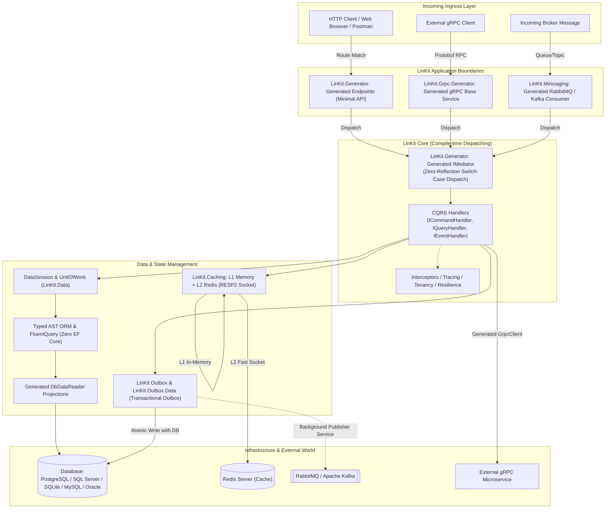
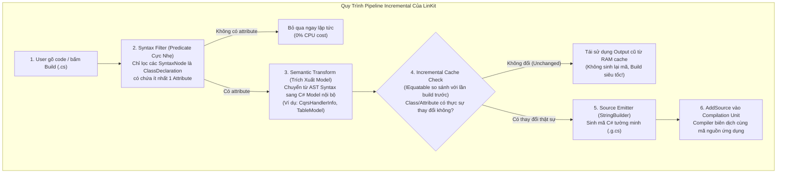
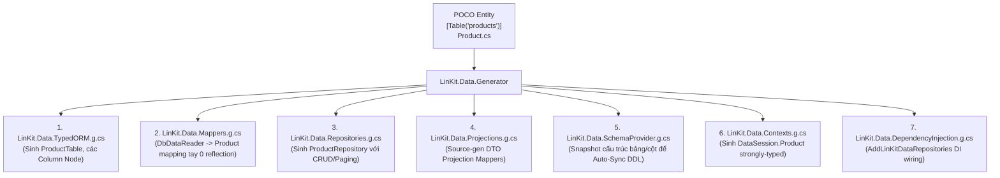
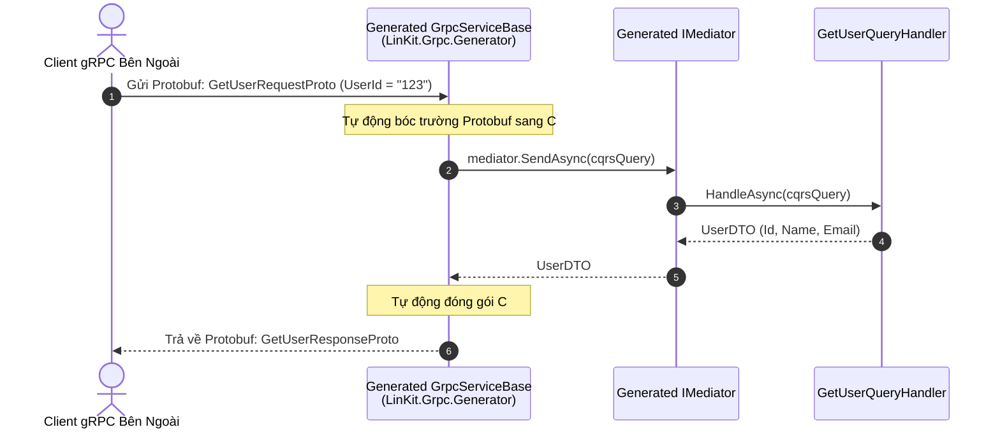
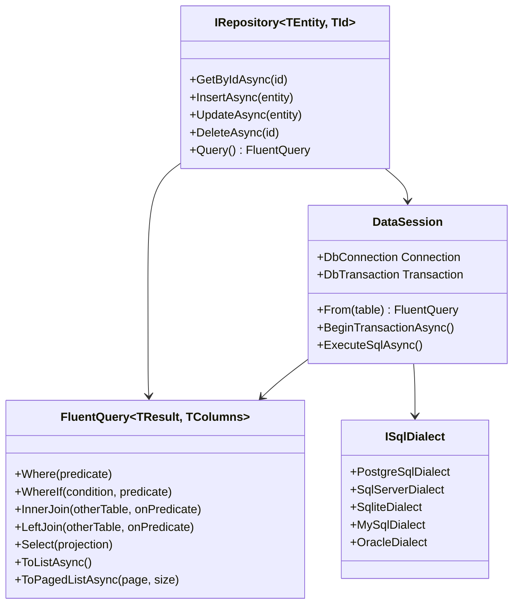
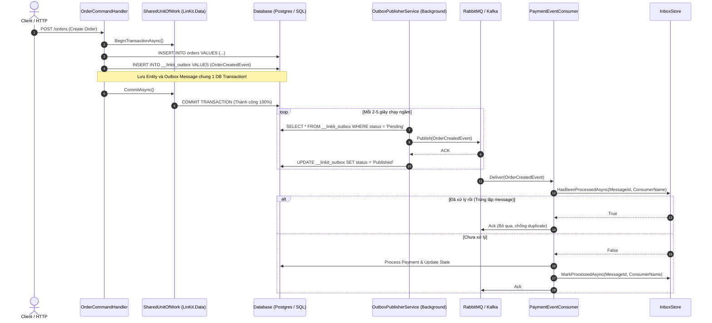
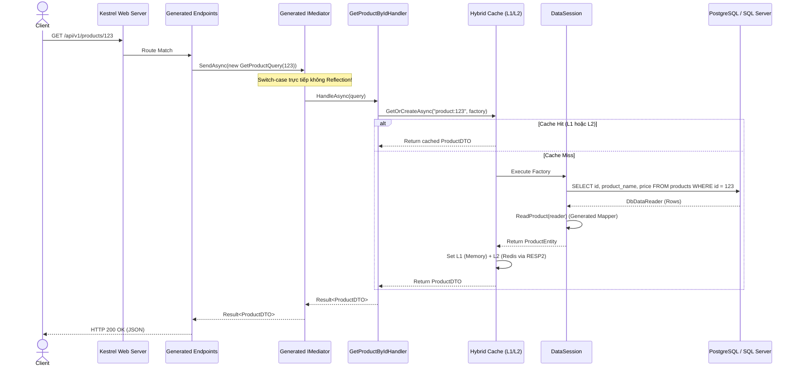

# TỔNG QUAN TOÀN DIỆN VỀ HỆ SINH THÁI LINKIT (.NET 8/9/10 & NATIVE AOT)
## TÀI LIỆU BÀN GIAO KỸ THUẬT VÀ KIẾN TRÚC NỘI TẠI DÀNH CHO DEVELOPER MỚI

> **Mục tiêu của tài liệu:** Cung cấp bức tranh toàn cảnh và chi tiết chuyên sâu nhất về hệ sinh thái **LinKit**. Không chỉ hướng dẫn cách *sử dụng*, tài liệu này phân tích tận gốc **cách LinKit được thiết kế, tại sao lại làm như vậy (design decisions & trade-offs)**, cơ chế hoạt động của các Roslyn Source Generator (`netstandard2.0`), cơ chế ORM Typed AST không dùng EF Core, hệ thống Messaging (Kafka, RabbitMQ, Outbox/Inbox), gRPC, Hybrid L1/L2 Cache, Tenancy, Sagas và tính tương thích tuyệt đối với **.NET 10 Native AOT (Ahead-Of-Time compilation)**.

---

## MỤC LỤC

1. [BỐI CẢNH & TRIẾT LÝ THIẾT KẾ (WHY LINKIT?)](#1-bối-cảnh--triết-lý-thiết-kế-why-linkit)
   - 1.1 Vấn đề của .NET Enterprise hiện đại
   - 1.2 Triết lý cốt lõi của LinKit: Compile-time over Runtime
   - 1.3 Native AOT & Zero Reflection
2. [BẢN ĐỒ KIẾN TRÚC TỔNG THỂ (SYSTEM ARCHITECTURE)](#2-bản-đồ-kiến-trúc-tổng-thể-system-architecture)
   - 2.1 Cấu trúc phân lớp module & nguyên tắc phụ thuộc
   - 2.2 Sơ đồ tổng thể kiến trúc LinKit
   - 2.3 Danh mục các thư viện thành phần (12 packages)
3. [CƠ CHẾ ROSLYN SOURCE GENERATORS (TRÁI TIM CỦA LINKIT)](#3-cơ-chế-roslyn-source-generators-trái-tim-của-linkit)
   - 3.1 Roslyn IIncrementalGenerator hoạt động thế nào?
   - 3.2 LinKit.Generator: CQRS Mediator, DI, Minimal Endpoints, Background Jobs, Mapper
   - 3.3 LinKit.Data.Generator: Typed AST ORM, DTO Projections, DbDataReader Mappers
   - 3.4 LinKit.Grpc.Generator: Auto Bridge CQRS ↔ Protobuf gRPC Services & Clients
4. [CHI TIẾT CÁC MODULE CHỦ CHỐT & CODE WALKTHROUGH](#4-chi-tiết-các-module-chủ-chốt--code-walkthrough)
   - 4.1 LinKit.Core: CQRS, Result<T>, DI & Dynamic Discovery Elimination
   - 4.2 LinKit.Data: Native AOT ORM, AST Query Builder, Schema Sync & Migrations
   - 4.3 LinKit.Messaging: Abstractions, RabbitMQ & Kafka Broker Implementations
   - 4.4 LinKit.Outbox & LinKit.Outbox.Data: Transactional Outbox, Idempotent Inbox & Atomic UnitOfWork
   - 4.5 LinKit.Caching: Two-Level Hybrid Cache (L1 Memory + L2 Redis RESP2 Socket)
   - 4.6 LinKit.Grpc: Zero-Reflection gRPC Service/Client Bridges & Scoped Contexts
   - 4.7 LinKit.Json: Zero-Allocation JSON Path Navigator
   - 4.8 Resilience, Tenancy & Sagas
5. [LUỒNG XỬ LÝ END-TO-END (SEQUENCE WORKFLOWS)](#5-luồng-xử-lý-end-to-end-sequence-workflows)
   - 5.1 Luồng 1: HTTP API Request -> CQRS -> LinKit.Data (Query / Mutation)
   - 5.2 Luồng 2: CQRS Command -> DB Transaction + Outbox Event -> RabbitMQ/Kafka Publish
   - 5.3 Luồng 3: Broker Consumer -> Idempotent Inbox Check -> CQRS Event Execution
   - 5.4 Luồng 4: Hybrid Cache Query (L1 Miss -> L2 Redis Miss -> Database -> Cache Set)
6. [TẠI SAO LẠI THIẾT KẾ NHƯ VẬY? (DESIGN DECISIONS & TRADE-OFFS)](#6-tại-sao-lại-thiết-kế-như-vậy-design-decisions--trade-offs)
7. [HƯỚNG DẪN DÀNH CHO DEVELOPER MỚI (DEVELOPER HANDBOOK)](#7-hướng-dẫn-dành-cho-developer-mới-developer-handbook)
   - 7.1 Setup môi trường & Build solution
   - 7.2 Cách debug và xem mã sinh ra bởi Source Generator
   - 7.3 Hướng dẫn tạo một Microservice hoàn chỉnh từ đầu với LinKit
   - 7.4 Cách đóng gói, versioning và xuất bản NuGet
8. [TỔNG KẾT & LỘ TRÌNH PHÁT TRIỂN TIẾP THEO](#8-tổng-kết--lộ-trình-phát-triển-tiếp-theo)

---

## 1. BỐI CẢNH & TRIẾT LÝ THIẾT KẾ (WHY LINKIT?)

### 1.1 Vấn đề của .NET Enterprise hiện đại
Trong các hệ thống phân tán, microservice hoặc ứng dụng backend hiệu năng cao viết bằng .NET, các lập trình viên thường kết hợp một ngăn xếp thư viện quen thuộc:
- **MediatR**: Cho mô hình CQRS (Command Query Responsibility Segregation).
- **AutoMapper / Mapster**: Để chuyển đổi giữa Entity và DTO.
- **EF Core / Dapper**: Để truy cập cơ sở dữ liệu.
- **MassTransit / CAP**: Cho hệ thống Event-Driven Architecture, Outbox/Inbox pattern.
- **Polly**: Cho resilience (Retry, Circuit Breaker).
- **StackExchange.Redis**: Cho distributed caching.

**Vấn đề phát sinh khi hệ thống tăng quy mô:**
1. **Lạm dụng Runtime Reflection:** MediatR, AutoMapper hay EF Core quét assembly khi khởi động (`Assembly.GetTypes()`), sử dụng `System.Reflection.Emit`, `MakeGenericType`, hoặc biên dịch LINQ Expression tree tại runtime (`Expression.Compile()`). Điều này làm thời gian cold-start kéo dài từ vài giây đến hàng chục giây.
2. **Chiếm dụng bộ nhớ (High Memory Footprint):** Các bảng lookup reflection runtime, JIT metadata cache, và reflection dynamic call sites tiêu tốn hàng trăm MB RAM ngay khi ứng dụng vừa khởi động.
3. **Bất tương thích với Native AOT:** Khi .NET 8/9/10 ra mắt tính năng xuất bản **Native AOT (Ahead-of-Time compilation)** để biên dịch thẳng mã C# ra mã máy (như C++ / Rust), toàn bộ các thư viện dựa vào Reflection quét assembly hoặc `Emit` đều bị gãy hoặc cảnh báo nguy hiểm (`IL2026`, `IL3050`), vì compiler cắt tỉa (trimming) loại bỏ các class không được gọi trực tiếp.

### 1.2 Triết lý cốt lõi của LinKit: Compile-time over Runtime
LinKit ra đời với một triết lý bất di bất dịch:
> **"Chuyển toàn bộ công việc tìm kiếm kiểu dữ liệu (discovery), sinh mã kết nối (wiring), mapping dữ liệu, và phân giải routing từ Runtime sang Compile-time bằng Roslyn Source Generators."**

Khi viết code với LinKit:
- Bạn chỉ cần khai báo một class với attribute (ví dụ `[CqrsHandler]`, `[Table]`, `[Message]`, `[GrpcEndpoint]`).
- Trình biên dịch C# Roslyn Compiler sẽ phân tích cú pháp (Syntax) và ngữ nghĩa (Semantic) ngay trong lúc gõ code hoặc lúc build.
- LinKit Source Generator sinh ra mã nguồn C# thuần túy (`.g.cs`) chứa các lệnh switch-case trực tiếp, gán trường trực tiếp (`dest.Name = src.Name`), hoặc gọi ADO.NET reader trực tiếp (`reader.GetString(0)`).
- **Không Reflection, không JIT dynamic code generation.**

### 1.3 Native AOT & Zero Reflection
Nhờ việc tất cả mã dispatching, mapping và ORM đều được viết dưới dạng mã C# tĩnh tường minh (statically-typed):
- Trình biên dịch AOT của .NET hiểu được 100% cây gọi hàm (call graph).
- Quá trình Trimming có thể loại bỏ hoàn toàn mã thừa mà không sợ vô tình xóa nhầm handler.
- Ứng dụng sau khi biên dịch Native AOT chỉ là 1 file thực thi nhị phân (`.exe` trên Windows hoặc ELF binary trên Linux), dung lượng chỉ khoảng 30MB - 40MB, thời gian khởi động tính bằng mili-giây (thường < 15ms), và tiêu tốn cực ít RAM (< 30MB lúc idle).

---

## 2. BẢN ĐỒ KIẾN TRÚC TỔNG THỂ (SYSTEM ARCHITECTURE)

### 2.1 Cấu trúc phân lớp module & nguyên tắc phụ thuộc
LinKit được chia thành các package độc lập theo nguyên tắc **Decoupled Architecture**:
- Tầng **Contract / Abstraction** (`LinKit.Core`): Định nghĩa interface, attributes, CQRS mediator contract, messaging contracts.
- Tầng **Generator (Build-time)**: Các Roslyn Analyzers & Generators nằm trong thư mục `analyzers/dotnet/cs` của NuGet package. Ứng dụng cài đặt không cần reference DLL generator lúc runtime!
- Tầng **Implementations & Adapters**: Các module hạ tầng cụ thể (`LinKit.Data`, `LinKit.Messaging.RabbitMQ`, `LinKit.Messaging.Kafka`, `LinKit.Caching`, `LinKit.Grpc`...).

### 2.2 Sơ đồ tổng thể kiến trúc LinKit



### 2.3 Danh mục các thư viện thành phần (12 Packages - Version 2026/10)

| Package NuGet | Version | Chức năng cốt lõi | Generator kèm theo |
|---|:---:|---|---|
| **`LinKit.Core`** | `3.2.0` | CQRS Contracts, In-process Mediator, Minimal Endpoints, DI, Background Jobs, Mapping abstractions. | `LinKit.Generator` |
| **`LinKit.Data`** | `2.3.0` | Typed AST ORM, zero-reflection `DbDataReader` mappers, multi-DB schema auto-sync, migrations, UnitOfWork. | `LinKit.Data.Generator` |
| **`LinKit.Grpc`** | `2.1.0` | gRPC Server and Client adapters tự động nối tầng CQRS với Protobuf contracts. | `LinKit.Grpc.Generator` |
| **`LinKit.Caching`** | `1.3.0` | In-memory cache bounded LRU + High-perf L2 Redis RESP2 client tương thích 100% Native AOT. | *Không* |
| **`LinKit.Json`** | `1.1.0` | Bộ điều hướng và trích xuất dữ liệu JSON đường dẫn (JSON Path) siêu nhanh, zero-allocation. | *Không* |
| **`LinKit.Messaging.RabbitMQ`** | `1.4.0` | Adapter RabbitMQ broker: tự động tạo Queue, Exchange, DLQ, channel pooling và auto-reconnect. | Tích hợp trong `LinKit.Generator` |
| **`LinKit.Messaging.Kafka`** | `1.3.0` | Adapter Apache Kafka broker: partition key, header propagation, batching producer. | Tích hợp trong `LinKit.Generator` |
| **`LinKit.Outbox`** | `1.2.0` | Contract & in-memory store cho Transactional Outbox và Idempotent Inbox pattern. | *Không* |
| **`LinKit.Outbox.Data`** | `1.2.0` | Durable persistent store cho Outbox/Inbox lưu trữ trực tiếp vào RDBMS dùng `LinKit.Data`. | *Không* |
| **`LinKit.Resilience`** | `1.2.0` | Pipeline thực thi bảo vệ: Exponential Backoff Retry, Circuit Breaker, Timeout (thay thế Polly). | *Không* |
| **`LinKit.Tenancy`** | `1.2.0` | Quản lý đa người thuê (Multi-Tenancy) bất đồng bộ (`AsyncLocal`) xuyên suốt HTTP, CQRS và Message Brokers. | *Không* |
| **`LinKit.Sagas`** | `1.2.0` | Điều phối giao dịch phân tán (Distributed Saga Orchestration) hỗ trợ cơ chế bù trừ (Compensation). | *Không* |

---

## 3. CƠ CHẾ ROSLYN SOURCE GENERATORS (TRÁI TIM CỦA LINKIT)

Mọi "phép thuật" của LinKit – từ việc không cần `AddMediatR`, không cần viết Controller, không cần cấu hình AutoMapper, cho đến việc ORM đọc Database siêu tốc mà không dùng Reflection – **đều được hiện thực tại tầng biên dịch thông qua Roslyn Source Generators**.

Thay vì để ứng dụng chạy lên rồi mới dùng CPU để "dò dẫm" xem trong project có những class nào, LinKit bắt trình biên dịch làm việc này trước từ lúc bạn bấm `dotnet build`.

---

### 3.1 Roslyn IIncrementalGenerator hoạt động thế nào?

Toàn bộ generator của LinKit đều kế thừa interface chuẩn `Microsoft.CodeAnalysis.IIncrementalGenerator` (chuẩn Generator v2 của Microsoft, target `netstandard2.0`).

#### Sự khác biệt giữa Source Generator cũ (v1) và Incremental Generator (v2)
- **Source Generator v1 (cũ):** Mỗi khi lập trình viên gõ 1 phím trong Visual Studio, generator sẽ chạy lại toàn bộ từ đầu, quét lại tất cả hàng nghìn file trong project. Điều này gây đơ giật IDE (IDE freezing) và tốn tài nguyên máy tính.
- **Incremental Generator v2 (LinKit đang dùng):** Áp dụng mô hình **Pipeline Cache từng bước**. Quá trình sinh mã được chia thành 3 trạm kiểm soát nghiêm ngặt:



#### Mã nguồn pipeline mẫu trong LinKit (`RootGenerator.cs`):
```csharp
public void Initialize(IncrementalGeneratorInitializationContext context)
{
    // Bước 1 & 2: Lọc cú pháp nhanh (Syntax Filter)
    IncrementalValuesProvider<ClassDeclarationSyntax> classDeclarations = context.SyntaxProvider
        .CreateSyntaxProvider(
            predicate: static (node, _) => node is ClassDeclarationSyntax { AttributeLists.Count: > 0 },
            transform: static (ctx, _) => (ClassDeclarationSyntax)ctx.Node)
        .Where(static c => c is not null);

    // Bước 3 & 4: Kết hợp ngữ nghĩa (Semantic Model) và lọc Incremental Cache
    IncrementalValueProvider<(Compilation, ImmutableArray<ClassDeclarationSyntax>)> compilationAndClasses =
        context.CompilationProvider.Combine(classDeclarations.Collect());

    // Bước 5 & 6: Đăng ký sinh mã nguồn
    context.RegisterSourceOutput(compilationAndClasses, static (spc, source) =>
    {
        Execute(source.Item1, source.Item2, spc);
    });
}
```

---

### 3.2 LinKit.Generator: CQRS Mediator, DI, Endpoints, Jobs, Mapper

Nằm trong project `LinKit.Generator`, generator này chịu trách nhiệm cho các chức năng tầng Application. Nó gồm các "Part" chuyên trách:

#### 1. Cơ chế sinh Mediator Zero-Reflection (`CqrsGeneratorPart.cs`)
- **Nỗi đau MediatR cũ:** MediatR lưu một dictionary khổng lồ `ConcurrentDictionary<Type, object>` trong RAM. Khi bạn gọi `_mediator.Send(cmd)`, nó phải tìm kiếm type của `cmd`, dùng reflection `MakeGenericType(typeof(IRequestHandler<,>))`, sau đó dùng Service Locator để lôi Handler ra và gọi `Invoke()`. Thao tác này sinh rác bộ nhớ (allocations) và làm Native AOT báo lỗi Trim Warning `IL2026/IL3050`.
- **Cách LinKit xử lý:** 
  1. `CqrsGeneratorPart` quét toàn bộ các class trong compilation có triển khai interface `ICommandHandler<TReq, TRes>`, `IQueryHandler<TReq, TRes>`, hoặc `IEventHandler<TEvent>`.
  2. Nó tìm thấy cặp đôi: Request `CreateOrderCommand` đi với Handler `CreateOrderCommandHandler`.
  3. Nó sinh ra một class `GeneratedMediator : IMediator` với một khối **`switch (request)`** cứng hoàn toàn bằng mã C# tĩnh:

```csharp
// MÃ C# ĐƯỢC LINKIT GENERATOR SINH TỰ ĐỘNG (Cqrs.Mediator.g.cs)
namespace LinKit.Core.Generated;

public sealed class GeneratedMediator : global::LinKit.Core.Cqrs.IMediator
{
    private readonly IServiceProvider _serviceProvider;

    public GeneratedMediator(IServiceProvider serviceProvider)
    {
        _serviceProvider = serviceProvider;
    }

    public async global::System.Threading.Tasks.ValueTask<TResult> SendAsync<TResult>(
        global::LinKit.Core.Cqrs.IRequest<TResult> request, 
        global::System.Threading.CancellationToken cancellationToken = default)
    {
        if (request is null) throw new global::System.ArgumentNullException(nameof(request));

        // Nhảy thẳng bằng CPU opcode 'isinst' và 'switch' (Tương đương O(1))
        switch (request)
        {
            case global::Ecommerce.Application.Commands.CreateOrderCommand cmd:
            {
                var handler = _serviceProvider.GetRequiredService<global::Ecommerce.Application.Commands.CreateOrderCommandHandler>();
                var result = await handler.HandleAsync(cmd, cancellationToken).ConfigureAwait(false);
                return (TResult)(object)result;
            }
            case global::Ecommerce.Application.Queries.GetProductByIdQuery query:
            {
                var handler = _serviceProvider.GetRequiredService<global::Ecommerce.Application.Queries.GetProductByIdQueryHandler>();
                var result = await handler.HandleAsync(query, cancellationToken).ConfigureAwait(false);
                return (TResult)(object)result!;
            }
            default:
                throw new global::System.InvalidOperationException($"No CQRS handler generated for request type '{request.GetType().FullName}'.");
        }
    }
}
```
*Tại sao Native AOT lại thích điều này?* Vì trong mã C# sinh ra, lời gọi `_serviceProvider.GetRequiredService<CreateOrderCommandHandler>()` được viết rõ ràng bằng chữ. Bộ cắt tỉa mã (IL Trimmer) của .NET Native AOT nhìn thấy class `CreateOrderCommandHandler` đang được gọi trực tiếp, nên sẽ **không bao giờ xóa nhầm** class này khỏi file `.exe`!

#### 2. Cơ chế tự động biến CQRS Request thành Minimal API (`EndpointsGeneratorPart.cs`)
- **Cách làm:** Bạn chỉ cần gắn attribute `[Endpoint]` lên chính Command hoặc Query:
  ```csharp
  [Endpoint(HttpMethod.Post, "/api/v1/orders", StatusCodes.Status201Created)]
  public record CreateOrderCommand(string CustomerId, decimal Amount) : ICommand<Guid>;
  ```
- **Mã sinh ra:** Generator sẽ tạo ra một extension method `MapGeneratedEndpoints`:
  ```csharp
  // MÃ SINH RA (LinKit.Core.Endpoints.g.cs)
  public static class GeneratedEndpointsExtensions
  {
      public static IEndpointRouteBuilder MapGeneratedEndpoints(this IEndpointRouteBuilder app)
      {
          app.MapPost("/api/v1/orders", async (
              [FromBody] global::Ecommerce.Application.Commands.CreateOrderCommand request, 
              IMediator mediator, 
              CancellationToken ct) =>
          {
              var response = await mediator.SendAsync(request, ct);
              return Microsoft.AspNetCore.Http.Results.Json(response, statusCode: 201);
          })
          .WithName("CreateOrderCommand")
          .Produces<Guid>(201);

          return app;
      }
  }
  ```
- Developer không cần tạo thư mục `Controllers/`, không cần kế thừa `ControllerBase`, không cần inject Mediator bằng tay ở từng API.

#### 3. Cơ chế đăng ký DI tự động (`DependencyInjectionGeneratorPart.cs`)
- Đánh dấu service của bạn bằng `[RegisterService(ServiceLifetime.Scoped)]`.
- Generator sinh sẵn file `LinKit.Core.CustomDI.DependencyInjection.g.cs`:
  ```csharp
  public static IServiceCollection AddLinKitDependency(this IServiceCollection services)
  {
      services.AddScoped<IEmailSender, EmailSender>();
      services.AddSingleton<ITokenGenerator, TokenGenerator>();
      return services;
  }
  ```
- Không còn tình trạng runtime bị crash `InvalidOperationException: Unable to resolve service...` chỉ vì ai đó quên đăng ký vào `Program.cs`.

#### 4. Cơ chế chuyển đổi DTO sang Entity không dùng Reflection (`MapperGeneratorPart.cs`)
- Thay vì dùng AutoMapper (quét type và compile Expression tree khi khởi chạy), LinKit cung cấp attribute `[MapTo(typeof(OrderEntity))]`.
- Generator sinh mã gán trường trực tiếp (`dest.Id = src.Id; dest.Amount = src.Amount;`). Tốc độ thực thi tính bằng Nano-giây, zero allocation rác bộ nhớ.

---

### 3.3 LinKit.Data.Generator: Typed AST ORM, DTO Projections & Mappers

`LinKit.Data.Generator` (file `DataGenerator.cs`) là "kỳ quan công nghệ" đồ sộ nhất trong LinKit với hơn **170KB mã nguồn Roslyn**. Đây chính là thành phần biến LinKit.Data thành một ORM Native AOT hoàn chỉnh thay thế hoàn toàn EF Core.

Nó sinh ra cùng lúc **7 nhóm mã nguồn** cho mỗi entity:



#### Chi tiết cơ chế sinh mã của LinKit.Data.Generator:

#### 1. Sinh Cây Cột Typed AST (`LinKit.Data.TypedORM.g.cs`)
Khi bạn định nghĩa:
```csharp
[Table("orders")]
public class Order
{
    [PrimaryKey] public Guid Id { get; set; }
    public decimal TotalAmount { get; set; }
    public string Status { get; set; }
}
```
Generator phân tích từng property và sinh ra:
```csharp
public sealed class OrderTable : global::LinKit.Data.Table<Order>
{
    public global::LinKit.Data.Column<Guid> Id { get; }
    public global::LinKit.Data.Column<decimal> TotalAmount { get; }
    public global::LinKit.Data.Column<string> Status { get; }

    public OrderTable(string? alias = null) : base("orders", alias)
    {
        Id = new global::LinKit.Data.Column<Guid>(this, "id");
        TotalAmount = new global::LinKit.Data.Column<decimal>(this, "total_amount");
        Status = new global::LinKit.Data.Column<string>(this, "status");
    }
}
```
*Điều kỳ diệu ở đây là gì?*
Khi bạn gõ code: `session.Order.Query().Where(o => o.TotalAmount >= 500m)`:
Biểu thức `o.TotalAmount >= 500m` **KHÔNG PHẢI** là C# boolean evaluation, mà toán tử `>=` đã được nạp chồng (overload) trên lớp `Column<decimal>` để trả về một `SqlBinaryExpression(Column, Op.GreaterThanOrEqual, Constant(500m))`. Cây AST này sau đó được chuyển thành SQL chuẩn theo từng dialect (Postgres dùng `$1`, SQL Server dùng `@p0`, Oracle dùng `:p0`).

#### 2. Sinh Reader Mappers siêu tốc (`LinKit.Data.Mappers.g.cs`)
Dapper và EF Core phải dùng Reflection để đọc tên cột từ kết quả SQL rồi gán vào object. LinKit sinh mã đọc trực tiếp theo chỉ số cột (Column Ordinal) cực kỳ tinh vi:
```csharp
public static Order ReadOrder(this global::System.Data.Common.DbDataReader reader)
{
    var entity = new Order();
    entity.Id = reader.GetGuid(0);
    entity.TotalAmount = reader.GetDecimal(1);
    entity.Status = reader.IsDBNull(2) ? default! : reader.GetString(2);
    return entity;
}
```
Đoạn code trên chạy ở mức phần cứng với tốc độ tối đa của máy tính: không boxing, không unboxing, không reflection, không dynamic method invocation!

#### 3. Sinh Metadata Snapshot phục vụ Auto-Sync Database (`LinKit.Data.SchemaProvider.g.cs`)
Generator đọc các attributes `[Table]`, `[MaxLength]`, `[CompositeIndex]`, `[ForeignKey]`, `[DecimalPrecision]` và mã hóa thành một danh sách đối tượng `TableMetadata` tĩnh trong code C#:
```csharp
public sealed class GeneratedSchemaMetadataProvider : ISchemaMetadataProvider
{
    public IReadOnlyList<TableMetadata> GetTables() =>
    [
        new TableMetadata("orders", [
            new ColumnMetadata("id", typeof(Guid), isPrimaryKey: true),
            new ColumnMetadata("total_amount", typeof(decimal), precision: 18, scale: 2),
            new ColumnMetadata("status", typeof(string), maxLength: 50)
        ],
        indexes: [
            new IndexMetadata("ix_orders_status", ["status"], isUnique: false)
        ])
    ];
}
```
Nhờ có class tĩnh này được sinh sẵn ở compile-time, khi ứng dụng vừa bật lên, service `SchemaSynchronizer` chỉ việc đọc danh sách này và so sánh với database catalog thực tế để chạy `ALTER TABLE` hoặc `CREATE TABLE` trong vòng vài mili-giây!

---

### 3.4 LinKit.Grpc.Generator: Auto Bridge CQRS ↔ Protobuf gRPC Services & Clients

Khi xây dựng các hệ thống Microservice hiệu năng cao, giao tiếp liên dịch vụ qua gRPC là bắt buộc. Thông thường lập trình viên phải chịu một "cực hình" boilerplate:
1. Viết file `.proto`.
2. Dùng `Grpc.Tools` compile ra class Protobuf Message C#.
3. Viết class Service kế thừa `.Base`, giải nén từng trường từ Protobuf gRPC Request sang CQRS Request.
4. Gọi Mediator.
5. Lấy kết quả từ Mediator đóng gói lại vào Protobuf gRPC Response.

`LinKit.Grpc.Generator` (gồm `GrpcGeneratorPart.cs` và `GrpcClientGeneratorPart.cs`) **xóa bỏ hoàn toàn 100% công việc thủ công này**.



#### 1. Chiều Server (`GrpcGeneratorPart.cs`): Gắn `[GrpcEndpoint]`
Bạn chỉ cần viết:
```csharp
[GrpcEndpoint(typeof(UserService.UserServiceBase), "GetUser")]
public record GetUserQuery(string UserId) : IQuery<UserResponseDto>;
```
Generator sẽ tự động tìm thấy kiểu base `UserService.UserServiceBase` do Protobuf sinh ra và phát sinh một class Service hoàn chỉnh:
```csharp
// MÃ C# DO LINKIT.GRPC.GENERATOR SINH RA
public sealed class GeneratedUserService : UserService.UserServiceBase
{
    private readonly IMediator _mediator;
    public GeneratedUserService(IMediator mediator) => _mediator = mediator;

    public override async Task<GetUserResponseProto> GetUser(
        GetUserRequestProto request, 
        ServerCallContext context)
    {
        // 1. Tự động map từ Protobuf Request sang CQRS Query
        var cqrsRequest = new GetUserQuery(request.UserId);

        // 2. Chạy qua Mediator của LinKit
        var result = await _mediator.SendAsync(cqrsRequest, context.CancellationToken);

        // 3. Tự động map ngược từ UserResponseDto sang Protobuf Response
        return new GetUserResponseProto
        {
            Id = result.Id,
            FullName = result.FullName,
            Email = result.Email
        };
    }
}
```

#### 2. Chiều Client (`GrpcClientGeneratorPart.cs`): Gắn `[GrpcClient]`
Nếu Service A muốn gọi gRPC sang Service B, chỉ cần khai báo:
```csharp
[GrpcClient(typeof(InventoryService.InventoryServiceClient), "CheckStockAsync")]
public record CheckStockQuery(string Sku) : IQuery<StockResultDto>;
```
Khi bạn gọi `mediator.SendAsync(new CheckStockQuery("IPHONE16"))`, Mediator sẽ **không gọi in-process handler**, mà Generator sinh ra mã tự động lấy `InventoryServiceClient` từ pool gRPC channel, đóng gói Protobuf và bắn RPC sang Service B qua mạng HTTP/2!

---

### Bảng đối chiếu: Trước và Sau khi dùng LinKit Source Generators

| Tiêu chí | Trước khi có LinKit (Thư viện truyền thống) | Khi dùng LinKit Source Generator |
|---|---|---|
| **Cơ chế phân giải CQRS** | Runtime Reflection (`MakeGenericType`, Dictionary lookup trong RAM). | `switch (request)` biên dịch tĩnh, tốc độ O(1), Native AOT an toàn 100%. |
| **Khai báo API Endpoints** | Tạo Controller, kế thừa `ControllerBase`, hoặc gõ `app.MapPost(...)` bằng tay. | Gắn `[Endpoint]` lên Command/Query, Generator tự sinh Minimal API. |
| **Mapping dữ liệu ORM** | Dapper/EF Core dùng Reflection duyệt từng property để gán giá trị. | Sinh thẳng `reader.GetString(0)`, `reader.GetInt32(1)` thuần túy. |
| **gRPC Server/Client** | Viết tay class kế thừa `.Base`, gõ tay code bóc tách Protobuf ↔ CQRS. | Gắn `[GrpcEndpoint]` / `[GrpcClient]`, Generator sinh 100% boilerplate. |
| **Cold Start / Khởi động** | Tốn 2 - 10 giây quét assembly, tải metadata, JIT compiling. | Khởi động trong **10 - 20 mili-giây** (Zero reflection startup). |
| **Tương thích Native AOT** | Hàng chục cảnh báo nguy hiểm `IL2026/IL3050`, dễ crash ngầm khi chạy thật. | **0 warning, 0 error**, xuất bản ra file binary Native AOT mượt mà. |


---

## 4. CHI TIẾT CÁC MODULE CHỦ CHỐT & CODE WALKTHROUGH

### 4.1 LinKit.Core: CQRS, Result<T>, DI & Validation
- **`IRequest<TResponse>`**, **`ICommand<TResponse>`**, **`IQuery<TResponse>`**: Các interfaces chuẩn hóa hành vi CQRS.
- **`Result<T>`**: Thay vì ném Exception lung tung trong business logic (gây tốn CPU stack trace), LinKit khuyến khích dùng Pattern `Result<T>`:
  ```csharp
  public readonly struct Result<T>
  {
      public bool IsSuccess { get; }
      public T? Value { get; }
      public string? ErrorCode { get; }
      public string? ErrorMessage { get; }
  }
  ```
- **Validation Pipeline**: Hỗ trợ gắn validation handler tự động trước khi bước vào Handler nghiệp vụ.

### 4.2 LinKit.Data: Native AOT ORM, AST Query Builder, Schema Sync & Migrations
LinKit.Data là một giải pháp ORM hoàn chỉnh thay thế cho EF Core và Dapper trong các hệ thống đòi hỏi độ trễ cực thấp và AOT.



#### Các tính năng độc đáo của LinKit.Data:
1. **Multi-Database Dialects:** Hỗ trợ native cho 5 hệ cơ sở dữ liệu phổ biến nhất (`PostgreSqlDialect`, `SqlServerDialect`, `SqliteDialect`, `MySqlDialect`, `OracleDialect`). Cú pháp phân trang (`LIMIT/OFFSET` vs `OFFSET/FETCH`), escape ký tự (`"`, `[]`, `` ` ``), và tham số (`@p` vs `:p`) được tự động điều chỉnh.
2. **Schema Auto-Synchronization (`AutoSyncSchema = true`):**
   - Khi khởi động, `SchemaSynchronizer` kiểm tra database catalog.
   - Nếu bảng chưa tồn tại -> Tự tạo bảng với kiểu dữ liệu chuẩn (`CREATE TABLE`).
   - Nếu bảng đã có nhưng thiếu cột -> Tự thêm cột (`ALTER TABLE ADD COLUMN`).
   - Tự động tạo các chỉ mục đơn (`[Indexed]`) và chỉ mục kết hợp (`[CompositeIndex]`).
3. **Set-Based Bulk Operations:**
   Thay vì tải hàng nghìn record về RAM rồi gọi `Update`, LinKit.Data hỗ trợ cập nhật và xóa trực tiếp trên database:
   ```csharp
   // Sinh ra SQL: UPDATE products SET price = 29.99 WHERE category_id = 5
   await session.Product.Query()
       .Where(p => p.CategoryId.Equal(5))
       .ExecuteUpdateAsync(p => [p.Price.Set(29.99m)], ct);

   // Sinh ra SQL: DELETE FROM workflow_steps WHERE workflow_id = @id
   await session.WorkflowStep.DeleteWhereAsync(s => s.WorkflowId.Equal(wfId), ct);
   ```

### 4.3 LinKit.Messaging: RabbitMQ & Kafka Broker Implementations
- **Giao thức chuẩn (`IBrokerProducer`, `IBrokerConsumer`, `IBrokerConnection`):** Cung cấp interface trừu tượng để ứng dụng có thể đổi từ RabbitMQ sang Kafka (hoặc ngược lại) mà không sửa một dòng code nghiệp vụ nào.
- **Khai báo Message bằng Attribute:**
  ```csharp
  [Message("order_events", ExchangeType = "topic", RoutingKey = "order.created")]
  public record OrderCreatedEvent(Guid OrderId, decimal Amount) : IEvent;
  ```
- **RabbitMQ Implementation (`LinKit.Messaging.RabbitMQ`):**
  - Quản lý Connection và Channel theo Pool tối ưu.
  - Tự động khởi tạo Exchange, Dead-Letter Exchange (DLX), Retry Queue và Consumer Ack/Nack với backoff.
- **Kafka Implementation (`LinKit.Messaging.Kafka`):**
  - Tối ưu batching khi gửi message, hỗ trợ Partition Key đảm bảo thứ tự xử lý sự kiện (Ordering guarantee).

### 4.4 LinKit.Outbox & LinKit.Outbox.Data: Transactional Outbox & Idempotent Inbox
Trong kiến trúc phân tán, vấn đề kinh điển là: **"Ghi Database thành công nhưng mạng lag không gửi được message sang RabbitMQ/Kafka, làm mất dữ liệu"** (Dual-Write Problem).

LinKit giải quyết triệt để vấn đề này bằng bộ đôi **Transactional Outbox** và **Idempotent Inbox**:



- **SharedUnitOfWork (`ECO-01`):** Cả business repository và outbox repository chia sẻ cùng một `DbConnection` và `DbTransaction` bên trong `DataSession`. Điều này đảm bảo tính nguyên tử (Atomicity - ACID): nếu ghi DB lỗi thì Outbox không sinh ra; nếu Outbox lưu thành công thì nghiệp vụ chắc chắn đã lưu.

### 4.5 LinKit.Caching: Two-Level Hybrid Cache (L1 Memory + L2 Redis RESP2)
Thông thường, các thư viện .NET dùng `StackExchange.Redis`, thư viện này rất nặng, chứa nhiều mã dynamic compilation và reflection.
`LinKit.Caching` (từ version 1.3.0) áp dụng kiến trúc **Two-Level Hybrid Cache**:
1. **L1 In-Memory (`InMemoryCacheProvider`):** Lưu trữ trên RAM của ứng dụng (ConcurrentDictionary với bounded LRU). Thời gian truy xuất: < 1 microsecond.
2. **L2 Distributed Redis (`Resp2RedisClient`):**
   - Viết trực tiếp trên nền `Socket` và `NetworkStream` sử dụng giao thức chuẩn **Redis RESP2**.
   - Hoàn toàn **không dùng Reflection**, không phụ thuộc thư viện bên ngoài.
   - Hỗ trợ Connection Pooling tự viết, zero-allocation buffer (`ArrayPool<byte>`).
   - 100% Native AOT Compatible!
3. **Single-Flight Lock (Chống Cache Stampede):**
   - Khi 1000 request cùng lúc hỏi 1 key bị hết hạn, thay vì cả 1000 request cùng chọc xuống Database, LinKit gom lại chỉ cho đúng 1 request xuống Database, 999 request còn lại đợi kết quả chia sẻ (`TaskCompletionSource`).

### 4.6 LinKit.Grpc: Zero-Reflection gRPC Bridge
- Tự động map giữa Domain CQRS requests và Protobuf RPC messages.
- Tích hợp `GrpcContextAccessor` (mô hình LIFO) cho phép truyền context người dùng (User ID, IP, Trace ID) xuyên suốt các lời gọi RPC mà không bị rò rỉ bộ nhớ.
- `DefaultGrpcClientFactory` quản lý vòng đời kênh kết nối `GrpcChannel` chuẩn hóa, không tạo channel mới lãng phí socket.

### 4.7 LinKit.Json: Zero-Allocation JSON Path Navigator
`LinKit.Json` là một thư viện tiện ích độc lập đi kèm:
- Cho phép duyệt và trích xuất dữ liệu từ các chuỗi JSON phức tạp bằng cú pháp path (ví dụ: `data.orders[0].items[1].price`).
- Sử dụng trực tiếp `Utf8JsonReader` và `JsonElement` của `System.Text.Json` mà **không parse cả cây đối tượng thành class DTO**, giúp tiết kiệm RAM và CPU tối đa.

---

## 5. LUỒNG XỬ LÝ END-TO-END (SEQUENCE WORKFLOWS)

### 5.1 Luồng 1: HTTP API Request -> CQRS -> LinKit.Data



---

## 6. TẠI SAO LẠI THIẾT KẾ NHƯ VẬY? (DESIGN DECISIONS & TRADE-OFFS)

Khi đọc mã nguồn LinKit, bạn sẽ thấy nhiều cách tiếp cận khác biệt so với các framework truyền thống. Dưới đây là lý do đằng sau các quyết định thiết kế:

| Quyết định thiết kế | Tại sao LinKit làm vậy? | Đánh đổi (Trade-off) |
|---|---|---|
| **Dùng Roslyn Incremental Generator thay vì Runtime Scanning** | Loại bỏ hoàn toàn cold-start delay, tiết kiệm RAM, tương thích 100% với Native AOT compilation. | Thời gian build của project sẽ lâu hơn một chút (khoảng vài giây) do compiler phải chạy code generation. |
| **Tự viết AST ORM thay vì tích hợp EF Core** | EF Core rất đồ sộ, chứa hàng nghìn API phụ thuộc reflection và dynamic query compilation. LinKit.Data chỉ tập trung vào CRUD, Paging, Relational Join và Bulk Update với tốc độ cực đại. | Không hỗ trợ các tính năng quá phức tạp của EF Core như change tracker tự động phát hiện thay đổi sâu, lazy loading, hoặc navigation property đa cấp. |
| **Tự viết RESP2 Client thay vì dùng StackExchange.Redis** | Đảm bảo Native AOT không bị warning Trim/AOT (`IL2026/IL3050`), kích thước binary sau compile Native AOT nhẹ hơn rất nhiều. | Chỉ hiện thực các command Redis phổ biến (`GET`, `SET`, `DEL`, `EXPIRE`, `PING`, `AUTH`, `SELECT`). Không hỗ trợ toàn bộ các tập lệnh mở rộng của Redis Stack (như RedisGraph, RedisJSON). |
| **Shared UnitOfWork cho Outbox và DataSession** | Đảm bảo nghiệp vụ và sự kiện Outbox được ghi đồng thời trong 1 database transaction duy nhất, chống lỗi Dual-Write. | Bắt buộc Outbox table phải nằm trong cùng database với các bảng nghiệp vụ. |
| **Zero External Third-party Dependencies ở Core** | `LinKit.Core`, `LinKit.Caching`, `LinKit.Resilience`, `LinKit.Tenancy` chỉ dùng pure BCL (`Microsoft.Extensions.*`), không phụ thuộc thư viện ngoài. | Đội ngũ phát triển phải tự duy trì các thuật toán Circuit Breaker, Exponential Backoff, RESP2 parser. |

---

## 7. HƯỚNG DẪN DÀNH CHO DEVELOPER MỚI (DEVELOPER HANDBOOK)

### 7.1 Setup môi trường & Build solution
Yêu cầu môi trường:
- .NET 8.0 SDK, .NET 9.0 SDK, và **.NET 10.0 SDK** (Khuyến nghị dùng .NET 10 SDK mới nhất).
- Visual Studio 2022 (v17.12+) hoặc JetBrains Rider / VS Code với C# Dev Kit.

**Các bước build:**
```powershell
# 1. Clone repository
git clone https://github.com/linhnq0520/LinKit.git
cd LinKit\LinKit

# 2. Restore và Build toàn bộ Solution ở chế độ Release
dotnet restore
dotnet build -c Release

# 3. Chạy toàn bộ Test suite để xác minh hệ thống hoạt động hoàn hảo
dotnet test -c Release
```

### 7.2 Cách debug và xem mã sinh ra bởi Source Generator
Để xem chính xác mã C# mà LinKit Source Generator đã sinh ra cho project của bạn:
1. Mở file `.csproj` của project ứng dụng, thêm cấu hình:
   ```xml
   <PropertyGroup>
       <EmitCompilerGeneratedFiles>true</EmitCompilerGeneratedFiles>
       <CompilerGeneratedFilesOutputPath>$(BaseIntermediateOutputPath)generated</CompilerGeneratedFilesOutputPath>
   </PropertyGroup>
   ```
2. Build project (`dotnet build`).
3. Truy cập thư mục:
   `obj\Debug\net10.0\generated\LinKit.Generator\LinKit.Generator.Generators.RootGenerator\` hoặc
   `obj\Debug\net10.0\generated\LinKit.Data.Generator\LinKit.Data.Generator.DataGenerator\`
4. Bạn sẽ thấy các file `.g.cs` như `Cqrs.Mediator.g.cs`, `LinKit.Data.Repositories.g.cs`, `Endpoints.g.cs`. Bạn có thể mở đọc và đặt breakpoint debug trực tiếp vào các file này!

### 7.3 Hướng dẫn tạo một Microservice hoàn chỉnh từ đầu với LinKit
Chỉ với 4 bước đơn giản:

#### Bước 1: Cài đặt packages cần thiết
```shell
dotnet add package LinKit.Core --version 3.2.0
dotnet add package LinKit.Data --version 2.3.0
dotnet add package LinKit.Caching --version 1.3.0
dotnet add package Npgsql --version 8.0.0
```

#### Bước 2: Khai báo Entity & Domain Model
```csharp
using LinKit.Data;

[Table("customers")]
public class Customer
{
    [PrimaryKey(AutoIncrement = true)]
    public int Id { get; set; }

    [Column("full_name")]
    [MaxLength(150)]
    public string FullName { get; set; } = string.Empty;

    public string Email { get; set; } = string.Empty;
}
```

#### Bước 3: Khai báo CQRS Request & Handler với Minimal API Endpoint
```csharp
using LinKit.Core.Cqrs;

// Khai báo request gắn kèm HTTP Endpoint
[Endpoint(HttpMethod.Get, "/api/customers/{id}")]
public record GetCustomerByIdQuery(int id) : IQuery<Customer?>;

// Khai báo Handler
[CqrsHandler]
public class GetCustomerByIdHandler(DataSession session) : IQueryHandler<GetCustomerByIdQuery, Customer?>
{
    public async Task<Customer?> HandleAsync(GetCustomerByIdQuery query, CancellationToken ct)
    {
        return await session.Customer.FindByIdAsync(query.id, ct);
    }
}
```

#### Bước 4: Khởi tạo trong `Program.cs`
```csharp
using LinKit.Data;
using Npgsql;

var builder = WebApplication.CreateSlimBuilder(args); // Dùng CreateSlimBuilder cho Native AOT

// 1. Cấu hình LinKit.Data
builder.Services.AddLinKitData(options =>
{
    options.UseConnection(DatabaseDialect.PostgreSql, () => 
        new NpgsqlConnection(builder.Configuration.GetConnectionString("DefaultConnection")));
    options.AutoSyncSchema = true; // Tự động tạo bảng customers nếu chưa có!
});

// 2. Kích hoạt LinKit Generators
builder.AddCoreServices();
builder.Services.AddLinKitDependency();
builder.Services.AddLinKitCqrs();

var app = builder.Build();

// 3. Map tự động toàn bộ API Endpoints
app.MapGeneratedEndpoints();

app.Run();
```

### 7.4 Cách đóng gói, versioning và xuất bản NuGet
Khi bạn có thay đổi hoặc cải tiến mã nguồn trong thư viện LinKit:
1. Cập nhật version trong file `.csproj` tương ứng (hoặc dùng script cập nhật version).
2. Chạy clean và đóng gói:
   ```powershell
   dotnet clean -c Release
   dotnet pack -c Release -o ./artifacts/packages
   ```
3. Chạy script push tự động lên NuGet (`publish.md`):
   ```powershell
   $API_KEY = "your-nuget-api-key"
   $SOURCE = "https://api.nuget.org/v3/index.json"
   Get-ChildItem ./artifacts/packages/*.nupkg | ForEach-Object {
       dotnet nuget push $_.FullName --source $SOURCE --api-key $API_KEY --skip-duplicate
   }
   ```

---

## 8. TỔNG KẾT & LỘ TRÌNH PHÁT TRIỂN TIẾP THEO

LinKit là một hệ sinh thái hiện đại, đón đầu xu thế phát triển của .NET trong kỷ nguyên Cloud-Native và Microservices tốc độ cao:
- **Zero Reflection & Fast Boot Time:** Thích hợp tuyệt đối cho Serverless, Kubernetes pods tự co giãn nhanh (Horizontal Pod Autoscaling).
- **Native AOT Ready:** Giảm chi phí hạ tầng máy chủ (tiết kiệm 60-80% RAM và CPU so với các framework nặng truyền thống).
- **Trải nghiệm lập trình viên (Developer Experience):** Giảm thiểu tối đa boiler-plate code, chỉ tập trung vào logic nghiệp vụ và dữ liệu.

Tài liệu này là cẩm nang nền tảng để bạn tự tin nắm bắt, vận hành, bảo trì và tiếp tục mở rộng LinKit lên các đỉnh cao công nghệ tiếp theo!

